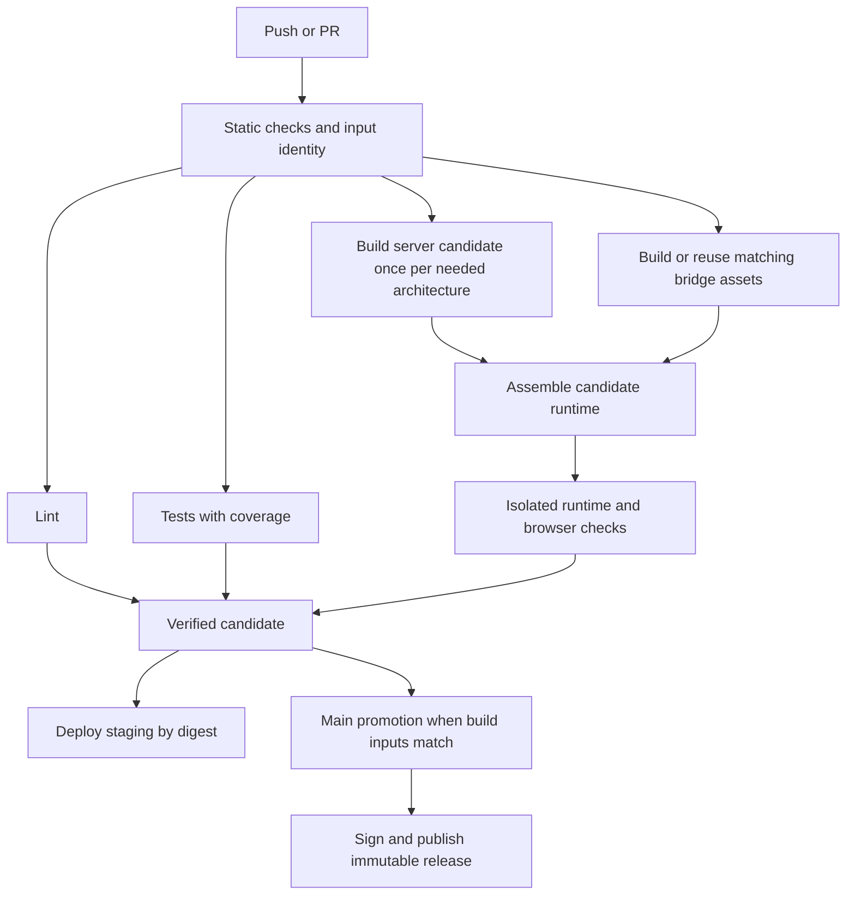

# CI and deployment repair plan

Reviewed 2026-09-07 on `next`. This records the current flow, the first repairs,
and the remaining implementation. It is not a declaration that CI is fixed.

## What happens today

| Action | Work performed | Publication/deployment |
|---|---|---|
| Commit locally | Tracked pre-commit hook, if installed; no GitHub Actions until push | None |
| Push `next` | Gates: static, lint/doc/MSRV, unit/integration/contract tests, then a second instrumented test pass for coverage | No GHCR image and no automatic staging deploy |
| Open/update a PR into `next` or `main` | Gates again on the PR merge commit; a push to `next` with an open PR can therefore start two workflows | None |
| `just deploy` | Cloud doctor, release workspace build, host bridge packaging, remote download backfill, asset publication, then `cloud deploy` | Builds the profile Dockerfile, pushes to the cloud registry, synchronizes secrets, deploys the tenant |
| `just deploy-next` | Vendors the sibling core working tree, then invokes `deploy`; currently requires active patches | Same `production` profile, which this repository calls staging |
| Merge/push `next` to `main` | Release checks published-core pins; calls all gates; builds four bridge packages; builds amd64/arm64 images; merges/signs/tags image; publishes assets and smoke-checks | GHCR and GitHub Release; **no automatic Fly deployment** |
| Push `main` again at the same version | Repeats gates, all bridge builds, both image builds | Versioned assets stay immutable; `latest` and the commit tag get a new image |

The branch documentation describes a fast-forward release, but history also
contains GitHub merge commits. The workflow responds to either kind of main
push. At review time both patch blocks are commented out even on `next`, and
`bridge/CORE_REF` names `v0.47.0`: branch name alone does not identify build inputs.

The local production Dockerfile is **not** the repository Dockerfile used by
release CI. It copies prebuilt `target/release` binaries and `web/dist`, plus
profile files. The root Dockerfile compiles Rust inside Docker and initializes
the runtime through `docker/entrypoint.sh`. A published GHCR image therefore
cannot simply replace the local image without verifying profile paths, secrets,
entrypoint behavior, and MCP manifests.

Before this repair, `build-all` built the workspace, called the MCP build command
again, bundled/copied web assets, and then ran `publish_pipeline`, which repeats
those asset jobs. The workspace already contains both MCP binaries. That proves
redundant build commands, not three independent Docker image compilations.

The release workflow's second Docker build exports the `artifacts` target from
the same builder cache. It is not inherently a second Rust compile. Native
amd64 and arm64 builds are necessary separate compilations.

## Evidence from actual runs

- [Failed release 34041181475](https://github.com/Astound-Digital/systemprompt-astound/actions/runs/34041181475):
  static, lint, tests, and coverage passed. Chromium failed: **50 failed,
  752 passed, 21 skipped**, browser execution 12.1 minutes. The E2E job took
  about 46 minutes including server compilation/setup, after waiting 24 minutes
  for the separate test job.
- [Release 34045359095](https://github.com/Astound-Digital/systemprompt-astound/actions/runs/34045359095):
  about **103 minutes** end to end. Coverage took about 50 minutes; E2E again
  failed but was non-blocking. Bridge packaging then took up to 23 minutes
  (Windows), followed by up to 18 minutes for images.
- [Next run 34045837263](https://github.com/Astound-Digital/systemprompt-astound/actions/runs/34045837263)
  is green after E2E was removed altogether. This is not evidence of an E2E fix.
- Earlier PR run 34039996936 failed at checkout in every gate, before tests.
  Immutable checkout SHAs prevent jobs from following a branch/merge ref that
  moves while a run is queued; the exact historical checkout error still needs
  classification separately from the browser failures.
- The installed `systemprompt cloud deploy --help` exposes `--skip-push` and
  `--check`, but **no image reuse option**. The core orchestrator unconditionally
  calls `build_image`; `--skip-push` skips only the push.
- `scripts/coverage.sh` used `if ! cargo ...; then status=$?`: the captured
  status is the successful negation, so build/test failures could be discarded.
- The coverage cache listed normal workspace targets, but the script compiles
  into `coverage-report/target-{root,tests,bridge}`. Those compilation trees
  were never cached.

## First repairs implemented in this change

- [x] Remove the extra MCP command and duplicate web jobs from `build-all`.
- [x] Make `just deploy --check` bypass all build/package steps.
- [x] Preserve quoted arguments to `just e2e`; regex filters previously became
  shell syntax, defeating cheap targeted reruns.
- [x] Use `npm ci` for the committed Playwright dependency lock.
- [x] Fix four marketplace audience tests to visit the existing audience tab.
  All eight tests in `groups-access.spec.ts` pass locally, with two workers.
- [x] Capture actual coverage subprocess failures. Exercise success, no-tests,
  test-failure, and build-failure statuses without compiling Rust.
- [x] Cache the actual instrumented target directories; retain coverage gates.
- [x] Run static checks before allocating expensive lint/test/coverage jobs;
  those three jobs still run in parallel once static succeeds.
- [x] Check out the triggering SHA, including the PR merge SHA, by default.
- [x] Cache bridge dependencies, keyed by platform and pinned core; exclude
  workspace outputs. Add per-architecture Docker layer cache import/export.
- [x] Require the existing smoke job before creating a GitHub Release.
  Image tags still move before smoke; moving promotion after smoke is below.

## Remaining work, in dependency order

### 1. Repair E2E and recover a trustworthy required result

Use the failed report/trace artifacts as the initial inventory. Reproduce each
family against the same binary, database fixture, Playwright lock, Linux image,
fonts, timezone, and viewport. Do not spend a full Rust rebuild per test edit.

| Failure family | Concrete repair | Acceptance |
|---|---|---|
| Stale UI selectors/routes | Update role cards, plugin cards, skill count, request-log region, CSV control, KPI labels and scope expectations to the intended current UI, using shared page objects | The same behavior/authorization is asserted; no assertion deleted merely to pass |
| Marketplace audience | Visit `/admin/marketplaces?tab=audience` | Done: 8/8 entitlement tests pass |
| Sorting/filtering and member deletion | Inspect the devices, governance, and groups failures; distinguish incorrect column assumptions, asynchronous navigation, fixture collisions, and actual product defects | Assert resulting order/filter and database deletion with deterministic dedicated records |
| Density/overflow | Repair table widths, header clipping, action-column overflow and oversized detail KPI grids; affected areas include requests, traces, contexts, approvals, roles and access control | Existing density, overflow and keyboard-focus assertions pass unchanged |
| Visual differences | Stabilize timestamps, random IDs, changing totals and background jobs; inspect actual/expected/diff artifacts after functional/layout repairs | Review baseline changes individually in a pinned Linux environment; rerun without updating snapshots |
| Missing cost digest | Check the scheduler's intended `cost_digest` registration/owner against the API; repair registration or an obsolete requirement explicitly | Scheduled behavior and access denial both proved |
| Existing skips | Inventory all 21 skips, especially entitlement prerequisites | Essential governance/authorization tests cannot silently skip in required CI |

Viewport investigation: the failing trace confirms **1440×900**, UTC, en-US,
reduced motion and device scale 1. The custom principal contexts inherit these
settings in the installed Playwright version. Do not “fix” density by enlarging
the viewport or weakening its thresholds.

Bring E2E back as a **blocking** job after the suite passes. Start its server
build after static alongside lint/test work, not after the full test suite.
Upload JSON results, traces, failure screenshots and server logs with bounded
retention. Use `npm ci` and `playwright install --with-deps chromium` in CI.
Allow a manual run of the same job for diagnosis, without publishing anything.

### 2. Establish one build identity and one image producer

Record immutable metadata for every candidate: application source tree,
Cargo.lock files, core mode and resolved ref, toolchain, target platform,
Dockerfile/base-image digests, runtime assets/configuration, bridge assets and
signing policy. Record the producing workflow SHA separately for provenance.

- Publish a staging candidate from `next` only when deployment is requested,
  or when a deploy-relevant change is deliberately configured to auto-deploy.
  Ordinary development pushes should not build four distribution packages.
- Tag candidates by full commit/build identity and retain their manifest digest.
  Select deployments by digest, not `latest` or an assumed version-to-commit map.
- Separate Rust compilation from runtime asset assembly so CSS/config/docs and
  downloaded bridge packages do not invalidate `COPY .` before `cargo build`.
- Export the server binaries once per required architecture, then assemble the
  runtime and server tarball from those same outputs. Build bridge packages
  alongside server compilation, joining only at runtime assembly.
- Cache bridge bundles by their actual inputs (bridge source, lockfile, pinned
  core, platform, packaging/installer scripts and signing identity/policy).
  Reuse only a verified matching artifact with checksum/provenance.
- Keep caches separate from artifacts. A cache hit never substitutes for a
  build/test invocation; an artifact may substitute only after identity checks.

**Promotion rule:** patched core source on `next` and published registry crates
on `main` are different build inputs, even at the same version. The final
release candidate must be built/tested after switching to published crates.
Promote that candidate without compilation when its inputs match main. If the
merge changes inputs, build once and validate the resulting candidate.

### 3. Add deployment of an existing image

The missing capability belongs in core's cloud deploy pipeline, not in a shell
script that guesses the private API or bypasses secret provisioning.

- Add a mutually exclusive `--image <registry@sha256:...>` path to core's CLI
  and typed deploy request. Keep doctor, profile validation, secret sync and
  deployment status handling. Skip local artifact resolution and Docker build.
- Support authenticated pull or registry-to-registry copy if the cloud target
  cannot pull private GHCR. Copy the already-built image; never rebuild it.
- Adapt the profile/entrypoint contract to the canonical runtime image and
  validate migrations, generated assets, MCP startup and mounted secrets.
- Make `just deploy` resolve the intended verified candidate and call that path.
  A missing image must fail with a clear build command; no silent compile fallback.
- Retain explicit `deploy-source` for uncommitted development work. Make
  `deploy-next` choose vendoring based on active patches rather than assuming
  every next checkout is patched. Apply the same choices to `deploy-to`.
- Roll back by selecting the previous digest, with a separate assessment of
  migration compatibility. Print target, source identity and digest before rollout.

Core changes must be committed/pushed on core `next`, then pinned in both app
workspaces through the normal adoption process. The currently installed
0.47.0 binary cannot accept an invented `--image` flag.

Acceptance: deployment from a verified image invokes **zero Cargo builds,
zero Docker builds, zero bridge packaging jobs**; repeat deployment and rollback
also perform zero builds. The running digest must equal the selected digest.

### 4. Remove duplicate CI runs without creating validation gaps

- Add a lightweight required coordinator/check with stable naming. Classify
  source changes by consumers: Rust, runtime assets/config, browser harness,
  bridge and packaging, documentation, and CI itself. Unknown inputs run all
  relevant checks. `services/content` is runtime content, not skippable docs.
- Keep PR merge validation: the synthetic merge SHA can differ from the next
  head. Reuse a successful trusted validation only when the tested input tree,
  dependency mode, test definitions and workflow policy match. Otherwise run.
  Do not accept “some green run on next” or an untrusted fork artifact.
- Once corrected coverage proves it runs the same unit/integration/contract
  suites and preserves nextest isolation, use that instrumented run as the
  authoritative test pass. Avoid running the full suite twice by default.
  Keep a fast targeted local test path and a separately selected diagnostic run.
- Move genuinely extended supply-chain/platform matrices to scheduled/manual
  runs where they are not necessary for the candidate. Keep the existing
  coverage floor/ratchet in the required path until equivalent enforcement is
  demonstrated; do not merely disable an expensive failing check.
- Cancel superseded validation/candidate builds by branch. Serialize rollout
  and immutable publication; do not cancel a workflow halfway through tagging.
- Shard browser tests only after shared mutation is isolated. Each shard gets
  its own database/profile/server, deterministic seed and mock-inference port;
  download the same server artifact into each shard. Start with two shards and
  measure runner minutes as well as elapsed time before increasing concurrency.

At review time the repository ruleset API returns HTTP 403 with a plan/visibility
restriction, and branch protection returns 404. Do not assume branch protection
is enforcing the checks. Repository rules availability/permissions must be
resolved when installing the coordinator as a required check.

### 5. Gate promotion and publication on the exact runtime candidate

Run database startup, migrations, health, CLI version, MCP readiness and browser
tests against the candidate digest. Test runtime paths and the complete download
asset set. Test arm64 startup on a native runner; run the browser suite once
unless architecture-specific evidence requires more.

Only after checks succeed: promote staging/release tags, sign the manifest and
publish the immutable release assets. Rerunning publication should reuse the
candidate and verify existing outputs, not rebuild everything. Add an explicit
new-release versus same-version-image path so an ordinary main update does not
unconditionally rebuild four immutable bridge assets.

## Target flow

Candidate construction is conditional on deploy/release-relevant work, not an
obligation for every documentation commit. A main input mismatch returns to
candidate construction; it never promotes an incompatible patched build.

## Verification and rollout

1. Land the narrowly scoped first repairs with shell/workflow validation and
   targeted E2E evidence. Do not claim the other 46 historical failures are fixed.
2. Repair all remaining E2E families, run the complete suite in the pinned CI
   environment, then restore its blocking job. No blanket retries, skips or
   snapshot updates as substitutes for diagnosis.
3. Implement canonical candidate production and image deployment. Exercise a
   disposable staging profile, including private-registry access and rollback.
4. Implement coordinator/reuse and compare cold/warm runs for: next push,
   next PR, unchanged fast-forward, changed merge, same-version main update,
   new version, docs-only change and rerun-after-failure.
5. Track p50/p95 duration, total runner minutes, Rust compile count, image build
   count, cache-hit rate, skips and flaky retries over multiple actual runs.

Hard acceptance targets: zero builds during deployment; at most one server
release compilation per required architecture/input identity; one authoritative
full Rust test pass per validation identity; no bridge rebuild for identical
verified bridge inputs; no release publication from failed E2E; no misleading
green status from swallowed failures or omitted required suites. Set wall-clock
targets from measured warm runs rather than promising unmeasured speedups.

Implementation references: [Rust cache inputs](https://github.com/Swatinem/rust-cache),
[Docker Actions caches](https://docs.docker.com/build/ci/github-actions/cache/),
[GitHub PR event semantics](https://docs.github.com/en/actions/reference/workflows-and-actions/events-that-trigger-workflows#pull_request).
