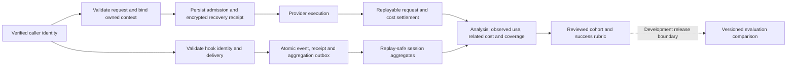

# Analysis and ingestion integrity

The first Analysis (Beta) surface measures observed skill use and the cost of related requests. The Platform Skills screen remains the configuration catalog. Evaluations have not been launched; existing AI session assessments and human ratings must never be presented as experiment results.

## Identity investigation

Inspection on 12 September 2026 used the local PostgreSQL database, not a verified export of the live Astound endpoint. Historical request rows generally carried authenticated user and context identifiers, while all inspected native client-session correlation fields were empty. Historical orphaned references and missing trace fields remain separate data-quality findings. These are different identities:

- `user_id`: the authenticated principal who owns the work.
- `session_id`: the server-attested authentication session.
- `client_session_id`: the client's native conversation UUID.
- `context_id`: the stored request thread, potentially one of several within a native conversation.
- `trace_id`: distributed execution correlation.

The client-session extractor recognized the older `_session_<uuid>` metadata convention but not JSON-encoded `metadata.user_id` with `session_id`. The new parser supports both; explicitly malformed native identity is a request error, not silently absent correlation. Native client IDs remain optional for general API clients that do not supply them. Authentication still comes from verified credentials, never metadata.

The local repair recovered 460 request correlations using retained payloads, a real user and an authentication session belonging to that user. It records source digests and repaired values in `ingestion_repairs`; it does not invent trace IDs, rewrite contexts or guess missing owners. No repaired request conflicts with a hook-session owner in the inspected database. Other historical integrity gaps and unmarked fixtures are not evidence that current authentication was bypassed.

The audit also found an owner-isolation defect independent of missing correlation: fallback contexts were derived solely from the conversation prefix, and Gemini thought-signature cache keys had no authenticated owner. Identical opening messages from different users could share a key. Context derivation now includes the authenticated user; native-session mapping retains its existing ownership checks. Both memory and persistent signature caches require `UserId`. Migration 023 invalidates only the old, unowned one-hour signature cache and installs an owner foreign key and composite primary key. There is no unscoped compatibility read. Active Gemini conversations whose clients discard signature fields may need to start a new conversation after this cache invalidation. Existing request history remains unchanged; future fallback contexts use the owner-scoped namespace.

## Admission and ingestion contract

Gateway admission must persist the owned context, request, payload and request messages before provider dispatch. Governance-decision storage errors propagate. Context materialization rejects a conflicting owner instead of quietly doing nothing. Dispatch pricing is pinned for subsequent accounting.

Hook ingestion requires a valid session key, recognized event and required event-specific fields. Statusline ingestion accepts its session ID in the native JSON payload or the query; when both are present they must agree. Missing, malformed and contradictory identities are rejected. Delivery identifiers bind the owner, native session and event kind. Identical delivery retries are acknowledged without an additional event; conflicting content for a delivery is rejected. Bridge retries reuse an ingestion event ID. A new bridge submission without a native event ID is a new delivery; the server does not deduplicate by prompt text or by a time heuristic. Generated plugin hooks use the bridge loopback transport. Roll out the matching bridge before enabling the stricter server boundary; direct hook callers must supply an event-specific delivery ID or `event_id`. Older callers missing those fields are rejected instead of silently losing retry identity.

Database triggers bind ingestion sessions to existing users and reject changes of ownership across hooks, summaries, cost snapshots, transcripts and session analyses. Durable event receipts and the aggregation outbox commit with the event. Session counters are recomputed from accepted events rather than incremented again after insertion. The scheduled rollup retries pending work.

Gateway terminal receipts use profile-scoped authenticated encryption, atomic replacement, file and directory sync, a bounded queue (64 outstanding receipts, 16 MiB per receipt) and per-request operating-system leases. These limits must be included in concurrency and outage-capacity checks before deployment. A terminal receipt cannot be overwritten by later failure handling. Database settlement is transactional and replayable; receipts remain until request and evaluation accounting settle. Abandoned admissions become explicitly incomplete failures with unknown upstream usage. Journal capacity or encryption configuration failures block new admission. The profile directory containing `gateway-journal` must be mounted on persistent storage alongside its encryption key before deployment; container-local storage does not survive replacement. Disk exhaustion or a failure before a terminal receipt reaches disk cannot reconstruct provider usage: the admission remains evidence of that uncertainty.

## Data path

## Measurement contract

Use half-open UTC windows. Select observed skill events in the window; link requests with the same owner by native session or exact tool-call identifier. Exclude explicitly synthetic requests, evaluation execution sessions and conflicting authentication-session ownership. Model filtering retains only matching linked conversations.

The headline request count, tokens and spend deduplicate request IDs. Skill rows represent related conversation spend and overlap when several skills share a conversation; they must not be summed. Repeated invocations remain counted and do not multiply request spend. Tokens include input, output, cache reads and cache creation. Reasoning is already contained in output. Unlinked usage is unknown, not zero. Coverage is shown separately from spend.

Conversation details expose native session, owner, request threads, linked tool requests, recorded tokens and related cost. Human ratings and AI assessments have separate labels. Historical events without reliable provenance may contain fixtures or duplicate deliveries; the screen explicitly discloses this limitation rather than treating them as a clean production baseline.

## Evaluation API state and next release boundary

The development API already exposes owner-scoped experiments, immutable resource revisions, worker enrollment, workspace configuration, cancellation, execution evidence and artifacts. Browser mutations require the configured origin and management roles. Core has execution-session bindings and request-budget settlement. Local experiment tables are empty. The Analysis evaluation page explains readiness and does not start jobs.

The admin router provides `GET/POST /evals/experiments`, experiment detail and cancellation, revision creation and retrieval, worker enrollment and revocation, workspace registration, and execution evidence/artifact retrieval. The core worker router exposes POST operations for claim, assignment, events, access, heartbeat, evidence and completion. These are two different authentication surfaces: management credentials must not become worker execution identity.

Before making an evaluation launch workflow available, validate the entire execution path with failure injection: dataset consent and secret removal, stable case IDs, versioned skill/model/rubric inputs, owner-scoped worker leases, budget reservation before dispatch, idempotent settlement, cancellation and crash recovery, evidence retention and reproducible comparisons. Evaluation and judge spend must remain separate from observed production spend.

A useful improvement loop starts with an observed cohort, a reviewed success rubric and a frozen baseline. Compare an independently versioned candidate on equivalent cases; report quality, failures, latency, tokens and cost per successful outcome with sample size and coverage. Human review precedes adoption. Do not infer causal skill savings from related conversation spend or equate an AI assessment with measured success.

## Validation

The local SQL queries were executed against real data, and template field and route-link checks pass. `just build` completed successfully with the patched core and online PostgreSQL checks. The local publish pipeline completed all 11 steps. Browser checks on port 8081 cover the overview, a linked conversation drilldown, evaluations, empty results, UTC filter submission, malformed query rejection and mobile layout; all tested pages returned 200, invalid filters returned 400, and no JavaScript errors or page-wide horizontal overflow occurred. The full unit suite passed: 853 tests, zero skips. The full database integration suite passed: 762 tests, zero skips. The database fault-injection test passed: an encrypted terminal receipt survived a rejected completion transaction, replay restored 18 tokens and one tool row, and a late failure could not replace the completion. Automated regression coverage covers native JSON/suffix metadata, malformed explicit identity, session-key validation, repeated skill signals, overlapping skill costs, conflicting ownership, delivery replay and aggregation replay. The owner-isolation regression verifies identical conversation/tool keys for two users in both memory and a second cache instance, including foreign-key cleanup. `just prepare` regenerated 1,206 query caches. `just preflight-static` passed formatting, cache/version checks and all 32 source gates; local `just clippy` passed. The full HTTP contract run passed 107 of 108 cases and exposed the statusline body-ID defect. After that fix, all 10 affected hook, webhook and route-baseline tests passed; the separate seeded performance benchmark remains intentionally ignored. The reviewed baseline adds the three Analysis routes and changes only the two retired skill-analytics redirects. No evaluation experiment was launched and no production deployment was performed.
