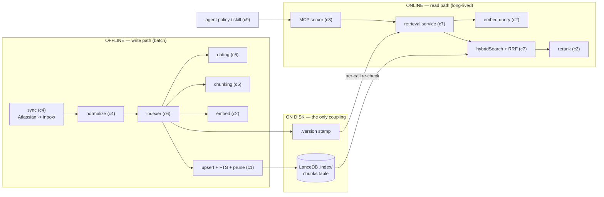
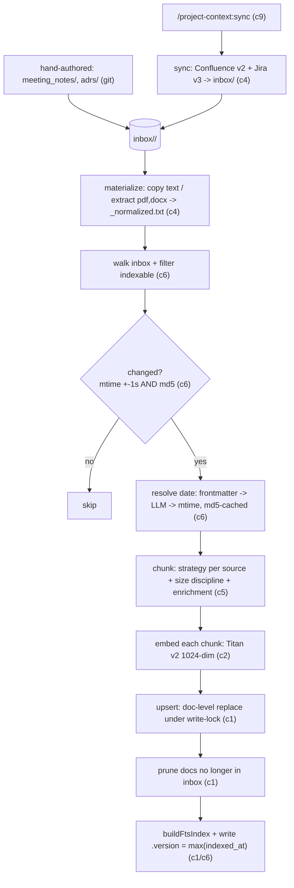

# project-context — system overview (as-is)

*A local, file-based RAG engine: documents from a few sources are synced, normalized, chunked, embedded on Bedrock, and stored in LanceDB, then served to Cursor over an MCP stdio interface via hybrid (vector + full-text) search with reranking. This is the whole-system narrative that ties the nine component docs (`c1`–`c9`) together. As-is only — no migration content.*

---

## 1. The system in one line

Ingest project knowledge (Confluence, Jira, meeting notes, ADRs, OpenSpec specs
and archives) into a single local index, and let an agent retrieve grounded
excerpts — with file+line pointers — through three MCP tools. One ~self-contained
Node engine; the only runtime dependency for serving is the on-disk index and AWS
Bedrock for embeddings/rerank.

Key facts:

- **File-based store**, no database server — LanceDB in `.index/`.
- **Provider connector** (Bedrock today) is the single place a model is called.
- **Strategy-per-source chunking** with a hard size backstop.
- **Hybrid retrieval** (vector ANN + full-text) fused with RRF, then reranked.
- **Similarity ≠ authority** — the engine ranks by relevance; the *agent policy*
  (c9) applies authority/temporal weighting on top.

---

## 2. Architecture: two runtimes, one store

The system splits into **two processes that never run at the same time** and meet
only at the index on disk:



- **Offline** = `cli/sync.mjs` + `cli/index.mjs`. Talks to Atlassian + Bedrock,
  writes the index. Runs on demand (or via `/project-context:sync`).
- **Online** = `mcp/server.mjs` + `retrieval/*`. Long-lived. Reads the index,
  calls Bedrock only for query-embed + rerank.
- **The only coupling is `.index/` (LanceDB) + a `.version` file.** The online
  side re-reads `.version` on every call, so a finished rebuild is picked up
  **without a restart**.

The single most important structural fact: **serving does not depend on ingestion
at runtime.**

---

## 3. Component map

Nine components across seven planes. Each has its own doc.

| # | Component | Plane | Runtime | Doc |
|---|---|---|---|---|
| 1 | Store (LanceDB) | storage | shared | [`c1-store.md`](c1-store.md) |
| 2 | Model connector (Bedrock today) | model | shared | [`c2-model.md`](c2-model.md) |
| 3 | Platform / core | platform | shared | [`c3-platform.md`](c3-platform.md) |
| 4 | Ingestion & sources | ingestion | offline | [`c4-ingestion.md`](c4-ingestion.md) |
| 5 | Chunking | transform | offline | [`c5-chunking.md`](c5-chunking.md) |
| 6 | Indexer + dating | platform | offline | [`c6-indexer.md`](c6-indexer.md) |
| 7 | Retrieval | retrieval | online | [`c7-retrieval.md`](c7-retrieval.md) |
| 8 | MCP interface | interface | online | [`c8-mcp.md`](c8-mcp.md) |
| 9 | Agent policy (consumer) | interface | online | [`c9-policy.md`](c9-policy.md) |

**Shared spine** (used by both runtimes): Store (c1), Model (c2), Platform (c3).
Everything else is exclusively write-path (c4–c6) or read-path (c7–c9).

---

## 4. The write path, end to end



Narrative: **sync** (c4) pulls Atlassian sources into `inbox/`; hand-authored
`meeting_notes`/`adrs` arrive via git. **materialize** (c4) turns binaries into
`_normalized.txt` sidecars and copies native text. The **indexer** (c6) walks the
inbox, skips unchanged files (mtime + md5), resolves each document's **date**
(c6), **chunks** it by source-type strategy (c5), **embeds** the chunks (c2), and
**doc-level-replaces** them in the store (c1) — then prunes deletions, rebuilds
FTS, and stamps `.version` last.

---

## 5. The read path, end to end

```mermaid
sequenceDiagram
  participant AG as agent (c9 policy)
  participant MCP as MCP server (c8)
  participant SVC as service (c7)
  participant B as Bedrock (c2)
  participant DB as LanceDB (c1)
  AG->>MCP: search(query, source_type[], top_k?)
  MCP->>SVC: search(...)  (guarded)
  SVC->>SVC: init() — re-check .version, (re)open table
  SVC->>B: embed([query]) -> queryVector
  SVC->>DB: vector search (limit candidateK) [+ source_type filter]
  SVC->>DB: FTS search (limit candidateK) [+ filter]
  SVC->>SVC: rrfMerge(vec, fts, k=60)
  alt rerank enabled
    SVC->>B: rerank(query, pool, topN=topK)
  end
  SVC-->>MCP: records (text, file, lines, date, ...)
  MCP-->>AG: asJson(records)
  AG->>AG: apply authority + temporal ranking; cite <file>:<lines>
```

Narrative: the **skill** (c9) decides *when* to search and *how to scope*
(`source_type` is mandatory). The **MCP server** (c8) validates input and delegates
to the **service** (c7), which hot-reloads on `.version`, embeds the query (c2),
runs **hybrid search** (vector + FTS, pre-filtered by `source_type`), fuses with
**RRF**, and optionally **reranks** (c2). Results come back as JSON; the agent
then applies the **authority + temporal contract** (c9) — because retrieval order
is similarity, not truth.

---

## 6. The shared spine and the `.index`/`.version` seam

Three components are touched by both runtimes:

- **Store (c1)** — the LanceDB `chunks` table + its two indexes; written by c6,
  read by c7.
- **Model (c2)** — the Bedrock connector; `embed` on both sides, `converse`
  (chunking/enrichment/dating) offline, `rerank` online.
- **Platform (c3)** — `config`/`env`/`preflight`/`concurrency`/`log`/`walk`,
  used everywhere.

The runtimes are otherwise decoupled. Their handshake is entirely on disk:

- the indexer writes chunks, then writes `.version = max(indexed_at)` **last**;
- the service reads `.version` on **every** call and reopens the table when it
  changes — a completed rebuild is served without a restart.

This is why the online server can start in well under a second (lazy singletons)
and never blocks on ingestion.

---

## 7. Data model at a glance (the `chunks` table)

One Arrow table, one row per chunk (see c1 for the full schema):

| Group | Fields | Purpose |
|---|---|---|
| identity | `chunk_id`, `doc_id`, `chunk_index`, `chunk_total` | address a chunk + its place in its doc |
| payload | `text`, `vector` (Float32[1024]) | the embedded content + its embedding |
| pointer | `file`, `lines`, `title`, `source_type` | open the source at the right span; scope key |
| dating | `doc_date`, `date_source` | effective date + provenance (feeds c9 ranking) |
| incremental | `mtime`, `content_hash`, `indexed_at` | change detection + `.version` derivation |
| lifecycle | `archived` | archive flag (default false) |

Two indexes over the same table: a **vector ANN** index and a **full-text (FTS)**
index over `text`. Writes are **doc-level replace** (`delete doc_id` → `add`), not
row upsert.

---

## 8. Source types & chunking strategies (recap)

| `source_type` | Origin | Strategy (c5) | Notes |
|---|---|---|---|
| `meeting_notes` | hand-authored, git | `llm` | LLM line-number semantic chunking; falls back to script |
| `confluence` | Atlassian mirror | `script` | heading-aware markdown + breadcrumbs + table-row split |
| `jira` | Atlassian subset | `none` | body + comment groups |
| `specs` | OpenSpec current specs | `script` | "what the system should do now" |
| `adrs` | hand-authored, git | `script` | durable architecture decisions |
| `openspec_archive` | archived OpenSpec changes | `script` | historical rationale; **opt-in** at query time |

Size discipline is universal: target 1600 / max 3000 / min 300 / tolerance 100 →
`mergeSmall` then `enforceCeiling`; no oversized chunk can leak. Contextual
enrichment (index-time, `script` docs only) prepends 1–2 factual sentences —
stored `text` may differ from source, but line pointers still map to the original.

---

## 9. Configuration & credentials

- **Config** — a single `config.yaml` under the engine home (`PROJECT_CONTEXT_HOME`),
  loaded by c3 into camelCase with defaults. It declares `sources` (with per-source
  `strategy`, origin `path`, include/exclude globs), `bedrock` models, `chunking`
  sizes, `retrieval` knobs, `dates.extract_via_llm`, and `indexing.doc_concurrency`.
- **Credentials** — `.env` at `envPath`: `AWS_BEARER_TOKEN_BEDROCK` (or an AWS key
  pair) for Bedrock, plus Atlassian creds for sync. `preflight` (c3) gates startup;
  the MCP server exits if it fails. `.env` is never read/committed by the refresh
  commands.
- **Wiring** — `mcp.json` (c9) launches the server with `PROJECT_CONTEXT_HOME`
  pointing at the in-workspace engine, so config/inbox/index all resolve locally.

---

## 10. Cross-cutting invariants

These hold across components and are the load-bearing properties of the system:

- **Serving is independent of ingestion at runtime** — coupled only by `.index/`
  + `.version` (hot reload, no restart).
- **The index mirrors the inbox** — doc-level replace on change + prune of missing
  docs → no orphan or stale-duplicate chunks.
- **Everything degrades to deterministic** — a missing/failing LLM routes chunking
  to a script splitter and dating to mtime; an unbuilt FTS index degrades search
  to vector-only; a per-doc error is isolated. Indexing and serving never hard-fail
  on a single bad input.
- **No oversized chunk** — `enforceCeiling` is the unconditional backstop after
  every chunking strategy.
- **One place talks to the model** — the c2 connector; retry/limiter/timeout live
  there.
- **stdout is protocol-only** — all logs go to stderr, so the MCP JSON-RPC stream
  is never corrupted.
- **Scope is mandatory, archive is opt-in** — enforced by the c8 schema, guided by
  the c9 policy.
- **Similarity is not authority** — the engine returns leads ranked by relevance;
  the agent (c9) decides what a hit may prove, weighting by authority class and
  `date`/`date_source` (`frontmatter > llm > mtime`).

---

## 11. Where to read next

- Start with the **shared spine**: [`c1-store.md`](c1-store.md),
  [`c2-model.md`](c2-model.md), [`c3-platform.md`](c3-platform.md).
- Then the **write path**: [`c4-ingestion.md`](c4-ingestion.md),
  [`c5-chunking.md`](c5-chunking.md), [`c6-indexer.md`](c6-indexer.md).
- Then the **read path**: [`c7-retrieval.md`](c7-retrieval.md),
  [`c8-mcp.md`](c8-mcp.md), [`c9-policy.md`](c9-policy.md).
- `TRACKER.md` has status + decisions; `01-component-map.md` has the module-level
  map; `03-doc-template.md` is the fixed per-component template.
