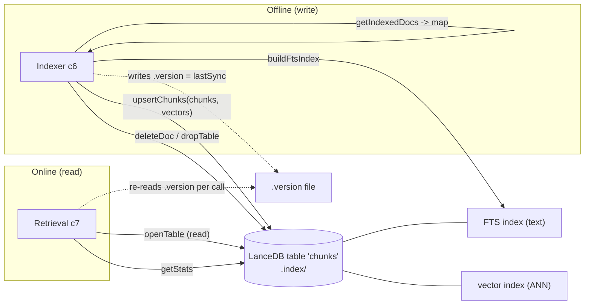

# Component 1 — Store (LanceDB)

*The single file-based store that holds every chunk and its vector, and the persistence primitives both runtimes use to write and read it.*

---

## 1. Purpose & scope

The store is the one place project-context keeps data: a single LanceDB table
named `chunks`, backed by files under `.index/`. It defines the record schema,
creates the table, replaces a document's chunks, exposes the incremental-sync
map, (re)builds the full-text index, and computes index statistics.

- **Plane:** storage.
- **Runtime:** shared — the offline indexer writes it, the online retrieval
  service reads it. It is the only state both runtimes touch.
- **Boundaries — owns:** the LanceDB connection, the Arrow schema, doc-level
  upsert/delete, the `doc_id → {mtime, content_hash}` map for incremental
  indexing, the FTS index build, and `getStats`.
- **Boundaries — does NOT:** produce embeddings (that is Model, c2 — vectors
  arrive ready-made); decide how documents are chunked (c5); resolve dates
  (c6). It also does not own query-time ranking: `hybridSearch`/`rrfMerge`
  physically live in the same file (`retrieval/store.mjs`) but belong to
  Retrieval (c7) and are documented there. This doc covers the persistence
  primitives only.

**Diagram — how the store sits between the two runtimes:**

---

## 2. Inputs

| Input | From | Shape |
|---|---|---|
| Chunk records + vectors | Indexer (c6) via `upsertChunks(table, chunks, vectors)` | camelCase chunk objects + `Float32[embedDim]` per chunk |
| `doc_id` to delete | Indexer prune / re-index via `deleteDoc(table, docId)` | string |
| `config.indexPath` | Platform config (c3) | filesystem path to `.index/` |
| `config.bedrock.embedDim` | Platform config (c3) | vector dimension for the schema (default 1024) |

Config/env that shapes the store:

- `index_path` (config.yaml) → `config.indexPath`, default `.index` relative to
  the project-context home. This is the LanceDB directory.
- `bedrock.embed_dim` → `config.bedrock.embedDim`, default `1024`. Fixes the
  `vector` column width; **the vector length written must equal this** or the
  Arrow schema rejects the row.

Preconditions: the table may not exist yet. `openTable(config, { create })`
handles both — `create: true` builds an empty typed table, `create: false`
returns `null` when it is missing (the retrieval service treats `null` as
"index is empty").

---

## 3. Processing

The store is a set of pure persistence primitives over one table
(`const TABLE = 'chunks'`). No LLM, no network — fully deterministic.

**Open / create / drop.**
- `connect(config)` → `lancedb.connect(config.indexPath)`.
- `openTable(config, { create=false })`: if the `chunks` table exists, open it;
  else with `create:true` build an empty table from `buildSchema(embedDim)`
  (`existOk: true`), otherwise return `null`.
- `dropTable(config)`: drop `chunks` if present (used by `--rebuild`).

**Schema (`buildSchema(dim)`) — 16 Arrow fields:**

| Field | Arrow type | Meaning |
|---|---|---|
| `chunk_id` | Utf8 | `"<doc_id>::<i>"`, unique per chunk |
| `doc_id` | Utf8 | source-relative path; the upsert/prune unit |
| `text` | Utf8 | the indexed chunk text (may include enrichment prefix) |
| `vector` | FixedSizeList\<Float32\>[dim] | embedding; **non-nullable** |
| `file` | Utf8 | workspace-relative openable pointer |
| `source_type` | Utf8 | category (`confluence`, `jira`, …); the search pre-filter key |
| `title` | Utf8 | inferred document title |
| `lines` | Utf8 | `"start-end"` line range into the original |
| `chunk_index` | Int32 | position within the document |
| `chunk_total` | Int32 | number of chunks in the document |
| `mtime` | Float64 | source mtime (seconds); incremental key |
| `content_hash` | Utf8 | source md5; incremental key |
| `indexed_at` | Utf8 | ISO timestamp of indexing; drives `lastSync` |
| `doc_date` | Utf8 | effective date `YYYY-MM-DD` (from c6) |
| `date_source` | Utf8 | `frontmatter \| llm \| mtime` |
| `archived` | Bool | archive-lifecycle flag (see §6) |

**Write model — doc-level replace (`upsertChunks`).**
Not a row upsert: it `deleteSafe(table, "doc_id = '<esc>'")` then `table.add(...)`
the fresh rows via `toRow` (camelCase → snake_case). So re-indexing a document
fully rewrites its chunk set. `deleteDoc` is the same delete on its own.
`deleteSafe` swallows errors (empty table / nothing to delete). `esc()` doubles
single quotes to guard the string predicates.

**Incremental map (`getIndexedDocs`).**
Scans `doc_id, mtime, content_hash` and returns `Map<doc_id, {mtime, contentHash}>`,
keeping the first row seen per `doc_id` (all chunks of a doc share the pair). The
indexer diffs this against the filesystem to skip unchanged docs.

**Full-text index (`buildFtsIndex`).**
`table.createIndex('text', { config: Index.fts(), replace: true })`. Wrapped in
try/catch that only warns — an FTS build failure is non-fatal (see §6).

**Stats (`getStats`).**
`countRows()` for total chunks; then scans `source_type, doc_id, indexed_at` to
build per-source **distinct-doc** counts and `lastSync = max(indexed_at)`.
Returns `{ totalChunks, sourceCounts, lastSync }` (empty/`'never'` on any error).

---

## 4. Outputs & state

**Persistent state owned:** the `.index/` directory — the LanceDB `chunks`
table plus its two secondary indexes (vector ANN, and the FTS index over
`text`). This directory is the entire on-disk footprint of the knowledge base.

**Returned to callers:**
- `openTable` → a LanceDB table handle (or `null`).
- `getIndexedDocs` → the incremental map (to the indexer).
- `getStats` → totals/per-source/lastSync (to the indexer log, and to the MCP
  `index_stats` / `list_sources` tools via retrieval).

**Handoff:** the indexer (c6) writes `.index/.version` with the value of
`stats.lastSync` after a run. The store does not write `.version` itself — but
it produces the `lastSync` that becomes its content. The retrieval service (c7)
re-reads `.version` on every call to decide whether to reopen the table. This
file is the sole synchronization signal between the write and read runtimes.

---

## 5. Dependencies

- **External libraries:** `@lancedb/lancedb` (connection, table, `Index.fts`,
  vector/fts search), `apache-arrow` (schema field types).
- **Upstream (writers):** Indexer (c6) — supplies chunk records + vectors, calls
  upsert/delete/prune/buildFts, reads `getIndexedDocs`/`getStats`.
- **Downstream (readers):** Retrieval (c7) — opens the table, runs the search
  primitives (documented in c7), calls `getStats`.
- **Platform (c3):** `config` for `indexPath` and `embedDim`; `log.warn` for the
  FTS-failure warning.
- **Model (c2):** indirect — vectors stored here are produced by Bedrock, but
  the store never calls Model; it receives ready vectors.

---

## 6. Behavioral notes & open questions

As-is invariants:

- **Doc-level atomic replace.** A document's identity is `doc_id`; its chunk set
  is delete-then-add on every (re)index. There is no partial chunk update.
- **Vector width is fixed at schema creation** to `embedDim`. Changing the embed
  model's dimension requires a rebuild (a new table), not an in-place migration.
- **`text` is what was indexed, not verbatim source.** For enriched script docs
  the stored text carries a prepended context sentence (from c5); `lines` +
  `file` are the pointers back to the original.
- **FTS degrades silently.** If `buildFtsIndex` fails it only warns; at query
  time the FTS branch also catches and warns, so retrieval falls back to
  vector-only. Search keeps working, quality drops, nothing errors.
- **Stats count distinct docs per source, chunks in total** — `sourceCounts` is
  doc counts, `totalChunks` is rows. The two are intentionally different units.

Edge cases / quirks:

- `deleteSafe` and every scan are wrapped to tolerate an empty/missing table, so
  a fresh index never throws on read.
- `getIndexedDocs` assumes all chunks of a doc share `mtime`/`content_hash`
  (true because they are written together by `upsertChunks`).

Open questions (current system only):

- **`archived` is currently always `false`.** The column exists and `toRow`
  writes `chunk.archived ?? false`, but the indexer/chunker never set it true
  (archive content is handled as separate `*_archive` **source types**, not via
  this flag). Confirm whether anything writes `archived = true` today, or if it
  is a reserved-but-unused field.
- No explicit vector index creation is visible in this module (only the FTS
  index). Confirm whether LanceDB builds/uses the ANN index implicitly for
  `search(vector, 'vector')` or whether it is created elsewhere.

---

## 7. Source map

| File | What it holds (this component) |
|---|---|
| `scripts/retrieval/store.mjs` | Entire store: `TABLE`, `buildSchema`, `connect`, `openTable`, `dropTable`, `toRow`, `deleteSafe`, `esc`, `upsertChunks`, `deleteDoc`, `getIndexedDocs`, `buildFtsIndex`, `getStats`. **Excluded (documented in c7 Retrieval):** `RESULT_COLUMNS`, `rrfMerge`, `hybridSearch`, `round`. |
