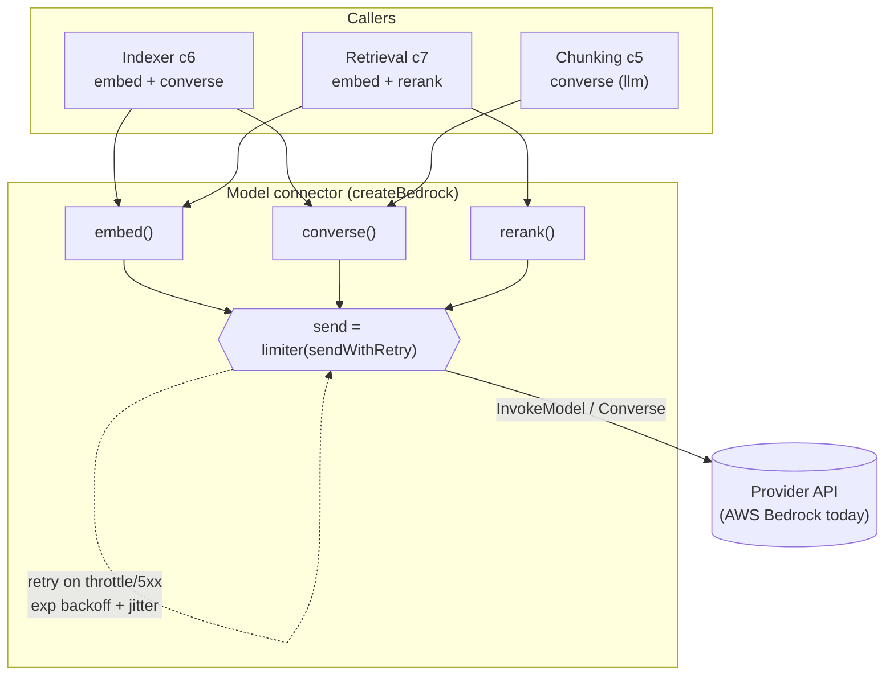
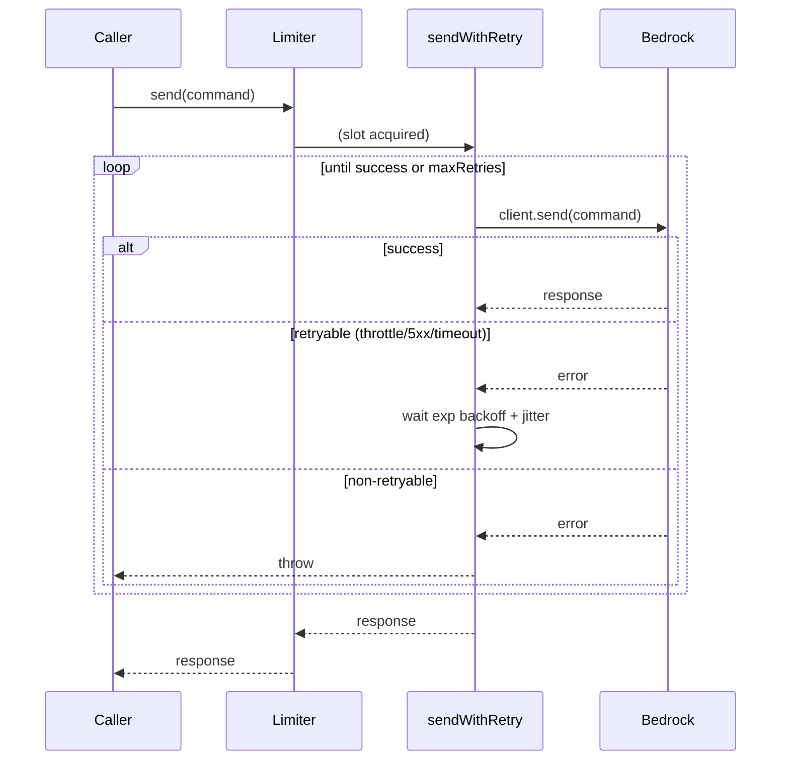

# Component 2 — Model access (provider connector)

*The single connector to an external model provider, exposing three capabilities — embed, chat, rerank — behind retry, timeout, and concurrency control. Today the configured provider is AWS Bedrock.*

---

## 1. Purpose & scope

This component is the one boundary between project-context and a model provider.
Every embedding, every LLM call, and every rerank goes through it. It hands
callers a small capability object (`embed`, `converse`, `rerank`, `check`) and
hides transport concerns: authentication, request timeouts, throttling
backoff, and a shared concurrency cap.

- **Plane:** model.
- **Runtime:** shared — the offline indexer uses `embed`/`converse`; the online
  retrieval service uses `embed`/`rerank`.
- **Provider (as-is):** the concrete implementation talks to **AWS Bedrock** via
  the AWS SDK (`@aws-sdk/client-bedrock-runtime`). Provider choice is expressed
  only through model ids + region in config; there is no second provider in the
  code (see §6).
- **Boundaries — owns:** provider auth, the request send-pipeline (limiter +
  retry/backoff + timeout), and the mapping of each capability to a provider
  API call.
- **Boundaries — does NOT:** decide *what* to embed or rerank, or *when* to call
  an LLM. Chunking (c5), dating and enrichment (c5/c6), and retrieval (c7)
  own those decisions; they receive `converse`/`embed`/`rerank` as plain
  functions and drive them.

**Diagram — the connector as a capability boundary over one send-pipeline:**

---

## 2. Inputs

Callers obtain the connector from `createBedrock(config)` and then invoke
capabilities:

| Capability | Call | Input |
|---|---|---|
| Embed | `embed(texts, { concurrency? })` | array of strings |
| Chat | `converse(system, user, { temperature=0, maxTokens=4096, modelId=chunkModel })` | two prompt strings |
| Rerank | `rerank(query, documents, { topN=documents.length })` | query + candidate strings |
| Health | `check()` | none (embeds `"ping"`) |

Config/env that shapes the connector (`config.bedrock`, from c3):

| Key (config.yaml) | Field | Default | Role |
|---|---|---|---|
| env `PROJECT_CONTEXT_BEDROCK_REGION` | `region` | `eu-central-1` | provider region |
| `bedrock.embed_model` | `embedModel` | `amazon.titan-embed-text-v2:0` | embeddings model |
| `bedrock.embed_dim` | `embedDim` | `1024` | embedding width (sent + verified) |
| `bedrock.chunk_model` | `chunkModel` | `openai.gpt-oss-120b-1:0` | default LLM for `converse` |
| `bedrock.rerank_model` | `rerankModel` | `cohere.rerank-v3-5:0` | rerank model |
| `bedrock.embed_concurrency` | `embedConcurrency` | `16` | embed fan-out width |
| `bedrock.max_concurrency` | `maxConcurrency` | `8` | global in-flight cap |

Preconditions / auth: one of `AWS_BEARER_TOKEN_BEDROCK` (a Bedrock API key,
bearer) or an `AWS_ACCESS_KEY_ID` pair must be in the environment;
`createBedrock` throws immediately if neither is present. The AWS SDK reads the
credential itself.

---

## 3. Processing

**Construction.** `createBedrock(config)` builds one `BedrockRuntimeClient`
(`region`, `maxAttempts: 1` — the SDK's own retry is disabled so retry is fully
owned here — `requestTimeout: 90s`, `connectionTimeout: 10s`), a semaphore
`limit = createLimiter(maxConcurrency)`, and returns the capability object. The
timeout matters: some models occasionally hang with no response and no error;
without a request timeout the call would block a slot forever, and the retry
loop only reacts to thrown errors — so a hang must first become a timeout
exception.

**Send-pipeline (every call).** `send(command) = limit(() => sendWithRetry(client, command))`:
1. `limit` caps concurrent in-flight requests at `maxConcurrency`, saturating
   the provider quota without permanently exceeding it.
2. `sendWithRetry` retries on transient failures with exponential backoff:
   `delay = min(500 · 2^attempt, 30_000) + jitter(≤500ms)`, up to `maxRetries=10`.
   `isRetryable` matches a throttle/timeout name set
   (`ThrottlingException`, `TooManyRequestsException`, `ServiceUnavailableException`,
   `ModelTimeoutException`, `InternalServerException`, `TimeoutError`,
   `AbortError`), `ECONNRESET`, or HTTP `429/503/500`. Anything else throws
   immediately.

**Capabilities.**
- `embed`: Titan v2 embeds **one text per call**, so `embed(texts)` fans out
  with `mapLimit(texts, embedConcurrency, embedOne)`. `embedOne` sends
  `InvokeModel` with body `{ inputText, dimensions: embedDim, normalize: true }`
  and returns `json.embedding`.
- `converse`: single-turn `ConverseCommand` at `temperature=0` by default;
  joins the response content parts into one trimmed string. Used as the generic
  `llm(system, user)` by chunking, dating, and enrichment.
- `rerank`: `InvokeModel` against `rerankModel`. Request body branches by model
  family — Cohere adds `api_version: 2`, Amazon omits it — but both return the
  same `{ results: [{ index, relevance_score }] }` shape, mapped to
  `[{ index, score }]` sorted descending.
- `check`: embeds `"ping"` and asserts the returned vector length equals
  `embedDim` — a cheap credential + dimension liveness probe.

**Determinism.** `converse` and `rerank` are model calls — non-deterministic in
general (though `converse` defaults to `temperature=0`). `embed` is stable for a
given text/model. The connector itself adds no randomness beyond retry jitter.

---

## 4. Outputs & state

- **Returns:** `{ embed, converse, rerank, check, embedModel, chunkModel, rerankModel }`.
  The three model-id fields are exposed so callers/logs can report which models
  ran.
- **Emissions downstream:** float vectors (to the store via the indexer), LLM
  text (to chunking/dating/enrichment), rerank orderings (to retrieval).
- **State owned:** none persistent. The only in-process state is the SDK client
  and the semaphore counter, both scoped to one `createBedrock` instance. No
  files, no cache. (Callers that want caching — e.g. date results by md5 — do it
  themselves; see c6.)

---

## 5. Dependencies

- **External:** `@aws-sdk/client-bedrock-runtime` (`BedrockRuntimeClient`,
  `InvokeModelCommand`, `ConverseCommand`); the provider account + quota; the
  credential in the environment.
- **Platform (c3):** `config.bedrock` for models/region/concurrency;
  `concurrency` (`mapLimit`, `createLimiter`); `log.warn` for retry notices.
- **Consumers:** Indexer (c6) — `embed` for chunk vectors, `converse` as the LLM
  for dating; Chunking (c5) — `converse` for LLM line-number chunking and
  enrichment; Retrieval (c7) — `embed` for the query vector, `rerank` for
  result ordering.

---

## 6. Behavioral notes & open questions

As-is invariants:

- **Single boundary.** This is the only module that constructs a provider client
  or issues model calls; nothing else imports the AWS SDK. That is what makes
  "the connector" a real seam rather than a convention.
- **Retry is owned here, not by the SDK** (`maxAttempts: 1`). All backoff policy
  is in `sendWithRetry`.
- **Concurrency is global per connector instance** — embed fan-out and every
  other call share the same `maxConcurrency` semaphore, so the provider quota is
  the thing being protected, not any single operation.
- **Embedding dimension is asserted** by `check()` and fixed into the store
  schema (c1); the two must agree.

Edge cases / quirks:

- Rerank uses `InvokeModel`, deliberately not the agent-runtime Rerank op,
  because the bearer-token auth is rejected by that op (noted in the source).
- Rerank body differs by model-id prefix (`cohere.` vs otherwise) — a string
  check, so a new rerank family would need a code branch.
- A hung model becomes a `TimeoutError` via the request timeout, which is in the
  retryable set — so hangs are retried, not surfaced immediately.

Open questions (current system only):

- **Provider is effectively hard-wired to Bedrock.** "Connector" describes the
  shape (one capability boundary), but there is no provider abstraction/registry
  in the code — swapping providers means rewriting this module. Confirm whether
  that is acceptable framing for the as-is doc or whether a provider-neutral
  interface is intended to be described as existing (it is not, today).
- `converse` accepts a `modelId` override but all current callers use the
  default `chunkModel`; confirm no caller passes a different model.

---

## 7. Source map

| File | What it holds (this component) |
|---|---|
| `scripts/core/bedrock.mjs` | The whole connector: `createBedrock`, `embed`/`embedOne`, `converse`, `rerank`, `check`, the `send`/`sendWithRetry` pipeline, `isRetryable`, `THROTTLE_NAMES`, `decodeJson`. |
| `scripts/core/concurrency.mjs` | `mapLimit` + `createLimiter` used by the send-pipeline (owned by c3 Platform; referenced here). |
