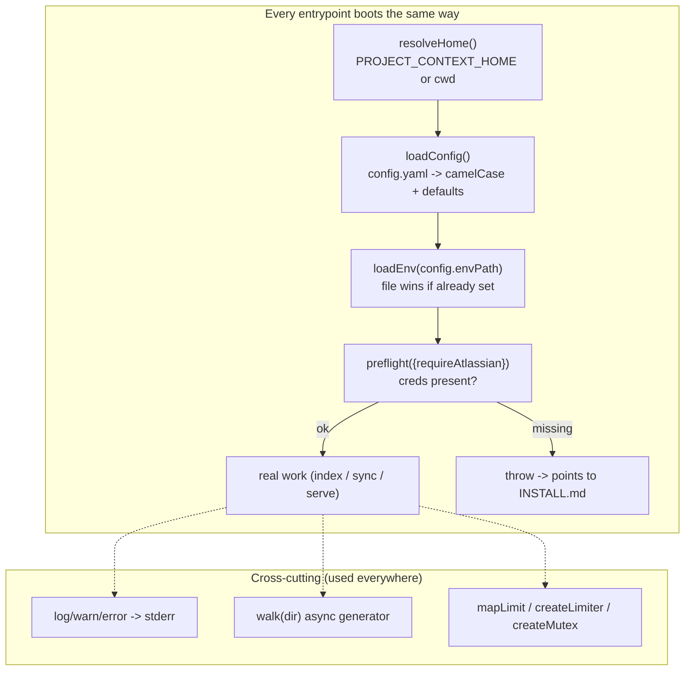

# Component 3 — Platform / core

*The dependency-free foundation shared by both runtimes: config loading, .env loading, startup preflight, concurrency primitives, stderr logging, and a directory walker.*

---

## 1. Purpose & scope

Platform is the set of small, business-logic-free utilities every other
component builds on. It resolves and normalizes configuration, loads the `.env`,
runs startup checks, provides the concurrency primitives, centralizes logging,
and offers a recursive file walk. Nothing here knows about chunks, vectors, or
retrieval — it is pure plumbing.

- **Plane:** platform.
- **Runtime:** shared — used by the offline CLIs (indexer, sync) and the online
  MCP server alike.
- **Boundaries — owns:** the config schema+defaults (`config.mjs`), the `.env`
  parser (`env.mjs`), the preflight contract (`preflight.mjs`), the concurrency
  primitives (`concurrency.mjs`), logging (`log.mjs`), and directory traversal
  (`walk.mjs`).
- **Boundaries — does NOT:** talk to Bedrock or Atlassian, touch LanceDB, or
  contain any ingestion/retrieval logic. It is imported by the components that
  do.

**Diagram — bootstrap order + cross-cutting utilities:**

---

## 2. Inputs

| Utility | Reads |
|---|---|
| `config.mjs` | `PROJECT_CONTEXT_HOME` env, `config.yaml`, provider/chunking/retrieval defaults |
| `env.mjs` | a `.env` file (path or directory) |
| `preflight.mjs` | `process.env` (Bedrock + optionally Atlassian keys), `.env` presence |
| `concurrency.mjs` | caller-supplied items/limits/fns |
| `log.mjs` | caller strings |
| `walk.mjs` | a directory path |

Config/env that shapes platform itself:

- `PROJECT_CONTEXT_HOME` — the project-context home (contains `config.yaml`,
  `inbox/`, `.index/`); defaults to `process.cwd()`. Set in `mcp.json` for the
  server.
- `config.yaml` `env_path` → where `loadEnv` reads from (default `.env` beside
  the home; in this deployment it is `../.env`, i.e. `.cursor/.project/.env`).

---

## 3. Processing

**`config.mjs` — the configuration authority.**
- `resolveHome()` → `PROJECT_CONTEXT_HOME` (resolved) or `process.cwd()`.
- `loadConfig(configPath?)` reads `config.yaml` (throws a guided error if
  missing), parses YAML, and returns a normalized **camelCase** object with all
  defaults applied: `bedrock` (region/models/dims/concurrency), `chunking`
  (target/max/min/tolerance/enrich), `dates.extractViaLLM`, `retrieval`
  (topK/candidateMultiplier/rerankEnabled), `indexing.docConcurrency`, and the
  `sources` map. Each source resolves its origin `path` (default `inbox/<name>`)
  and `include`/`exclude` globs.
- `strategyFor(config, sourceType)` → the fixed chunk strategy for a source
  (default `script`). This is the one function the chunker calls back into.

**`env.mjs` — minimal `.env` loader (no dependency).**
`loadEnv(target)` accepts a file or a directory (appends `.env`). Parses
`KEY=VALUE`, **does not overwrite** a key already in `process.env` (real
environment wins), strips quotes, and strips inline `# comments` for unquoted
values. Returns whether a file was loaded.

**`preflight.mjs` — startup checks.**
`preflight({ requireAtlassian=false })` collects issues: `.env` presence, the
Bedrock key (`AWS_BEARER_TOKEN_BEDROCK`), and — only when `requireAtlassian`
(the sync CLI) — `ATLASSIAN_BASE_URL`/`SITE`, `EMAIL`, `API_TOKEN`. If any issue
exists it throws one Error listing them all, referencing `INSTALL.md` so an
agent can open the guide and fix it.

**`concurrency.mjs` — three primitives (deterministic).**
- `mapLimit(items, limit, fn)` — bounded parallel map, results in input order.
- `createLimiter(max)` — a semaphore returning `run(fn)`; caps in-flight tasks
  to protect a shared resource (the provider quota).
- `createMutex()` — serializes async writes in call order (the indexer's writes
  to LanceDB).

**`log.mjs` — stderr only.**
`log`/`warn`/`error` all write to **stderr**, never stdout — because the MCP
server speaks JSON-RPC on stdout and any stray byte would corrupt the stream.

**`walk.mjs` — recursive file generator.**
`async function* walk(dir)` yields every file under `dir` in stable sorted
order, skips dotfiles/dotdirs, and yields nothing for a missing/unreadable
directory (callers apply their own filtering).

---

## 4. Outputs & state

- **Returns:** `config` object (`config.mjs`); a boolean loaded-flag
  (`env.mjs`, plus the side effect of populating `process.env`); nothing or a
  thrown Error (`preflight.mjs`); wrapped async runners (`concurrency.mjs`); a
  file-path stream (`walk.mjs`).
- **State owned:** none persistent. The only side effects are mutating
  `process.env` (env loader) and writing to stderr (logger). No files are
  written by this component.

---

## 5. Dependencies

- **External:** `yaml` (config parse); Node built-ins only otherwise (`fs`,
  `path`).
- **Consumers (everyone):**
  - `config.mjs` → all components.
  - `env.mjs` → indexer, sync, MCP server (at bootstrap).
  - `preflight.mjs` → MCP server, sync CLI.
  - `concurrency.mjs` → Model connector (c2), Indexer (c6).
  - `log.mjs` → all.
  - `walk.mjs` → Indexer (c6), Normalizer (c4).
- Platform depends on nothing else in the system — it is the bottom layer.

---

## 6. Behavioral notes & open questions

As-is invariants:

- **`config.mjs` is the single source of defaults.** Every default value
  (models, dims, chunk sizes, topK, concurrency) lives here; other components
  read the resolved config, never re-declare defaults.
- **Real environment always wins over `.env`.** `loadEnv` never overwrites an
  already-set key — shell/CI values take precedence.
- **All logs go to stderr** so stdout stays a clean MCP JSON-RPC channel. This
  is load-bearing for the server, not a style choice.
- **`walk` is deterministic and dotfile-blind** — sorted output, hidden entries
  skipped; this is why `.dates.json`/`.version` sidecars are never walked as
  documents.

Edge cases / quirks:

- `resolveHome` falls back to `process.cwd()`, so running a CLI from the wrong
  directory silently changes which `config.yaml`/index is used unless
  `PROJECT_CONTEXT_HOME` is set (it is set in `mcp.json` for the server).

Open questions (current system only):

- **Preflight comment vs. behavior for `.env`.** The code comments the `.env`
  check as "warn but do not block," but a missing `.env` is pushed into the same
  `issues` array that triggers the throw — so it appears to block even when
  credentials are present in the shell environment. Confirm the intended
  behavior (warn-only vs. hard-fail) against how it actually runs.

---

## 7. Source map

| File | What it holds |
|---|---|
| `scripts/core/config.mjs` | `resolveHome`, `resolveConfigPath`, `loadConfig`, `strategyFor`, path/glob helpers, all defaults |
| `scripts/core/env.mjs` | `loadEnv` — minimal `.env` parser (real env wins) |
| `scripts/core/preflight.mjs` | `preflight` — startup credential checks; points to `INSTALL.md` |
| `scripts/core/concurrency.mjs` | `mapLimit`, `createLimiter`, `createMutex` |
| `scripts/core/log.mjs` | `log`, `warn`, `error` — stderr only |
| `scripts/core/walk.mjs` | `walk` — recursive, sorted, dotfile-skipping file generator |
