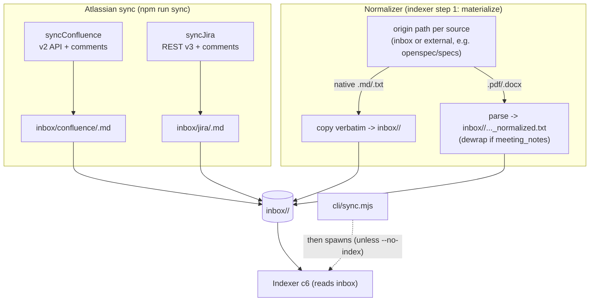
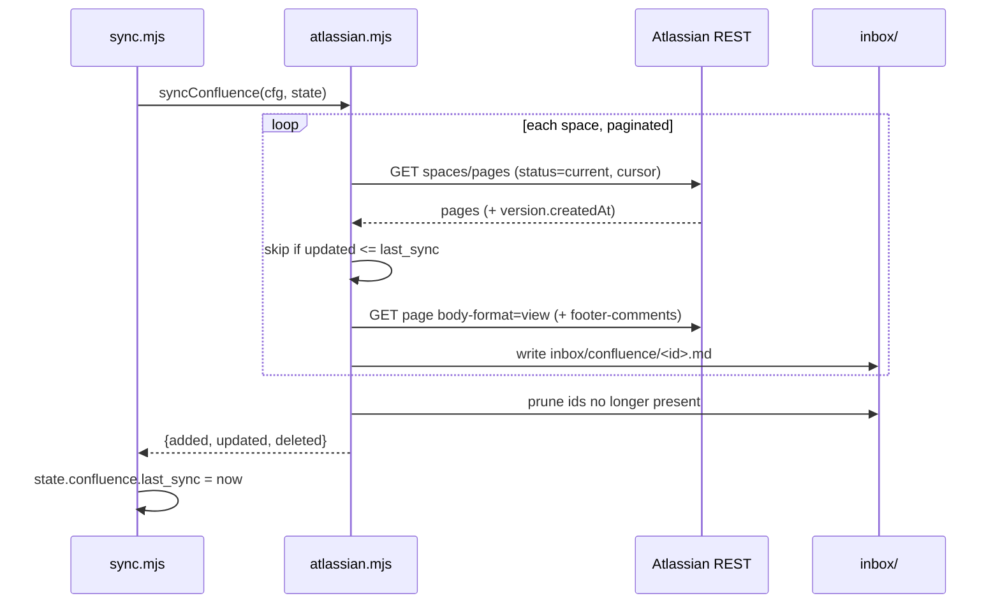

# Component 4 — Ingestion & sources

*Everything that turns external sources into a uniform `inbox/<type>/` tree of indexable text: the Atlassian sync (Confluence + Jira → Markdown), the binary parsers (PDF/DOCX), and the normalizer that materializes every source into inbox.*

---

## 1. Purpose & scope

Ingestion is the source boundary. It gets raw knowledge — Confluence pages,
Jira issues, PDFs, DOCX, local Markdown — into one place and one shape:
UTF-8 text files under `inbox/<source_type>/`. Everything downstream (chunking,
indexing) reads only `inbox/`, so all format- and network-specific mess is
contained here.

- **Plane:** ingestion.
- **Runtime:** offline (write path). Two triggers: the **sync CLI**
  (`npm run sync`, network → inbox) and the **normalizer** (called as step 1 of
  the indexer, filesystem origin → inbox).
- **Boundaries — owns:** the Atlassian REST client + HTML→Markdown conversion +
  document builders; the PDF/DOCX/text parsers; the materialize/normalize step
  (copy native text, extract binaries to `_normalized.txt`, dewrap transcripts,
  glob-filter, prune); the `.atlassian_sync_state.json` incremental cursors.
- **Boundaries — does NOT:** chunk (c5), embed, date, or write the index (c6),
  or serve anything (c7–c9). It contains **no LLM calls** — ingestion is
  deterministic parsing and network I/O only; the model enters at chunking.

**Diagram — two mechanisms, one inbox:**

---

## 2. Inputs

| Input | From | Notes |
|---|---|---|
| Confluence pages / Jira issues | Atlassian REST (v2 wiki, v3 jira) | via `fetch`, Basic auth |
| Binary/native files | each source's origin `path` | PDFs (meetings), DOCX/MD specs, ADRs |
| `config.sources` | Platform config (c3) | origin path + `include`/`exclude` globs + strategy |
| Atlassian settings | env via `settings()` | see below |

Config/env:

- `settings()` reads: `ATLASSIAN_SITE` or `hostOf(ATLASSIAN_BASE_URL)`,
  `ATLASSIAN_EMAIL`, `ATLASSIAN_API_TOKEN`, `CONFLUENCE_SPACES`
  (or `CONFLUENCE_SPACE_KEY`), `JIRA_PROJECTS` (or `JIRA_PROJECT_KEY`),
  `JIRA_JQL`, `ATLASSIAN_INCLUDE_COMMENTS` (default `true`). Own variable names
  take precedence; toolkit names are accepted as fallback.
- Per source in `config.yaml`: `path` (origin; default `inbox/<name>`),
  `include`/`exclude` globs. `meeting_notes` triggers transcript dewrap in the
  normalizer.

**Supported source types (categories, from `config.yaml`).** The `source_type`
is the inbox subfolder; each has a fixed chunk strategy (used later in c5) and an
origin:

| source_type | How it arrives | Chunk strategy | Origin |
|---|---|---|---|
| `confluence` | Atlassian sync → `.md` | `script` | `inbox/confluence` |
| `jira` | Atlassian sync → `.md` | `none` | `inbox/jira` |
| `meeting_notes` | hand-added PDFs → dewrapped | `llm` | `inbox/meeting_notes` |
| `adrs` | hand-authored `.md` | `script` | `inbox/adrs` |
| `specs` | external openspec tree (read-only) | `script` | `openspec/specs` (`**/spec.md`) |
| `openspec_archive` | external openspec archive (read-only) | `script` | `openspec/changes/archive` (`proposal/design/technical-design.md`) |

**Supported file types (convert vs. keep as-is).** Only four on-disk suffixes are
handled; HTML/JSON are converted at sync time before they ever hit disk:

| Input | Handling | Result on disk | Indexed? |
|---|---|---|---|
| `.md` | kept as-is (copied, or left in place) | `.md` | yes, directly |
| `.txt` | kept as-is | `.txt` | yes, directly |
| `.pdf` | **converted** via `pdf-parse` (+ `dewrapTranscript` for `meeting_notes`) | `<name>.pdf_normalized.txt` | yes, the sidecar |
| `.docx` | **converted** via `mammoth` (raw text) | `<name>.docx_normalized.txt` | yes, the sidecar |
| Confluence/Jira HTML + JSON | **converted** to Markdown at sync (`cheerio` + `turndown`) | `.md` | yes, directly |
| anything else (`.png`, `.xlsx`, `.doc`, …) | unsupported | not materialized | no |

The indexer (c6) treats a file as indexable only if it is native `.txt`/`.md`
**or** ends with `_normalized.txt`; original `.pdf`/`.docx` binaries are never
indexed directly — only their extracted sidecars.

Preconditions: sync runs `preflight({ requireAtlassian: true })` (creds
mandatory). The normalizer needs each configured origin to exist (a missing
origin walks to nothing).

---

## 3. Processing

### 3a. Atlassian sync (`atlassian.mjs` + `cli/sync.mjs`)

`cli/sync.mjs` loads config/env, runs preflight, reads
`.atlassian_sync_state.json`, then runs the requested source(s) (`--source
confluence|jira|both`), writes state back, and — unless `--no-index` — spawns
`index.mjs --sync`.

- **Confluence:** for each space → resolve space id → paginate pages (cursor,
  `status=current`). Incremental: skip pages whose `version.createdAt <=
  last_sync`, but still collect every page id for pruning. For each changed page,
  fetch `body-format=view` HTML, optionally footer-comments, and build a Markdown
  doc with `buildConfluenceDoc` (frontmatter: title, `source_type`, page_id,
  space, `updated`, url + body + comments). Write `inbox/confluence/<pageId>.md`.
  Prune local `.md` not in the fetched id set (keep `*gitkeep*`).
- **Jira:** build JQL = `project IN (...) AND (jql) [ORDER BY]`; incremental adds
  `AND updated >= '<last_sync date>'`. Paginate `POST /search/jql`
  (`nextPageToken`, `expand=renderedFields`, fixed field list). Per issue,
  optionally re-fetch with comments, build with `buildJiraDoc` (frontmatter +
  status/type/priority/assignee header + description + comments). Write
  `inbox/jira/<KEY>.md`. Prune **only on a full sync** (no `last_sync`).
- **HTML→Markdown (`htmlToMd`):** cheerio strips `script/style/iframe` and
  Atlassian Connect widgets; Turndown (atx headings, fenced code) converts;
  CDATA leftovers removed. The document builders are pure and covered by
  byte-identical tests.

### 3b. Parsers (`parsers.mjs`)

`parse(filePath)`: `.pdf` → `pdf-parse`, `.docx` → `mammoth.extractRawText`,
`.txt/.md` → read as UTF-8. `SUPPORTED_SUFFIXES` = those four; everything else is
unsupported by design.

### 3c. Normalizer (`normalizer.mjs`)

`materialize(config)` walks each source's origin and produces indexable text in
`inbox/<type>/`:
- **In-place** when origin already is `inbox/<type>` (confluence/jira/etc.):
  native files stay, binaries get a `_normalized.txt` sidecar next to the
  original.
- **External origin** (e.g. `specs` → `openspec/specs`): native `.md/.txt` are
  copied in; binaries are extracted; then the target is pruned to exactly the
  expected set (external origins are never written to).
- Binary extraction (`extractTo`) parses then, for `meeting_notes`, runs
  `dewrapTranscript` (repairs PDF line-wrap: speaker headers on their own line,
  one sentence per line — wording preserved, only whitespace changes).
- `include`/`exclude` globs (`globToRegExp` + `matchFilters`) decide which origin
  files are taken; own `_normalized.txt` sidecars are never re-materialized.
- Staleness by mtime: a target is rebuilt only if missing or older than source.
  Returns `{ created, skipped, failed }`.

**Determinism:** entirely deterministic (parse, HTML→MD, dewrap, glob). Network
results vary run to run, but no model is involved.

---

## 4. Outputs & state

**Persistent state owned:**
- `inbox/confluence/<pageId>.md`, `inbox/jira/<KEY>.md` — written by sync.
- `inbox/<type>/…_normalized.txt` — binary extractions (normalizer).
- Copied native files in `inbox/<type>/` for external origins.
- `.atlassian_sync_state.json` — `{ confluence.last_sync, jira.last_sync }`
  ISO timestamps, the incremental cursors.

**Returned:** per-source `{ added, updated, deleted }` (sync);
`{ created, skipped, failed }` (normalize).

**Handoff:** the `inbox/<type>/` tree of text files is what the indexer (c6)
walks. A file's frontmatter (`updated`/`created`) later feeds dating (c6); its
`source_type` (the inbox subfolder) drives the chunk strategy (c5) and the
search pre-filter (c7).

---

## 5. Dependencies

- **External:** `cheerio`, `turndown` (HTML→MD); `pdf-parse`, `mammoth`
  (binaries); `fetch` + Atlassian REST v2/v3; the Atlassian credential.
- **Platform (c3):** `config` (sources, inboxPath), `env`/`preflight` (sync
  bootstrap), `log`, `walk` (normalizer traversal).
- **Downstream:** Indexer (c6) reads `inbox/`. **Cross-calls:** `sync.mjs`
  spawns the indexer after a sync; the indexer calls `materialize` as its step 1
  — so ingestion and indexing invoke each other at the CLI boundary (documented
  in both).
- **Upstream:** none — this is the outermost boundary of the system.

---

## 6. Behavioral notes & open questions

As-is invariants:

- **inbox is the only contract downstream.** Whatever the origin, the indexer
  sees `inbox/<type>/` text. External origins are read-only; inbox is owned.
- **`source_type` = the inbox subfolder name.** It is set at ingestion (sync
  folder, or normalize target) and carried, unchanged, all the way to the search
  filter.
- **No LLM in ingestion** — the pipeline is deterministic up to this point.
- **`*gitkeep*` files are never pruned** — the documented escape hatch for
  hand-authored sources with no upstream page.

Edge cases / quirks:

- **Jira incremental never prunes.** Deletion is reconciled only on a full sync
  (no `last_sync`); an incremental run leaves a deleted issue's `.md` in place.
  Confluence, by contrast, prunes every run (it collects all current ids even
  while skipping unchanged ones).
- **Confluence comment author is `authorId`** (a numeric account id), not a
  display name — comments render with the id.
- Some sources are **not synced at all**: `meeting_notes` (hand-added PDFs),
  `adrs` (hand-authored), `specs`/`openspec_archive` (external openspec tree).
  Only confluence + jira come from the Atlassian sync.

Open questions (current system only):

- Confirm how `meeting_notes` PDFs and `adrs` land in their origins today
  (manual drop vs. some other step) — the engine only normalizes what is
  already there.
- `ATLASSIAN_INCLUDE_COMMENTS=false` skips the per-issue re-fetch for Jira;
  confirm whether that path is used in this deployment (default is `true`).

---

## 7. Source map

| File | What it holds |
|---|---|
| `scripts/cli/sync.mjs` | Sync CLI: args, state file, runs Confluence/Jira, then spawns the indexer |
| `scripts/ingest/atlassian.mjs` | `settings`, REST client, `buildJiraJql`, `syncConfluence`/`syncJira`, `buildConfluenceDoc`/`buildJiraDoc`, `htmlToMd`, comment fetchers |
| `scripts/ingest/parsers.mjs` | `parse`, `parsePdf`, `parseDocx`, `SUPPORTED_SUFFIXES`, `isBinarySuffix` |
| `scripts/ingest/normalizer.mjs` | `materialize`, `dewrapTranscript`, glob filtering, staleness, prune, `NORMALIZED_SUFFIX` |
