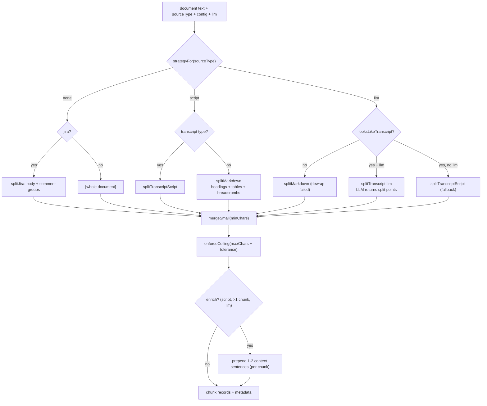
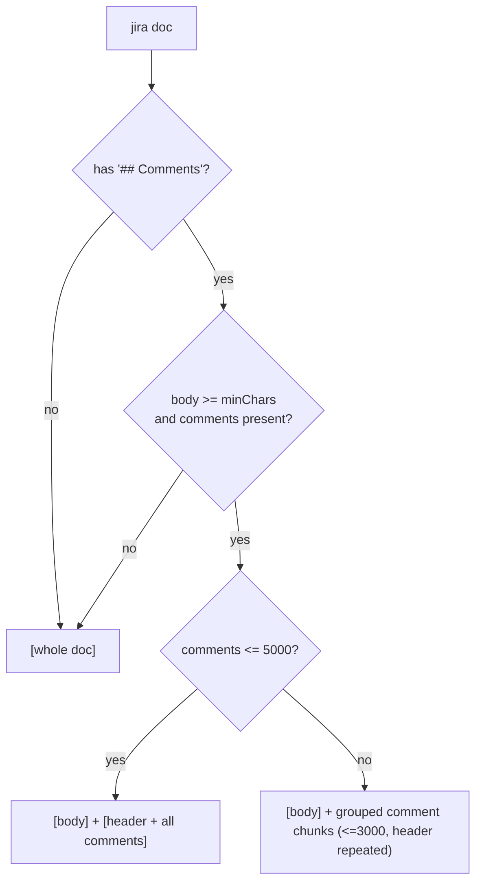
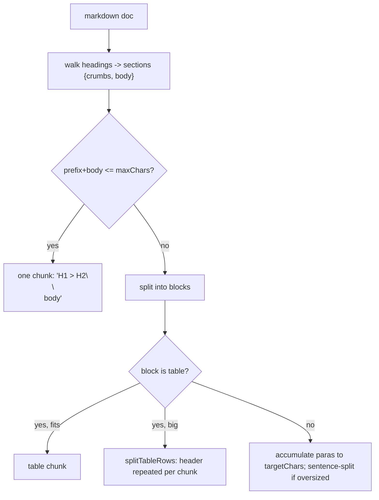
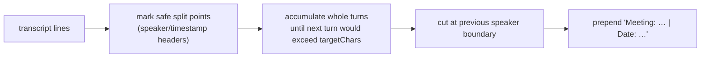

# Component 5 — Chunking

*Splits one inbox document into retrieval-sized chunk records, using a strategy fixed per source type, a size-discipline backstop, optional LLM boundary detection, and optional index-time contextual enrichment.*

---

## 1. Purpose & scope

Chunking turns a single document's text into an array of chunk records — the
unit that gets embedded and stored. It picks a splitting strategy by source
type, enforces size bounds, optionally asks the LLM for semantic boundaries,
optionally prepends a short context sentence to each chunk, and attaches
per-chunk metadata (title, line range, indices).

- **Plane:** transform.
- **Runtime:** offline (write path) — invoked by the indexer (c6), once per
  changed document.
- **Boundaries — owns:** strategy dispatch (`llm | script | none`), the size
  primitives (merge-small / enforce-ceiling / sentence & window splitting), the
  markdown/transcript/jira splitters, LLM line-number chunking, contextual
  enrichment, and chunk metadata (`inferTitle`, `findLineRange`,
  `chunkDocument`).
- **Boundaries — does NOT:** read files or walk inbox (c4/c6), embed (c2),
  resolve dates (c6 — it receives `docDate`/`dateSource` as inputs), or write to
  the store (c1). It is a pure transform: text in, records out.

**Diagram — strategy dispatch and the size backstop:**



---

## 2. Inputs

`chunkDocument({ filePath, sourceType, docId, content, mtime, contentHash,
docDate, dateSource, archived, config, llm })` — called by the indexer per
document.

| Input | From | Role |
|---|---|---|
| `content` | inbox file (c4) read by indexer (c6) | the text to split |
| `sourceType` | inbox subfolder | selects strategy + LLM prompt |
| `docId`, `filePath` | indexer | identity + openable pointer |
| `docDate`, `dateSource` | dating (c6) | metadata passthrough (not used to split) |
| `mtime`, `contentHash`, `archived` | indexer | metadata passthrough |
| `llm(system, user)` | Model connector (c2) via indexer | boundary detection + enrichment |

Config (`config.chunking`, from c3) and the constants that govern splitting:

| Knob | Value | Role |
|---|---|---|
| `targetChars` | 1600 | preferred chunk size — splitters accumulate up to this |
| `maxChars` | 3000 | soft ceiling a single block may reach before forced splitting |
| `splitTolerance` | 100 | slack above `maxChars`; hard ceiling = 3100 |
| `minChars` | 300 | fragments below this are merged into a neighbour |
| `enrich` | true | enable contextual enrichment (script docs only) |
| `LINES_PER_SECTION` | 300 | LLM chunking window (lines per model call) |
| `JIRA_SPLIT_THRESHOLD` | 5000 | comments longer than this are split per-comment |
| `JIRA_MAX_GROUP` | 3000 | max size of a grouped-comments chunk |
| `TRANSCRIPT_SPEAKER_MIN` | 5 | speaker lines needed to treat text as a transcript |

Strategy per source comes from `strategyFor(config, sourceType)` (default
`script`). Precondition: `content` is non-empty (the indexer skips empty files).

---

## 3. Processing

The entry `splitDocument` dispatches on strategy, then **every** path runs
through the same size discipline (§3.5) and, for eligible docs, enrichment
(§3.6); finally `chunkDocument` attaches metadata (§3.7). The strategy is fixed
per source type — see the dispatch diagram in §1. Each strategy is detailed
below with what it does, why, the algorithm, a diagram, and an example.

### 3.1 Strategy `none` — Jira (body + comments)

**What.** For `jira`, split the document into the ticket body and its comment
thread, and split a large thread further per comment. Any other `none` source is
kept as a single chunk.

**Why.** A ticket's description and its discussion answer different questions.
Keeping the description as its own chunk, and each comment with its author/date,
means a retrieval hit points at the exact turn — and a long thread becomes
several retrievable chunks instead of one oversized blob.

**How (`splitJira`).**
- Find `## Comments` (`/^## Comments\s*$/m`). Absent → return `[content]`.
- `body` = text before it; `commentsRaw` = from it onward. If `body < minChars`
  or there are no comments → `[content]` (don't fragment a tiny ticket).
- If `commentsRaw ≤ JIRA_SPLIT_THRESHOLD` (5000) → `[body, ticketHeader +
  commentsRaw]` (two chunks).
- Else split on comment boundaries (`/^\*\*[^*]+\*\*\s+\(\d{4}-\d{2}-\d{2}\):/gm`)
  and pack comments into groups ≤ `JIRA_MAX_GROUP` (3000), each re-prefixed with
  `"<title>\n\n## Comments\n\n"` so every chunk is self-describing.



**Example.**

```markdown
---
title: "[NAVA-123] Cart total wrong"
source_type: jira
---
# [NAVA-123] Cart total wrong

**Status:** Done | **Type:** Bug
## Description
Totals ignore tax rounding on multi-currency baskets.

## Comments

**Alice** (2026-01-05):
Repro on CHF baskets.

**Bob** (2026-01-06):
Root cause is the rounding mode.
```

→ two chunks (thread < 5000):

```text
chunk[0] = frontmatter + header + "## Description ... rounding on multi-currency baskets."
chunk[1] = "[NAVA-123] Cart total wrong\n\n## Comments\n\n**Alice** (2026-01-05): Repro ...\n\n**Bob** (2026-01-06): Root cause ..."
```

### 3.2 Strategy `script` — structured Markdown (headings, breadcrumbs, tables)

**What.** For `confluence`, `specs`, `adrs`, `openspec_archive` (and any other
`script` non-transcript source): split along the heading outline, prefix each
chunk with its heading breadcrumb, and break wide tables row-by-row while
repeating the header.

**Why.** A chunk lifted out of a page loses its place. The breadcrumb
(`H1 > H2 > H3`) re-attaches that context so the embedding and the reader both
know a "Cards" chunk lives under "Checkout > Payment". Repeating a table's header
on every row-chunk keeps each fragment interpretable on its own.

**How (`splitMarkdown` + `splitTableRows`).**
- Walk lines; on a heading (`/^(#{1,4})\s+(.*)/`) flush the current section, pop
  the heading stack to shallower levels, push the new heading. Each section =
  `{ crumbs, body }` — and the heading line itself **stays in the body**.
- `breadcrumb = crumbs.join(' > ')` only when depth > 1; `prefix =
  breadcrumb\n\n` is *prepended on top of* the body (so a deep chunk shows both
  the breadcrumb and its own `##` heading; a top-level H1 section gets no
  breadcrumb).
- If `prefix + body ≤ maxChars` → one chunk. Else split into blocks (blank-line
  separated; a block is a `table` if any line matches `TABLE_SEP_RE`):
  accumulate paragraphs up to `targetChars`; a table that fits `maxChars` is its
  own chunk, otherwise `splitTableRows` emits header+rows chunks ≤ `maxChars`
  (the header block — the section heading through the `| --- |` separator — is
  repeated on each); an oversized paragraph is sentence-split
  (`splitBySentences`).



**Example.**

```markdown
# Checkout
Intro.

## Payment
Cards are tokenized.

### Cards
| Field | Type |
| --- | --- |
| pan | string |
| cvv | string |
```

→ chunks (the section's own heading line is kept; breadcrumb is prepended only
when depth > 1, so the H1 section has none):

```text
chunk[0] = "# Checkout\nIntro."
chunk[1] = "Checkout > Payment\n\n## Payment\nCards are tokenized."
chunk[2] = "Checkout > Payment > Cards\n\n### Cards\n| Field | Type |\n| --- | --- |\n| pan | string |\n| cvv | string |"
```

If the Cards table had hundreds of rows, chunk[2] would become several chunks,
each starting with the breadcrumb `Checkout > Payment > Cards` followed by the
repeated header block (`### Cards` + `| Field | Type |` + `| --- | --- |`).

### 3.3 Strategy `script` — transcripts (speaker accumulation)

**What.** For transcript-type sources (`meeting_notes`) under the `script` path —
either by config or as the LLM fallback — accumulate whole speaker turns up to
`targetChars`, never cutting mid-turn. A meeting header is prepended.

**Why.** In a transcript the natural unit is a speaker turn; splitting inside one
severs a statement from its speaker and its answer. Accumulating whole turns to
~`targetChars` keeps exchanges together.

**How (`splitTranscriptScript`).**
- `safeSplitPoints`: line 0, every speaker/timestamp header
  (`SPEAKER_HEADER_RE`), and the first line after a blank line.
- Walk turns between split points; when adding the next turn would exceed
  `targetChars`, cut at the previous speaker boundary and start a new chunk.
- `meetingHeader` is prepended to each chunk in `splitDocument`: `Meeting:
  <title>` always (when a title exists), plus `| Date: <d>` **only if** a date
  (`\d{1,2} <month> \d{4}`) is found in the first 500 chars of the document.



**Example.**

```text
Alice   00:01
Let's start with the cart bug.
Bob   00:15
I think it's the tax rounding.
Alice   00:20
Agreed — fix the rounding mode.
```

→ (small, one chunk here) with header — `title` from frontmatter, `Date` only
because "5 Jan 2026" appears in the opening:

```text
Meeting: Cart sync | Date: 5 Jan 2026

Alice   00:01
Let's start with the cart bug.
Bob   00:15
I think it's the tax rounding.
Alice   00:20
Agreed — fix the rounding mode.
```

A long meeting is cut at speaker boundaries into ~`targetChars` chunks, each
carrying the same header. (Had the opening carried no recognizable date, the
header would read just `Meeting: Cart sync`.)

### 3.4 Strategy `llm` — semantic line-number chunking

**What.** For `meeting_notes` with an LLM available: ask the model where chunks
should start, by line number, and split there. The model never rewrites text.

**Why.** Transcripts are messy — fixed-size or pure speaker-accumulation can
still mix unrelated topics or split a decision from its rationale. A model can
pick semantic boundaries (a Q with its A, a decision with its reasoning) far
better, while staying safe because it only returns integers.

**How (`splitTranscriptLlm`).**
- Feed the text **with stable line numbers** in windows of `LINES_PER_SECTION`
  (300). System prompt is source-tuned (`PROMPT_MEETING_NOTES` /
  `PROMPT_STRUCTURED` / `PROMPT_DEFAULT`).
- The model returns `{"starts": [1, 12, 34]}`; parsing is defensive
  (`parseJsonLineNumbers` → bare-number fallback), forced to include the first
  line, clamped to valid range; `splitAtLines` slices the original.
- **Fallback chain:** not transcript-looking → `splitMarkdown`; no LLM →
  `splitTranscriptScript`; LLM empty/error → `splitTranscriptScript`.

```mermaid
sequenceDiagram
  participant CH as chunker
  participant LLM as Model (c2)
  loop each 300-line window
    CH->>LLM: numbered lines + "return start line numbers"
    LLM-->>CH: {"starts":[...]} (or fails)
    CH->>CH: parse + clamp; carry max start to next window
  end
  alt got starts
    CH->>CH: splitAtLines(starts) — slice original text
  else empty / error
    CH->>CH: splitTranscriptScript (fallback)
  end
```

**Example.** A boundary appears only where the meeting genuinely switches
feature — not between a symptom and its fix (the prompt keeps a decision with its
rationale together). Here two distinct features are discussed:

```text
input (numbered, ~1500 chars total):
 1: Alice   00:01
 2: Let's start with the cart tax bug.
 3: Bob   00:15
 4: On multi-currency baskets the CHF totals are off by a cent.
 5: Alice   00:40
 6: Right, it's the rounding mode — we truncate instead of banker's rounding.
 7: Bob   01:10
 8: Fix is to switch the rounding mode and add a regression test on CHF.
 9: Alice   01:35
10: Agreed, I'll take that and ship it this sprint.
...
24: Alice   08:02
25: Next topic — the new saved-payment-methods feature.
26: Carol   08:20
27: Design wants tokenized cards listed in the account area.
28: Bob   08:45
29: That needs a new PSP vault call and a consent checkbox at save time.
30: Carol   09:10
31: Legal signed off on the consent copy yesterday, so we're clear to build.
...

model -> {"starts": [1, 25]}

chunks:
chunk[0] = lines 1-24   feature "cart tax bug" — symptom, root cause, decision (kept together)
chunk[1] = lines 25-…   feature "saved payment methods" — a separate topic
```

Note the split is **between** the two features, not inside the first one: the bug
discussion (symptom → cause → decision → owner) stays a single chunk because the
prompt forbids splitting a coherent exchange. Both resulting chunks are well over
`minChars` (300), so `mergeSmall` leaves them as-is — had the model over-split
into tiny fragments, `mergeSmall` would fold them back together anyway (§3.5).

### 3.5 Size discipline (applies after every strategy)

**What / why.** Whatever a strategy produces, two passes guarantee usable sizes:
tiny fragments hurt retrieval (no context), oversized ones blow the embedding
and dilute relevance.

**How.**
- `mergeSmall(minChars)` — fold any sub-`minChars` (300) fragment into its
  neighbour.
- `enforceCeiling(maxChars + splitTolerance)` — hard ceiling 3100; anything over
  is split sentence → whitespace-window (`windowSplit`) → hard boundary, never
  cutting inside a word token unless a single token exceeds the window.

**Example.** A 6 000-char heading-less paragraph → `enforceCeiling` yields ~2–3
chunks each ≤ 3100, cut at sentence boundaries near 1600.

### 3.6 Contextual enrichment (script docs only)

**What.** Prepend 1–2 factual sentences to each chunk so it is self-contained
for search.

**Why.** A mid-document chunk often lacks the terms someone would search for
(feature name, Jira key, the section it belongs to). A short, fact-only preface
raises recall without changing the source.

**How (`enrichChunk`).** Runs only when `enrich` is true, the strategy is
`script`, there is more than one chunk, and an LLM is present; skips chunks below
`minChars`. The model gets the document context (title + heading outline +
opening ≤ 15 000 chars) and the exact chunk, and must add only visible facts (no
inference); on failure the chunk is used unchanged. Line pointers are still
computed against the **pre-enrichment** text (§3.7).

**Example.**

```text
before: "| pan | string |\n| cvv | string |"
after:  "Checkout > Payment > Cards: the card fields (pan, cvv) for the payment API.\n\n| pan | string |\n| cvv | string |"
```

### 3.7 Metadata assembly (`chunkDocument`)

Builds each record: `chunkId` (`<docId>::<i>`), `docId`, `text` (possibly
enriched), `file`, `sourceType`, `title` (`inferTitle`: capability folder for
`spec.md`, else first heading, else filename), `lines` (`findLineRange` against
the **original** text — so pointers map to source even after enrichment),
`chunkIndex`, `chunkTotal` (backfilled), plus passthrough `mtime`,
`contentHash`, `docDate`, `dateSource`, `archived`, `indexedAt`.

**Determinism.** `script`/`none` and the size primitives are fully
deterministic. LLM chunking and enrichment are non-deterministic — both preserve
source text and have deterministic fallbacks.

---

## 4. Outputs & state

- **Returns:** `Promise<chunkRecord[]>` (camelCase) to the indexer, which embeds
  each `text` (c2) and upserts the batch (c1).
- **State owned:** none — chunking is a pure transform, no files, no cache.
- **Handoff:** the record's `text` becomes the embedded + stored chunk; `lines` +
  `file` are the openable pointer back to the original; `sourceType` becomes the
  store's pre-filter key.

---

## 5. Dependencies

- **Platform (c3):** `strategyFor` (config), `log.warn` (fallback notices).
- **Model (c2):** the injected `llm(system, user)` (= `bedrock.converse`) for LLM
  chunking and enrichment.
- **Upstream:** Indexer (c6) supplies content + metadata + the `llm`.
- **Downstream:** Indexer embeds (c2) and writes (c1) the returned records.
- **External:** none directly (all model access is through the injected `llm`).

---

## 6. Behavioral notes & open questions

As-is invariants:

- **Strategy is per source type, not per document.** Every `confluence` doc is
  `script`, every `jira` is `none`, every `meeting_notes` is `llm`.
- **No chunk exceeds `maxChars + splitTolerance` (3100).** `enforceCeiling` is
  the unconditional backstop after every strategy.
- **LLM chunking never rewrites text** — it returns split points; the caller
  slices. Enrichment is the one place text is *added*, and even then the source
  chunk is preserved after the prepended context.
- **Line pointers map to the original**, computed from the pre-enrichment source
  text, so `lines` stays true even though stored `text` may carry a prefix.
- **Everything degrades to deterministic.** No LLM, an LLM error, or a failed
  dewrap all route to a script splitter; retrieval quality drops, indexing never
  fails.

Edge cases / quirks:

- **Enrichment skips single-chunk docs** (`sourceTexts.length > 1` guard) and
  chunks below `minChars`.
- A `meeting_notes` PDF whose dewrap failed (< 5 speaker lines) is chunked as a
  markdown document, not a transcript.
- `splitJira` only splits comments when they exceed `JIRA_SPLIT_THRESHOLD`
  (5000); smaller tickets stay body + one comments chunk.

Open questions (current system only):

- Confirm the effective chat model used for chunking/enrichment is
  `bedrock.chunk_model` for every call (the indexer injects
  `(s,u) => bedrock.converse(s,u)`, which defaults to `chunkModel`).
- `findLineRange` locates a chunk by its first 80 chars; confirm whether
  duplicate opening text in a document could mis-map a line range (it searches
  from a moving cursor, which mitigates but may not eliminate this).

---

## 7. Source map

| File | What it holds |
|---|---|
| `scripts/ingest/chunker.mjs` | Everything: `splitDocument`, size primitives (`splitSentences`, `windowSplit`, `hardSplit`, `enforceCeiling`, `mergeSmall`), `splitJira`, `splitMarkdown`/`splitTableRows`/`parseBlocks`, transcript splitters + `looksLikeTranscript`/`safeSplitPoints`/`meetingHeader`, LLM chunking (`systemPromptFor`, prompts, `parseLineNumbers`, `askLineNumbers`, `splitAtLines`, `splitTranscriptLlm`), enrichment (`ENRICH_SYSTEM`, `buildDocContext`, `enrichChunk`), metadata (`inferTitle`, `findLineRange`, `chunkDocument`) |
