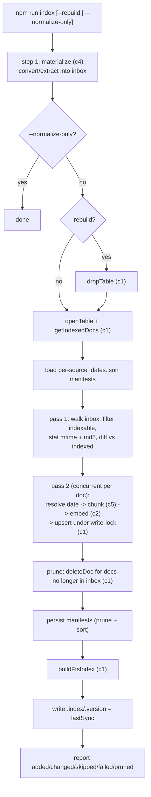
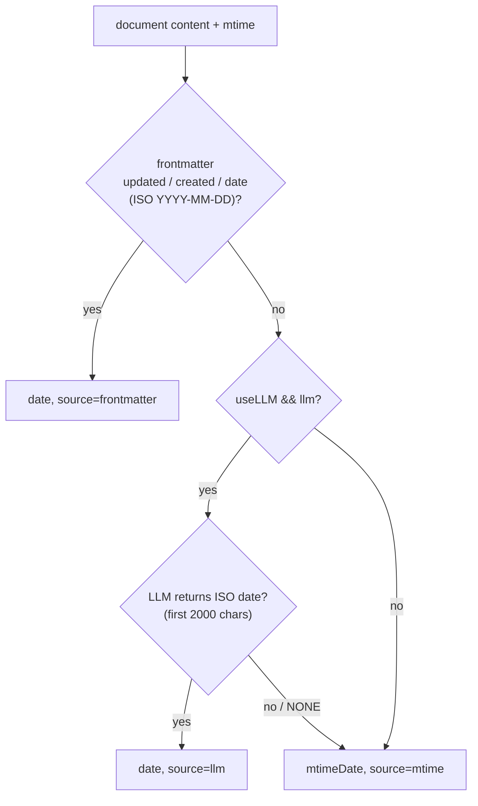
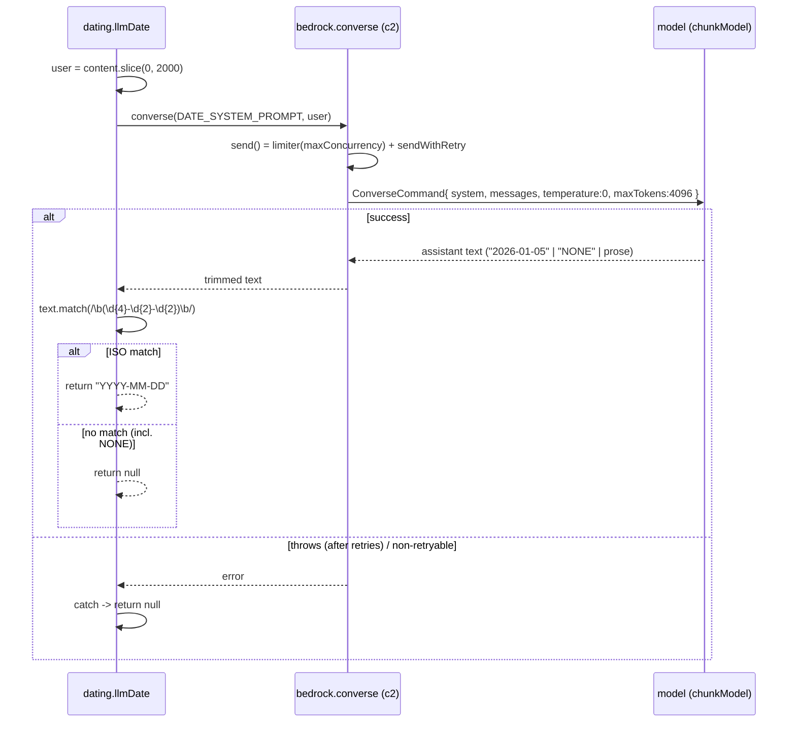

# Component 6 — Indexer / orchestration (incl. dating)

*The offline write-path conductor: one CLI run that normalizes sources, finds what changed, dates each document, chunks + embeds it, replaces it in the store, prunes deletions, rebuilds full-text search, and stamps a `.version` — plus the dating module it owns (frontmatter → LLM → mtime, cached per source).*

---

## 1. Purpose & scope

The indexer is the top-level offline pipeline. It doesn't do the heavy lifting
itself — it sequences the other write-path components in the right order, decides
which documents actually need work (incremental diff), and keeps the index a
faithful mirror of the inbox. It also owns **dating**: resolving each document's
one effective date and caching it per source so unchanged files never re-run the
LLM.

- **Plane:** platform (orchestration).
- **Runtime:** offline (write path) — the `npm run index` entry point.
- **Boundaries — owns:** the CLI (`--rebuild`, `--normalize-only`, default
  incremental), file enumeration + the indexability rule, change detection
  (mtime ±1s **and** md5), document concurrency + write serialization, deletion
  pruning, the FTS-refresh and `.version` steps, and the entire dating module
  (`resolveDate`, `resolveWithManifest`, `.dates.json` load/save/prune).
- **Boundaries — does NOT:** convert/extract source files (c4 `materialize`),
  split text (c5 `chunkDocument`), embed (c2 `bedrock.embed`), or implement store
  internals (c1 `upsertChunks`/`deleteDoc`/`buildFtsIndex`/`getStats`) — it calls
  all of these. The resolved date is metadata only; it is never written into
  chunk text.

**Diagram — the write-path pipeline (one `index` run):**

---

## 2. Inputs

Entry: `scripts/cli/index.mjs::main()`, run as `npm run index [-- <flags>]`.

| Input | From | Role |
|---|---|---|
| CLI flags | argv | `--rebuild` (drop + rebuild), `--normalize-only` (stop after c4) |
| `config` | `loadConfig()` (c3) | paths, source list, concurrency, dating toggle |
| env | `loadEnv(config.envPath)` (c3) | credentials for Bedrock (c2) |
| inbox files | produced by `materialize` (c4) earlier in the same run | the documents to index |
| LanceDB table | `openTable` (c1) | current index state (`getIndexedDocs`) |
| `.dates.json` per source | `loadManifest` (dating) | date cache keyed by md5 |

Config keys that shape the run:

| Key | Default | Role |
|---|---|---|
| `indexing.docConcurrency` | 6 | parallel documents in pass 2 (`mapLimit`) |
| `dates.extractViaLLM` | true | allow the LLM date step (else frontmatter → mtime only) |
| `inboxPath` | `<home>/inbox` | where indexable files live |
| `indexPath` | `<home>/.index` | where `.version` is written |
| `home` | config dir | base for the workspace-relative pointer (`../../..`) |
| `sources` | — | the set of valid source-type folders (keys) |

Preconditions: `config.yaml` present (c3 throws otherwise); Bedrock credentials
resolvable (`createBedrock`, c2). The inbox does not need to be pre-populated —
step 1 runs `materialize` (c4) to produce it.

---

## 3. Processing

### 3.1 Setup and mode

1. Parse flags. `loadConfig()` + `loadEnv()`.
2. **Step 1 — normalize.** `await materialize(config)` (c4) copies native text and
   extracts binaries into `inbox/<type>/`; logs `created/skipped/failed`. If
   `--normalize-only`, return here — nothing is embedded or indexed.
3. Build `bedrock` (c2) and the `llm = (system, user) => bedrock.converse(...)`
   closure passed to dating and chunking.
4. **Mode.** `--rebuild` → `dropTable` (c1) and start from an empty `indexed`
   map; otherwise `indexed = getIndexedDocs(table)` (docId → `{mtime,
   contentHash}`). `openTable(config, { create: true })` either way.
5. Load one date manifest per configured source type into `manifests`
   (sourceType → `{ dir, data }`).

### 3.2 Pass 1 — enumerate and diff

Walk the whole inbox (`walk`, c3) and decide per file:

- **Indexable?** `isIndexable` accepts a `_normalized.txt` sidecar or a native
  `.txt`/`.md`; everything else (originals like `.pdf`/`.docx`) is skipped — those
  are handled as sidecars by c4.
- **Under a configured source?** `sourceType` = first path segment; a file at the
  inbox root (no `/`) or under an unknown source type is ignored
  (`!rel.includes('/') || !config.sources[sourceType]`).
- Record `docId` (= inbox-relative path) into `currentDocIds`, and its
  manifest key (docId minus `"<sourceType>/"`) into `currentKeys`.
- `stat` → `mtime` (seconds = `mtimeMs/1000`); `md5` of the file bytes.
- **Skip-unchanged:** if a previous entry exists and `|prev.mtime - mtime| < 1`
  **and** `prev.contentHash === md5` → `skipped++`. Both must match.
- Otherwise compute `fileRel` — the **workspace-relative** openable pointer
  (`workspaceRoot = resolve(home, '../../..')`) stored in each chunk so an agent
  can open the source directly — and push `{filePath, fileRel, docId, sourceType,
  mtime, contentHash, isNew}` onto `toProcess`.

### 3.3 Pass 2 — date, chunk, embed, write (concurrent)

`mapLimit(toProcess, max(1, docConcurrency), …)` runs documents in parallel; a
single `createMutex()` (`writeLock`) serializes only the store writes:

1. Read file utf8; empty → `warn` + `failed++`, skip.
2. **Date** via `resolveWithManifest` (§3.5) → `{docDate, dateSource}`.
3. **Chunk** via `chunkDocument` (c5) with `fileRel`, dates, and `llm`. Zero
   chunks → warn, skip.
4. **Embed** all chunk texts in one `bedrock.embed(...)` call (c2).
5. `writeLock(() => upsertChunks(table, chunks, vectors))` (c1) — doc-level
   replace (delete-then-add). `isNew ? added++ : changed++`.
6. **Per-doc isolation:** the body is wrapped in try/catch — a failing document
   is logged and counted (`failed++`); the run continues.

### 3.4 Prune, persist, finalize

- **Prune deletions.** Re-read `getIndexedDocs`; any indexed `docId` **not** in
  `currentDocIds` → `deleteDoc(table, docId)` (`pruned++`). This drops chunks for
  source files that were removed, keeping the index a mirror of the inbox.
- **Persist manifests.** For each source, delete manifest entries whose key is no
  longer in `currentKeys`, then `saveManifest` — but only if the manifest is
  non-empty (sorted keys for stable git diffs).
- **Rebuild FTS.** `buildFtsIndex(table)` (c1).
- **Stamp version.** `getStats(table)` → log totals + per-source counts; write
  `stats.lastSync` to `<indexPath>/.version`. This is the last write of the run,
  so a reader that sees a new `.version` sees a fully built + FTS-indexed table —
  it is the hot-reload signal for Retrieval (c7).
- Fatal errors bubble to `main().catch` → log + `exit(1)`.

### 3.5 Dating (`ingest/dating.mjs`)

Every document gets exactly one effective date, resolved by priority and cached
per source. The date is **metadata only** — never written into chunk text.

**Resolution order (`resolveDate`):**

- **frontmatter** — `parseFrontmatter` reads a leading `---…\n---` block; prefers
  `updated`, then `created`, then `date`; value must contain `YYYY-MM-DD`.
  (Present on Atlassian-sourced docs, c4.)
- **LLM** — `DATE_SYSTEM_PROMPT` on the first 2000 chars; expects a bare
  `YYYY-MM-DD` or `NONE`; any parse/throw → null. Gated by `dates.extractViaLLM`.
  Full algorithm below.
- **mtime** — last resort: file modification time as `YYYY-MM-DD`.

#### LLM date extraction — detailed algorithm (`llmDate`)

Reached only when (a) frontmatter produced no ISO date, (b) `dates.extractViaLLM`
is true **and** an `llm` closure was injected, and (c) the manifest missed
(changed/new md5) — an unchanged file reuses its cached date and never calls the
model (§ manifest cache). Given those, `llmDate(content, llm)` runs:

Step by step:

1. **Truncate the input.** Only `content.slice(0, 2000)` is sent as the user
   message. The representative date is expected near the top (meeting header, spec
   version line, PDF first page); this also bounds cost/latency. A date that only
   appears after char 2000 is invisible to this step → it will fall through to
   mtime.
2. **System prompt = `DATE_SYSTEM_PROMPT`.** It pins the task ("the single most
   representative date: created, or the date it describes — meeting date for
   notes, version date for a spec") and the output contract: reply with **only**
   `YYYY-MM-DD`, or the exact word `NONE` when there is no clear date.
3. **Model call** via `bedrock.converse(system, user)` (c2):
   - `modelId = chunkModel` (default `openai.gpt-oss-120b-1:0`) — the same chat
     model used for chunking/enrichment; there is no separate "date model".
   - `temperature = 0`, `maxTokens = 4096` (`ConverseCommand`).
   - `send()` wraps the call in the shared concurrency limiter (`maxConcurrency`,
     default 8) and `sendWithRetry` (exponential backoff + jitter, up to 10
     retries on throttling/429/500/503/timeout; 90 s request timeout, 10 s
     connect). The assistant text parts are joined and `trim()`-ed.
4. **Parse defensively.** `String(out).match(ISO_DATE)` with
   `ISO_DATE = /\b(\d{4}-\d{2}-\d{2})\b/` extracts the **first** ISO-shaped date
   *anywhere* in the reply — so even if the model wraps the answer in prose, the
   date is salvaged. `NONE` (or any reply without an ISO date) yields no match →
   `null`.
5. **Never throws.** The body is wrapped in try/catch; any error surviving the
   retries (or a non-retryable one) returns `null` silently.
6. **Caller decision (`resolveDate`).** A non-null result becomes
   `{ date, source: 'llm' }`; `null` falls through to
   `{ date: mtimeDate(mtime), source: 'mtime' }`.

Consequences worth noting:

- **No calendar validation.** The regex accepts any `\d{4}-\d{2}-\d{2}` shape, so
  a malformed-but-ISO-shaped reply (e.g. `2026-13-40`) would pass through
  unchecked (see §6 open questions).
- **"Deterministic enough", then frozen.** `temperature: 0` makes the answer
  stable but not formally guaranteed identical across runs — which is exactly why
  the result is cached by md5 in the manifest and committed to git, so the whole
  team shares one frozen date per document.
- **First-match semantics.** If the model emits several dates, the *first* ISO
  match wins, not necessarily the most representative one.

**Manifest cache (`resolveWithManifest`).** The per-source
`inbox/<type>/.dates.json` maps `relPath → { date, date_source, md5 }`. On a
match (`cached.md5 === md5 && cached.date`) the cached date is reused with **no
LLM call**; otherwise the date is resolved fresh and written back. Because the
manifest is committed to git, teammates share identical dates for
non-deterministic (LLM-dated) sources. `loadManifest` tolerates a missing or
corrupt file (returns `{}`); `saveManifest` sorts keys.

### 3.6 Determinism & fallbacks

Enumeration, diff, prune, FTS refresh, and `.version` are fully deterministic.
LLM dating is non-deterministic but is cached by md5 (shared via git) and falls
back to mtime. Chunking/enrichment non-determinism lives in c5. Per-document
try/catch means one bad file never fails the whole run.

---

## 4. Outputs & state

- **Store writes (via c1):** `upsertChunks` (doc-level replace) for each changed
  document; `deleteDoc` for pruned ones; `buildFtsIndex` at the end.
- **`.dates.json`** per source (`inbox/<type>/`): the date cache — this
  component's own persistent state.
- **`.index/.version`**: a single timestamp (`stats.lastSync`), written last; the
  hot-reload trigger consumed by Retrieval (c7).
- **Logs:** progress + a final `added / changed / skipped / failed / pruned` line
  and per-source doc counts (to stderr via c3 `log`).
- **Exit code:** 0 on success, 1 on fatal error.
- **Handoff:** the populated, FTS-indexed LanceDB table plus a fresh `.version`
  are what Retrieval (c7) and the MCP server (c8) read at query time.

---

## 5. Dependencies

- **Upstream / calls:** c4 `materialize` (produces inbox), c3
  `config`/`env`/`concurrency` (`mapLimit`, `createMutex`)/`walk`/`log`, c2
  `createBedrock` (`embed` + `converse`), c5 `chunkDocument`, c1
  `openTable`/`dropTable`/`getIndexedDocs`/`upsertChunks`/`deleteDoc`/`buildFtsIndex`/`getStats`,
  and its own dating module.
- **Downstream:** Retrieval (c7) and MCP (c8) consume the table + `.version`.
- **External:** filesystem (inbox, `.index`, manifests), AWS Bedrock (via c2).

---

## 6. Behavioral notes & open questions

As-is invariants:

- **Change detection needs both signals** — mtime within 1s **and** equal md5 —
  or the document is reprocessed. mtime is stored in seconds; sub-second jitter
  is tolerated by the `< 1` window.
- **The index mirrors the inbox.** Doc-level replace on change + prune of missing
  docs means no orphan chunks and no stale duplicates.
- **Writes are serialized; work is parallel.** Chunk + embed run at
  `docConcurrency`; only `upsertChunks` is inside the mutex.
- **`.version` is written last**, after FTS — so its appearance guarantees a
  complete index to any hot-reloading reader (c7).
- **Dates are metadata, never text.** They flow into chunk records (c5 passthrough
  → c1 columns) but never alter what gets embedded.
- **`--rebuild` re-embeds but reuses date cache.** The table is dropped (all docs
  reprocessed), yet manifests are still loaded, so unchanged-content files hit the
  md5 cache and skip the LLM date call.
- **`--normalize-only` stops after c4** — conversion without indexing.

Edge cases / quirks:

- Files at the inbox root or under an unconfigured source type are silently
  ignored; only `<sourceType>/<...>` paths index.
- A manifest is written only when non-empty; a source with no dated files leaves
  no `.dates.json`.
- Originals (`.pdf`/`.docx`) are never indexed directly — only their
  `_normalized.txt` sidecars (the `isIndexable` rule).

Open questions (current system only):

- `buildFtsIndex` runs on **every** incremental pass, even with zero changes —
  confirm whether it is a full rebuild each time and its cost on large tables (the
  mechanics live in c1).
- `getStats().lastSync` is the **max `indexed_at`** across all chunks (confirmed
  in `store.mjs`; ISO strings compared lexically) — this is the literal `.version`
  value and the hot-reload key read by Retrieval (c7).
- After `--rebuild`, prune re-reads `getIndexedDocs` and should find
  `currentDocIds ⊇ allIndexed`, making prune a no-op — confirm no window where a
  concurrent write makes that untrue.
- LLM date parsing does no **calendar validation** — `ISO_DATE` accepts any
  `\d{4}-\d{2}-\d{2}`, so an impossible date (`2026-13-40`) or a hallucinated one
  could be cached. Confirm whether a real-date check is wanted, or whether the
  frontmatter/mtime fallbacks make this acceptable in practice.

---

## 7. Source map

| File | What it holds |
|---|---|
| `scripts/cli/index.mjs` | The orchestrator: flag parsing + modes, `isIndexable`/`md5`/`manifestKey`, `materialize` call, table open/drop, pass 1 (enumerate + diff), pass 2 (`mapLimit` date→chunk→embed→`writeLock`+upsert), prune, manifest persistence, `buildFtsIndex`, `.version` write, fatal handler |
| `scripts/ingest/dating.mjs` | Dating: `parseFrontmatter`, `frontmatterDate`, `llmDate` (+ `DATE_SYSTEM_PROMPT`), `mtimeDate`, `resolveDate`; per-source manifest `manifestPath`/`loadManifest`/`saveManifest`/`resolveWithManifest` (md5 cache) |
