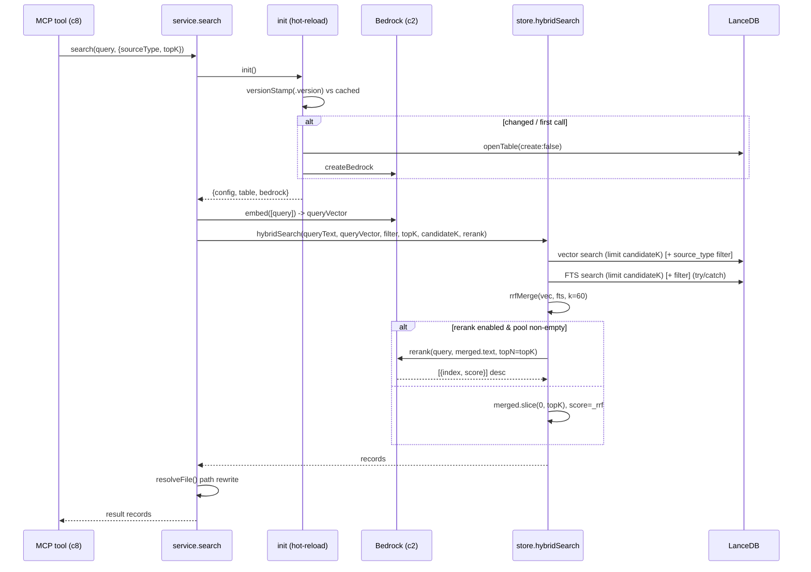

# Component 7 — Retrieval

*The online read path: turn a query string into ranked chunk records — embed the query, run vector + full-text search in parallel, fuse them with Reciprocal Rank Fusion, optionally rerank via Bedrock, and rewrite paths so hits are openable. Includes lazy singletons and `.version` hot-reload so a rebuild is picked up without a restart.*

---

## 1. Purpose & scope

Retrieval answers a query against the built index. It embeds the query, asks the
store for two candidate lists (semantic ANN + lexical FTS), fuses them with RRF,
optionally reranks the fused pool with a cross-encoder, trims to `topK`, and
normalizes each hit into a stable record an agent can act on. It also holds the
lazy-initialized singletons (table + Bedrock client) and re-checks the index
`.version` on every call.

- **Plane:** retrieval.
- **Runtime:** online (read path) — invoked per query by the MCP tools (c8).
- **Boundaries — owns:** the service facade (`search`, `listSources`,
  `indexStats`, `reset`), lazy init + `.version` hot-reload, query embedding,
  `topK`/`candidateK` sizing, the hybrid algorithm (`hybridSearch`), RRF
  (`rrfMerge`), the rerank branch, the pre-ranking `source_type` filter, score
  rounding, and openable-path rewriting.
- **Boundaries — does NOT:** own the model (c2 — it calls `bedrock.embed` /
  `bedrock.rerank`), own store schema/upsert/stats mechanics (c1 — it reuses
  `openTable`/`getStats`; `hybridSearch`/`rrfMerge` live in the same file but are
  the retrieval seam), implement the MCP transport or tool schema (c8), or ever
  write to the table (**read-only**).

**Diagram — one `search()` call:**



---

## 2. Inputs

Entry points (`retrieval/service.mjs`): `search(query, { sourceType, topK })`,
`listSources()`, `indexStats()`, `reset()`.

| Input | Shape | Role |
|---|---|---|
| `query` | string | the search text (embedded **and** used as FTS query text) |
| `sourceType` | `string[]` \| string \| `null` | pre-ranking category filter (MCP passes an array) |
| `topK` | number \| `null` | requested result count (falls back to config) |

Config keys that shape a query:

| Key | Default | Role |
|---|---|---|
| `retrieval.topK` | 5 | default result count when caller passes none |
| `retrieval.candidateMultiplier` | 4 | candidate pool = `topK × this` per list |
| `retrieval.rerankEnabled` | true | run the Bedrock reranker over the fused pool |
| `bedrock.embedDim` | 1024 | table vector dim (via `openTable`) |
| `indexPath` | `<home>/.index` | location of the table **and** `.version` stamp |
| `home` | config dir | base for openable-path rewriting (`../../..`) |

Preconditions: a built index must exist — `openTable(config, { create: false })`
returns `null` for a missing table, which `init` turns into a thrown
`"Index is empty…"`. Bedrock credentials must resolve (c2). The `.version` file
is optional (absent → empty stamp).

---

## 3. Processing

### 3.1 Lazy init + `.version` hot-reload (`init`)

Two module-level singletons: `state = { config, table, bedrock }` and
`indexVersion`. Every entry point calls `init()` first:

1. `loadConfig()` (cheap) and `current = versionStamp(config)` — read
   `<indexPath>/.version` (trimmed) or `''` if absent.
2. If `state` exists **and** `current === indexVersion` → return the cached state
   (fast path; no I/O beyond the stamp read).
3. Otherwise (first call **or** the stamp changed) dynamically import
   `store.mjs` + `bedrock.mjs`, `createBedrock`, and `openTable(create:false)`;
   `null` → throw `"Index is empty…"`. Cache `state` and `indexVersion`.

Because the indexer (c6) writes `.version` **last**, a completed rebuild flips the
stamp and the next query transparently reopens the table — hot reload, no
restart. Heavy resources are built on first use so the server starts in well
under a second.

### 3.2 `search()` — orchestration

1. `init()`.
2. `k = clamp(topK ?? config.retrieval.topK, 1, 20)`;
   `candidateK = k × config.retrieval.candidateMultiplier` (default 4).
3. `queryVector = (await bedrock.embed([query]))[0]` (c2).
4. `hybridSearch({ table, bedrock, queryText: query, queryVector, sourceType,
   topK: k, candidateK, rerank: config.retrieval.rerankEnabled })`.
5. Rewrite each `file` (§3.5) and normalize into the result record shape (§4).

### 3.3 `hybridSearch()` — the core algorithm

1. **Normalize the filter.** `sourceType` (array | string | null) → a trimmed,
   non-empty `types[]`. `where = source_type IN ('a','b', …)` (values escaped via
   `esc` = single-quote doubling) or `null`. The filter is applied **pre-ranking**
   to *both* candidate queries, so narrowing categories shrinks the pool before
   the expensive rerank.
2. **Vector candidates.** `table.search(queryVector, 'vector')
   .select(RESULT_COLUMNS).limit(candidateK)` (+ `where`) → `vec[]` (semantic
   nearest neighbours).
3. **FTS candidates.** `table.search(queryText, 'fts').…limit(candidateK)`
   (+ `where`) → `fts[]`, wrapped in try/catch: if the FTS index isn't ready the
   error is logged and `fts = []` — the query **degrades to vector-only** rather
   than failing.
4. **Fuse.** `rrfMerge(vec, fts)` (§3.4).
5. **Rerank branch.**
   - If `rerank && bedrock && merged.length > 0`:
     `bedrock.rerank(queryText, merged.map(r => r.text), { topN: topK })` returns
     `[{ index, score }]` sorted desc; map back to `merged[index]` with
     `score = round(score)`. The final order is the **reranker's**, and `score` is
     its relevance.
   - Else: `merged.slice(0, topK)` with `score = round(_rrf)` — the **RRF** order
     and score.

### 3.4 Reciprocal Rank Fusion (`rrfMerge`, k = 60)

For each list (vector, then FTS), walk rows by rank `r` (0-based) and accumulate
`score[chunk_id] += 1 / (k + r + 1)`; keep the first-seen row object per id. Sort
ids by summed score descending and attach `_rrf`.

- A chunk that ranks well in **both** lists collects both contributions and rises
  to the top; a chunk in only one list still competes on its single contribution.
- The constant `k = 60` dampens rank dominance so the very top of one list can't
  automatically swamp broad agreement across both. It is rank-based, so the raw
  (incomparable) cosine-distance and BM25 scores never need to be reconciled.

**Example** (small candidate lists for illustration; `1/(60 + rank + 1)`):

```text
vector list (rank):  c12(0), c07(1), c33(2)
FTS list (rank):     c07(0), c99(1), c12(2)

c07 = 1/62 + 1/61 = 0.01613 + 0.01639 = 0.03252   (in both lists -> wins)
c12 = 1/61 + 1/63 = 0.01639 + 0.01587 = 0.03226   (in both lists)
c99 = 1/62                            = 0.01613   (FTS only)
c33 = 1/63                            = 0.01587   (vector only)

fused order: c07, c12, c99, c33
```

Note `c99` (FTS rank 1) edges out `c33` (vector rank 2): a better single-list
rank beats a worse single-list rank, while agreement across both lists (c07, c12)
dominates either.

### 3.5 Openable-path rewriting (`resolveFile`)

Chunks store a `file` pointer. `workspaceRoot = resolve(home, '../../..')` and
`homePrefix = relative(workspaceRoot, home)` (i.e.
`.cursor/.project/project-context`). For each hit:

- empty or absolute → returned as-is;
- already workspace-relative (starts with `homePrefix + '/'`, `.cursor/`, or
  `.project/`) → as-is;
- otherwise (a legacy inbox-relative path) → prefixed with `homePrefix + '/'`.

Documents indexed by the current c6 already store a workspace-relative `fileRel`,
so this mainly repairs older indexes.

### 3.6 Determinism & fallbacks

Vector + FTS candidate retrieval and RRF are deterministic given a fixed index.
The reranker is a model call (non-deterministic-leaning) and is optional — off by
config or skipped on an empty pool. FTS failure silently degrades to vector-only.
The `.version` check may reopen the table between calls. Retrieval never writes.

---

## 4. Outputs & state

- **`search` →** an array of records, each:
  `{ text, file, lines, title, source_type, date (= doc_date), date_source,
  chunk_index, chunk_total, score }`.
- **`listSources` →** `{ sources: {type: docCount}, last_sync }`.
- **`indexStats` →** `{ total_chunks, source_counts, last_sync }`.
  (`last_sync` = `getStats().lastSync` = the max `indexed_at` across chunks — the
  same value the indexer stamps into `.version`; resolves the c6 open question.)
- **State owned:** in-memory singletons only (`state`, `indexVersion`). No files
  are written — retrieval is read-only. `reset()` clears them (tests).
- **Handoff:** records are returned to the MCP tools (c8), which serialize them to
  the calling agent.

---

## 5. Dependencies

- **Upstream / calls:** c3 `loadConfig`/`log`; c1 `openTable`/`getStats` (and the
  shared `store.mjs` housing `hybridSearch`/`rrfMerge`); c2 `createBedrock`
  (`embed` for the query, `rerank` for the pool).
- **Downstream:** the MCP server (c8) — `search` / `list_sources` /
  `index_stats` map onto these three functions.
- **External:** LanceDB (vector ANN + FTS search), AWS Bedrock, filesystem
  (`.version`, table dir).

---

## 6. Behavioral notes & open questions

As-is invariants:

- **Read-only.** No entry point mutates the table.
- **Pre-ranking filter.** `source_type` narrowing runs on both candidate queries,
  before RRF and rerank — cheaper and it shapes what the reranker sees.
- **Wider pool than needed.** `candidateK = topK × multiplier` (default 4×) per
  list gives RRF and the reranker material to work with; the cut to `topK` happens
  only at the end.
- **`topK` is clamped to 1..20** regardless of caller/config.
- **FTS is best-effort.** A missing/unbuilt FTS index degrades the call to
  vector-only instead of erroring.
- **Hot reload every call.** The `.version` stamp is compared on each entry;
  changing it (a finished rebuild) reopens the table without a restart.
- **Two scoring regimes.** With rerank on, order + `score` come from the reranker;
  with it off, from RRF (`_rrf`). Scores from the two regimes are not comparable.

Edge cases / quirks:

- Empty index → `init` throws `"Index is empty…"`; the message is surfaced to the
  agent.
- `sourceType` as an empty array → no filter (whole index searched).
- Filter values are escaped (`''`), but are interpolated into the `IN (...)`
  predicate string rather than parameterized.
- RRF dedupes by `chunk_id` (first-seen row wins); a chunk present in both lists
  appears once with the summed score.
- Result `date` is the *document* effective date (`doc_date`), not `indexed_at`.

Open questions (current system only):

- Whether vector search hits a real **ANN index** or brute-forces the table
  affects recall/latency at scale (cross-refs the c1 open question on implicit vs
  explicit ANN index creation).
- The reranker receives up to `|vec| + |fts|` distinct fused candidates (up to
  ~`2 × candidateK`). Confirm the provider's max-document limit and that no
  silent truncation occurs before rerank.
- **No relevance floor.** `search` always returns up to `topK` even when the best
  match is weak; confirm whether a minimum-score cutoff is desired.
- Path rewriting assumes `home` sits exactly three levels below the workspace
  root; a different deploy layout would change `homePrefix`.

---

## 7. Source map

| File | What it holds (retrieval seam) |
|---|---|
| `scripts/retrieval/service.mjs` | Lazy singletons + `.version` hot-reload (`init`, `versionStamp`); `search` (query embed, `k`/`candidateK` sizing, `resolveFile` path rewrite, record shaping); `listSources`; `indexStats`; `reset` |
| `scripts/retrieval/store.mjs` *(shared with c1)* | `hybridSearch` (filter normalize, vector + FTS candidate queries, rerank branch), `rrfMerge` (RRF, k=60), `round`, `RESULT_COLUMNS`. Schema / upsert / stats for this file are documented in c1. |
