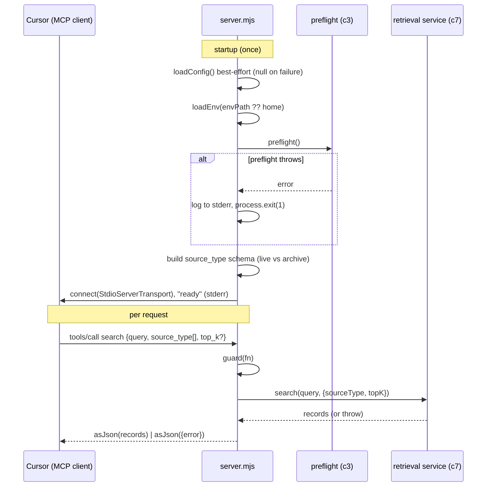
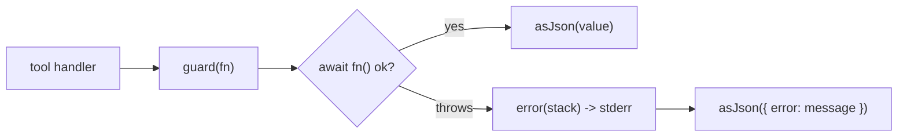

# Component 8 — MCP interface

*The online boundary that exposes retrieval to Cursor over an MCP stdio server: three tools (`search`, `list_sources`, `index_stats`), a `source_type` schema built from the project's own sources that makes scoping mandatory and archives opt-in, and a guard that returns every error as data so the server never crashes on a bad call.*

---

## 1. Purpose & scope

This is the process an MCP client (Cursor) launches and talks to over stdio. It
boots (best-effort config, env, a preflight credentials gate), registers three
tools, shapes their input schemas — most importantly the required, enum-typed
`source_type` filter — and delegates each call to the retrieval service (c7),
wrapping the result (or error) in a JSON envelope.

- **Plane:** interface.
- **Runtime:** online (read path) — a long-lived server, one tool call per query.
- **Boundaries — owns:** process bootstrap (`loadConfig` best-effort, `loadEnv`,
  `preflight` gate), the `McpServer` + `StdioServerTransport`, the three
  `registerTool` definitions and their `zod` schemas (including the dynamic
  `source_type` enum with the archive opt-in guidance), the `guard()` error
  envelope, and `asJson()` formatting.
- **Boundaries — does NOT:** search, rank, or rerank (c7 — it calls
  `search`/`listSources`/`indexStats`), touch the model or store directly
  (c2/c1, via c7), define the source list (c3 config), or own the client-side
  agent policy / skill / `mcp.json` (c9). It keeps no state of its own beyond what
  c7 caches.

**Diagram — startup and one tool call:**

---

## 2. Inputs

Launched as `npm run mcp` (= `node scripts/mcp/server.mjs`), wired into Cursor via
`.cursor/mcp.json` (c9).

**Startup inputs**

| Input | From | Role |
|---|---|---|
| config | `loadConfig()` in try/catch → config \| `null` | source list, `envPath`, default `topK` |
| env | `loadEnv(config?.envPath ?? resolveHome())` | credentials for Bedrock (via c7/c2) |
| preflight | `preflight()` (c3) | hard credentials gate — throw ⇒ `exit(1)` |

**Per-tool inputs** (JSON-RPC over stdio)

| Tool | Input schema |
|---|---|
| `search` | `query: string` (required); `source_type` (required, **non-empty array**; `enum` of `config.sources` when config present, else free strings); `top_k?: int 1..20` |
| `list_sources` | `{}` |
| `index_stats` | `{}` |

Config keys used: `config.sources` (→ enum + live/archive split), `retrieval.topK`
(→ `defaultTopK` in the `top_k` description), `envPath`. Preconditions: preflight
must pass; config is **optional** (missing config → free-form filter + default
`topK` 5). Index existence is enforced downstream by c7 (a throw becomes an
`{error}` result, not a crash).

---

## 3. Processing

### 3.1 Bootstrap (module top level, once per process)

1. `loadConfig()` wrapped in try/catch → `config` or `null`. A fresh checkout or
   the smoke test with no `config.yaml` is tolerated.
2. `loadEnv(config?.envPath ?? resolveHome())` (c3).
3. `preflight()` (c3) in try/catch — on throw, `error(msg)` to stderr and
   `process.exit(1)`. This is the one hard startup gate.
4. Derive `sourceNames = Object.keys(config.sources)` (or `[]`), `defaultTopK`,
   and split names into `liveNames` (name **not** matching `/archive/i`) and
   `archiveNames` (matching `/archive/i`).
5. Build `sourceFilter` (§3.4) and `new McpServer({ name: 'project-context',
   version: '0.1.0' })`.

### 3.2 Tool registration

Three tools via `server.registerTool(name, def, handler)`:

- **`search`** — `inputSchema { query, source_type: sourceFilter, top_k? }`;
  handler `guard(() => search(query, { sourceType: source_type, topK: top_k ?? null }))`.
- **`list_sources`** — `inputSchema {}`; `guard(() => listSources())`. (Use before
  filtering or when results look empty.)
- **`index_stats`** — `inputSchema {}`; `guard(() => indexStats())`. (Index health.)

### 3.3 Error envelope (`guard` / `asJson`)

- `asJson(value)` → `{ content: [{ type: 'text', text: JSON.stringify(value, null,
  2) }] }` — every tool returns pretty-printed JSON text.
- `guard(fn)` runs the handler; on throw it logs the stack to **stderr** and
  returns `asJson({ error })`. So a failure (e.g. c7's `"Index is empty…"`) comes
  back as an ordinary tool result the agent can read — **not** a protocol error,
  and the server stays up.

### 3.4 The `source_type` schema — mandatory scope + archive opt-in

This is where interface-level policy is encoded:

- **When config exists:** `z.array(z.enum(sourceNames)).nonempty()` — the filter
  is a **required, non-empty** array of known categories. An unscoped search is
  therefore impossible by schema.
- **Broad search = list all live categories explicitly.** The `.describe(...)`
  tells the model to pick the smallest set that could hold the answer, and to
  search broadly by passing `[liveNames…]` rather than omitting the filter.
- **Archive is opt-in.** `archiveNames` (e.g. `openspec_archive`) are excluded
  from the "broad" set; the description says to include them **only** for
  historical rationale, never for current scope/status/approvals. They are only
  searched when named explicitly.
- **When no config:** falls back to `z.array(z.string()).nonempty()` — still
  required and non-empty, just without the enum/guidance.

The schema only *shapes intent*; the actual filtering is c7's pre-ranking
`source_type IN (...)`.

### 3.5 Transport & lifecycle

`StdioServerTransport`; `await server.connect(transport)`. **stdout is the
JSON-RPC channel**, so all logging goes to **stderr** via c3 `log`/`error` —
including the final `"project-context MCP server ready (stdio)."` readiness line —
and never corrupts the protocol. The process is long-lived; each call flows into
c7, which lazily initializes and hot-reloads on `.version`.

### 3.6 Determinism & fallbacks

Missing config degrades the schema to free-form strings + default `topK` 5, but
the server still runs. `preflight` failure is fatal (`exit 1`). Per-call errors
are caught by `guard` and returned as data — a bad request never brings the
server down.

---

## 4. Outputs & state

- **Tool results** (all via `asJson`):
  - `search` → an array of retrieval records (c7 shape: `text`, `file`, `lines`,
    `title`, `source_type`, `date`, `date_source`, `chunk_index`, `chunk_total`,
    `score`).
  - `list_sources` → `{ sources: {type: count}, last_sync }`.
  - `index_stats` → `{ total_chunks, source_counts, last_sync }`.
  - any failure → `{ error: <message> }`.
- **stderr:** error logs + the readiness line.
- **State:** none of its own — stateless; the cached table/Bedrock singletons live
  in c7. Process lifetime = the server.
- **Handoff:** results go to the Cursor agent; how the agent *uses* them (authority
  ranking, when to search) is c9.

---

## 5. Dependencies

- **Upstream / calls:** c7 service (`search`/`listSources`/`indexStats`); c3
  `loadConfig`/`resolveHome`/`loadEnv`/`preflight`/`log`; the MCP SDK
  (`McpServer`, `StdioServerTransport`); `zod` for input schemas.
- **Downstream:** the Cursor MCP client / agent (policy in c9).
- **External:** the MCP SDK + stdio pipe to Cursor; transitively Bedrock + LanceDB
  through c7.

---

## 6. Behavioral notes & open questions

As-is invariants:

- **Exactly three tools:** `search`, `list_sources`, `index_stats`.
- **Scoping is mandatory.** `source_type` is required and non-empty — the schema
  makes an unscoped search impossible.
- **Archives are opt-in.** Names matching `/archive/i` are excluded from the broad
  set and must be requested explicitly.
- **Errors are data.** `guard` converts any throw into an `{error}` tool result;
  the server never crashes on a bad call.
- **stdout is protocol-only.** All logs go to stderr (c3), so JSON-RPC framing is
  never corrupted.
- **Config is best-effort at boot.** No config → free-form filter + default
  `topK` 5; the server still starts.
- **`preflight` is the one fatal gate** (besides SDK/transport failure).

Edge cases / quirks:

- Fresh checkout without `config.yaml` → `sourceNames = []` → free-form array
  filter, no enum guidance.
- `top_k` omitted → `null` → c7 uses `config.topK` (schema caps at 20; c7 also
  clamps 1..20).
- No archive sources → the description renders `none`.
- Empty index → c7 throws → surfaced as `{error: "Index is empty…"}` (not a crash).

Open questions (current system only):

- The `source_type` **enum is frozen at process start** from config. Adding a new
  source type needs a server restart to appear in the schema — c7's `.version`
  hot-reload refreshes data, not the tool schema. Confirm this is intended.
- `zod` validation of `source_type` happens in the SDK **before** the handler, so
  an out-of-enum value is rejected as an SDK/validation error, not through
  `guard`'s `{error}` envelope. Confirm the client-visible shape of that case.
- Archive detection is a substring regex (`/archive/i`) on the source **name**, so
  any source with "archive" in its name is treated as archival. Confirm the naming
  convention this relies on.

---

## 7. Source map

| File | What it holds |
|---|---|
| `scripts/mcp/server.mjs` | The entire component: bootstrap (`loadConfig` best-effort, `loadEnv`, `preflight` gate), `source_type` schema builder (live/archive split + guidance), `McpServer` + three `registerTool` calls, `guard`/`asJson` envelope, `StdioServerTransport` connect + readiness log |
