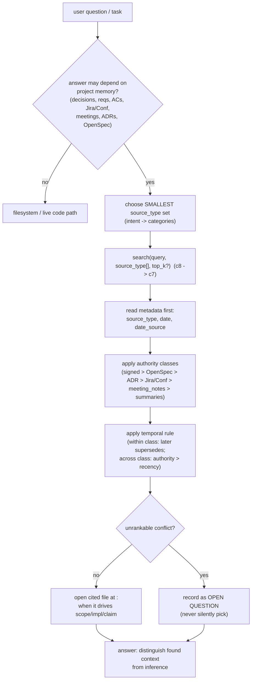

# Component 9 — Agent policy (consumer)

*The Cursor-side layer that governs how an agent uses the engine: when to query project-context, how to scope every search, and — crucially — how much to trust a hit. Retrieval ranks by similarity only; this policy adds the binding authority + temporal contract on top. It is the skill, the MCP wiring, and the refresh commands — instructions and config, not engine code.*

---

## 1. Purpose & scope

The engine (c1–c8) finds and returns semantically similar excerpts. It assigns no
authority and makes no decision about when a search is warranted. Component 9 is
where that judgement lives: a Cursor **skill** that tells the agent when to
search, how to scope, and how to weigh results by authority and recency; the
**`mcp.json`** that launches the server; and the **slash commands** that refresh
the index.

- **Plane:** interface (consumer).
- **Runtime:** online (read path) — applied at agent-time, per question.
- **Boundaries — owns:** the retrieval usage contract (when to search,
  source-lookup-first), category-selection guidance, the **binding Source
  Authority & Temporal ranking contract**, legacy-doc handling, tool-usage
  patterns, the MCP client wiring, and the refresh/reindex commands.
- **Boundaries — does NOT:** rank or score results (that is c7's semantic
  similarity — the policy explicitly treats a hit as a *lead, not a verdict*),
  serve or index (c1–c8), or enforce anything at runtime. Its only *hard*
  enforcement is delegated to c8's schema (required `source_type`); everything
  else is a contract the agent is instructed to follow.

**Diagram — the agent decision loop:**

---

## 2. Inputs

This component is markdown + config consumed by Cursor, not a running module.

**To the policy (agent-time):**

| Input | From | Role |
|---|---|---|
| user question / task | the user | triggers the "do I need project memory?" decision |
| result records | c8 `search` | carry `source_type`, `date`, `date_source`, `file`, `lines`, … |
| index health | c8 `list_sources` / `index_stats` | source list, counts, `last_sync` |

**Wiring inputs:**

| Input | Contents |
|---|---|
| `mcp.json` | registers server `project-context`: `command: node`, `args: [${workspaceFolder}/.cursor/.project/project-context/scripts/mcp/server.mjs]`, `env.PROJECT_CONTEXT_HOME = ${workspaceFolder}/.cursor/.project/project-context` |
| `SKILL.md` front-matter | `name` + `description` — how Cursor auto-selects the skill |

Preconditions: the MCP server is registered (`mcp.json`) and the skill is
available; an index exists (else c8 surfaces `"Index is empty…"`); for a refresh,
`.cursor` is a git repo and Atlassian/Bedrock creds are present.

---

## 3. Processing (the policy)

### 3.1 When to search, and search first

Use project-context when an answer may depend on knowledge outside the current
source files: before explaining *why* something was designed/decided; before
planning work that may already have requirements/ACs/proposals; whenever the user
mentions Jira, Confluence, meetings, ADRs, OpenSpec, specs, requirements,
decisions, or ACs; and whenever you would otherwise infer business context from
code alone.

**Source Lookup Contract:** for business / source-of-truth questions, query
project-context **first** — *not* filesystem grep. Use it to find the cited source
and line range, then open the file only when exact wording matters. Filesystem
search is appropriate *after* project-context has identified a source, or for live
code the engine does not index (implementation files, routes, components,
cartridges, tests).

### 3.2 Choosing categories (`source_type` is REQUIRED)

Pick the **smallest** set of categories that could hold the answer — tight scope
sharpens results and shrinks the candidate pool before rerank. Map intent →
categories:

| Intent | Categories |
|---|---|
| Why decided / rationale | `["meeting_notes", "confluence", "adrs"]` |
| Current requirements / ACs / scope | `["confluence", "jira", "specs"]` |
| Ticket state, comments, estimates | `["jira"]` |
| Current expected behavior of a capability | `["specs", "confluence"]` |
| Durable architecture decisions | `["adrs"]` |
| What the client said in a workshop | `["meeting_notes"]` |
| Historical rationale from a COMPLETED change | `["openspec_archive"]` |

Rules: can't omit the filter and must not guess one type — for a broad search pass
**all live categories explicitly** (`["meeting_notes","confluence","jira","specs","adrs"]`),
then narrow. **Archive is opt-in** (`openspec_archive` only when listed, history
only). Don't invent values; call `list_sources` if unsure.

### 3.3 Source buckets (what each holds)

- **`meeting_notes`** — curated, hand-authored transcripts/notes (workshops,
  discovery, tech calls), shared via git. A curated subset, not a system mirror.
  PROVISIONAL.
- **`confluence`** — a full mirror of the configured space(s): every current page
  + footer comments; refreshed on sync, deleted pages drop out. The reconciled
  project docs (requirements, designs, FSD/ISD). May contain **legacy reference**.
- **`jira`** — issues from configured project(s) (subset by keys + optional JQL),
  with comments + status; incremental on sync.
- **`specs`** — the current OpenSpec capability specs (`openspec/specs/**/spec.md`),
  read-only mirror: "what the system should do now."
- **`openspec_archive`** — historical rationale from completed changes
  (`proposal.md`, `design.md`, `technical-design.md`); delta `spec.md` excluded.
  Opt-in, history only.
- **`adrs`** — durable Architecture Decision Records (the *why*).

### 3.4 Source Authority & Temporal ranking (BINDING)

Retrieval ranks by semantic similarity, **not** authority or recency — so a
result is a lead, not a verdict. Before using any retrieved fact to state scope, a
decision, or a status, apply this contract (binding):

1. **Read metadata first** — `source_type`, `date`, `date_source` — on every
   result.
2. **Authority classes** (high → low): (1) Signed/approved docs (SRD, BRD,
   contracts; an approved tracker requirement); (2) Reconciled OpenSpec artifacts
   (`discovery`, `design`, `specs`) + dispositions; (3) ADRs; (4) Jira/Confluence
   status + ticket state; (5) `meeting_notes` / workshop transcripts —
   PROVISIONAL; (6) derived summaries / indexes — orientation only, **not** a
   source.
3. **Provenance rule** — a lower class never establishes scope/sign-off/settled
   decision alone; a `meeting_notes` remark is a CANDIDATE until a higher class
   ratifies it. Restating it as settled is *fabrication of authority*.
4. **Temporal rule** — within a class, a later `date` supersedes an earlier one
   (surface the supersede, don't merge). Across classes, **authority wins over
   recency** — a newer low-class remark doesn't override an older signed fact;
   raise the conflict. Trust `date_source` in order `frontmatter > llm > mtime`;
   an `mtime` date is a filesystem artifact, not an authored date, so it must not
   drive a supersede.
5. **Downstream rule** — a reconciled upstream artifact's disposition governs an
   item's STATUS downstream; a raw lower-class source may add DETAIL but may not
   re-open, re-scope, or resurrect what the upstream deferred/left unsigned.
6. **Unrankable conflict** — when neither authority nor date breaks a tie, record
   an open question; never silently pick one.

### 3.5 Legacy documentation (reference only)

Project-context also carries **legacy reference** docs describing the *previous*
storefront (imported to explain old behavior). They are **never** a source of
truth — lowest authority ("orientation only") — and are double-marked so neither
retrieval nor a reader confuses them with current docs: (1) filename
`legacy-<name>.gitkeep.md`, and (2) a `⚠️ LEGACY REFERENCE — NOT A SOURCE OF
TRUTH` banner at the top. Use only as background; always label as legacy when
citing.

### 3.6 Usage pattern

1. One specific `search`, scoped to the smallest category set.
2. Read excerpts **and dates**.
3. Open cited files when the answer drives implementation, scope, or a
   user-facing claim (cite the precise `<file>:<lines>` anchor).
4. For synthesis, run 2–3 focused searches varying **both** query and categories,
   not one broad search.
5. If results are empty or suspiciously stale, call `list_sources` /
   `index_stats` and tell the user the index may need a sync.

Always distinguish found context from inference; if the MCP returned no evidence
for a claim, say so rather than presenting it as documented.

### 3.7 Wiring & refresh commands

- **`mcp.json`** launches c8: Cursor runs `node …/scripts/mcp/server.mjs` with
  `PROJECT_CONTEXT_HOME` set, so config/inbox/index resolve to the in-workspace
  engine.
- **`/project-context:sync`** (`commands/project-context.md`) — refresh local
  memory in order, stop on first failure: **Stage 1** pull committed docs
  (`.cursor` git — `meeting_notes/`, `adrs/`), **Stage 2** sync Confluence + Jira
  (`npm run sync -- --no-index`, invoking c4), **Stage 3** reindex (`npm run
  index`, invoking c6; `--rebuild` for a clean pass), **Stage 4** verify via
  `index_stats`. The server re-reads `.version` per call, so no restart is needed
  (c7 hot-reload). Never reads/commits `.env`; local state only.
- **`/project-sync`** (`commands/project-sync.md`) — a broader preflight that pulls
  tooling, installs `.cursor`-root Node deps, refreshes the OpenSpec schema/config,
  then runs the same project-context sync + reindex.

### 3.8 Determinism & enforcement

The policy is a natural-language contract the agent is asked to follow; the only
**runtime-enforced** part is c8's required, non-empty `source_type` schema. The
authority/temporal weighting, the search-first discipline, and the legacy handling
depend on the agent honoring the skill.

---

## 4. Outputs & state

- **Outputs (agent behavior):** scoped searches; answers grounded in cited
  excerpts with `<file>:<lines>` anchors; conclusions weighted by authority +
  recency; conflicts surfaced as open questions rather than silently resolved;
  "index may need a sync" prompts when results are empty/stale. When citing inside
  OpenSpec artifacts, the precise anchor is used
  (e.g. `.cursor/.project/project-context/inbox/meeting_notes/discovery-workshop.md:12-28`).
- **State:** none of its own — this component is instructions + wiring. The refresh
  commands do mutate engine state (`inbox/`, `.index/`), but by invoking c4/c6, not
  by holding state here.
- **Handoff:** a grounded answer to the user, or cited context written into
  OpenSpec artifacts.

---

## 5. Dependencies

- **Consumes:** c8 tools (`search`, `list_sources`, `index_stats`) → c7 → c1/c2;
  `mcp.json` launches c8; the commands invoke c4 (`sync`) and c6 (`index`).
- **Depended on by:** nothing in the engine — this is the top of the stack (the
  human + agent).
- **External:** Cursor (skill selection, MCP client, slash commands), git (the
  `.cursor` repo pull), Atlassian (via the sync command).

---

## 6. Behavioral notes & open questions

As-is invariants:

- **The engine ranks by similarity; the agent ranks by authority.** The authority
  hierarchy exists *only* here — c1 stores `source_type`/`date`/`date_source` but
  assigns no authority.
- **A hit is a lead, not a verdict.**
- **Scoping is mandatory** (hard-enforced by c8; guided here); **archive is
  opt-in**, history only.
- **Authority > recency across classes; later date supersedes within a class.**
- **`date_source` trust order `frontmatter > llm > mtime`; `mtime` never drives a
  supersede** — directly consumes the c6 dating provenance.
- **Legacy docs are lowest authority and double-marked** (filename prefix +
  banner).
- **Unrankable conflicts become open questions**, never a silent pick.

Edge cases / quirks:

- Fresh checkout / `.cursor` not a git repo → `/project-context:sync` skips
  Stage 1 (nothing to pull) and proceeds to sync + reindex.
- Empty/stale results → escalate to `list_sources` / `index_stats` and prompt a
  sync rather than guessing.
- `npm run sync` with no flags does Stage 2 **and** Stage 3 in one shot (the split
  form is for per-stage control).

Open questions (current system only):

- **Authority classes don't map 1:1 to engine `source_type`s.** "Signed/approved
  docs" and "reconciled OpenSpec `discovery`/`design`" are content/marker
  judgements, but the engine only exposes buckets like `confluence` / `specs`
  (which can mix reconciled docs and legacy). Confirm the intended division of
  labor: the agent judges authority from document content/banners, not
  `source_type` alone.
- **Class 6 "derived summaries / indexes"** has no dedicated `source_type` in the
  config — confirm whether it's purely a content judgement.
- **SKILL.md source buckets must track `config.sources` / the c8 enum.** Drift
  between the skill's prose list and the actual configured sources would mislead
  scoping; the skill mitigates by telling the agent to trust the schema and call
  `list_sources`. Confirm a process keeps them aligned.

---

## 7. Source map

| File | What it holds |
|---|---|
| `skills/project-context/SKILL.md` | The agent contract: when to use + source-lookup-first, source buckets, category selection (`source_type` required), the binding authority + temporal ranking contract, legacy-doc handling, tool reference, usage pattern |
| `mcp.json` | MCP client wiring: registers the `project-context` server (`node … server.mjs`, `PROJECT_CONTEXT_HOME`) — how Cursor launches c8 |
| `commands/project-context.md` | `/project-context:sync` — pull committed docs → sync Atlassian (c4) → reindex (c6) → verify (`index_stats`) |
| `commands/project-sync.md` | `/project-sync` — broader preflight (tooling pull, `.cursor`-root deps, OpenSpec schema refresh) then project-context sync + reindex |
