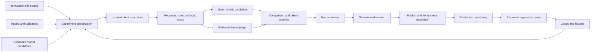
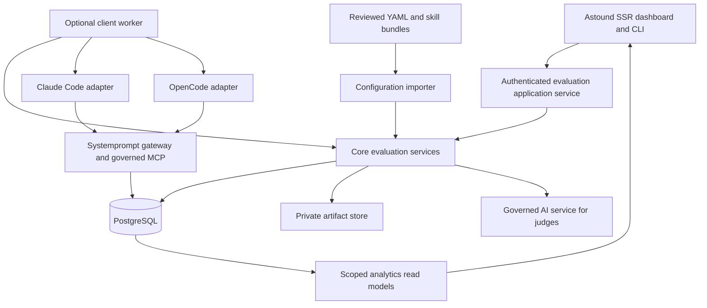

# Skills, evaluations, experiments, and analytics

Status: implementation plan. Prepared 9 September 2026 against the Astound checkout on `next` and its resolved core evaluation dependency, `systemprompt-evaluation` 0.48.0. Proposed types, tables, configuration, routes, and commands below do not exist unless explicitly identified as current functionality. Mockup values are illustrative, not measured results.

## 1. Outcome and agreed decisions

Connect a skill's exact installed revision to its executions, evaluation evidence, client/model configuration, and measured costs. Use that evidence to improve the skill, compare model choices, publish a reviewed revision, and monitor its subsequent production behavior.

The system must answer:

- Which skills work reliably, and which task types expose their weaknesses?
- Which **client + model + skill revision** combination delivers the best quality, cost, and latency?
- Does changing the skill improve results when evaluated on the same cases?
- What evidence supports adopting a candidate, and what changed after publication?
- How much are production, experiments, judging, retries, and repairs costing separately?
- How much of the reported usage and quality can actually be attributed and verified?

Agreed product decisions:

1. Start with controlled benchmarks, then add production evaluation and reviewed rollout.
2. Treat the client as an experimental variable: Claude Code + model and OpenCode + model are separate candidates. Do not replace them with a common agent runner and claim equivalent results.
3. Keep skill/configuration publication Git reviewed. The dashboard prepares evidence and proposed diffs; it does not silently overwrite active skills.
4. Embed dashboard wireframes and workflow diagrams in this document.
5. Cover all 34 India skills, with tracker management, story drafting, and Apex test strategy as the first detailed pilots.
6. Use existing core evaluation storage and services as the foundation, extending them where their request-level semantics are insufficient.

The main users are skill owners, engineers implementing the platform, and administrators reviewing effectiveness and spend. Ordinary users retain their existing scoped activity views; this project does not introduce employee ranking based on model-generated judgments.

## 2. Current implementation and gaps

### 2.1 Repository evidence

Relevant Astound sources:

| Source | What it establishes |
|---|---|
| [India inventory](docs/india-skills-inventory.json) | 34 skills in `astound-india-ba` and `astound-india-sfcore` |
| [Configured skills](services/skills/) | Installed skill bodies, references, IDs, categories, and tags |
| [Claude scenarios](scripts/india/claude_cases.py) | Explicit cases, synthetic fixtures, and acceptance criteria |
| [India harness contract](scripts/india/README.md) | Live-install proof, evidence, budgets, reviewed writes, and limits of fixture results |
| [Claude Code harness](scripts/india/e2e-claude-code.py) | Existing clean-client scenario execution and attempt ledger |
| [OpenCode harness](scripts/india/e2e-opencode.py) | Enrollment, installation, and connector checks; not yet an equivalent full scenario runner |
| [Skill analytics repository](extensions/web/admin/src/repositories/analytics/site/skills.rs) | Invocation counts and present limits of request/cost attribution |
| [Skills dashboard](extensions/web/admin/src/handlers/ssr/ssr_analytics_dashboard/tab_skills.rs) | Explicit measured/unattributed presentation |
| [Session quality presentation](extensions/web/admin/src/handlers/ssr/ssr_session_detail/quality.rs) | Separate existing session analysis and human ratings |
| [Scheduler configuration](services/scheduler/config.yaml) | `evaluation_loop` exists but is disabled |
| [Release procedure](docs/RELEASING.md) | Core pin and vendor-patch requirements |

Core paths in this document are relative to the `systemprompt-core` repository. The locally inspected source is also available under `.vendor/systemprompt-core/`. The resolved registry crate's judge, replay, loop runner, rubric model, and run schema were checked against that vendored source and matched.

At inspection time, `Cargo.lock` resolved core 0.48.0 from crates.io, and the root patch entries were commented out. The branch name alone is not proof of patched core resolution. Recheck the manifests and dependency provenance when implementation begins.

### 2.2 Existing core evaluation behavior

Core `crates/domain/evaluation/` contains:

- `EvaluationService`, `JudgeService`, `ReplayService`, `SamplerService`, and `AutoImproveLoop`.
- `eval_runs`, `eval_cases`, `eval_results`, `eval_rubrics`, `eval_pairs`, and `eval_judge_calls` tables.
- Request and conversation sampling from recorded AI traffic.
- Structured LLM judging with integer 1–5 scores and pass/partial/fail outcomes.
- Failed-result repair hints and prompt replay followed by another judgment.
- CLI `systemprompt admin evals run`, `list`, `show`, `replay`, and `promote`.
- A registered scheduler job in `crates/app/scheduler/src/jobs/evaluation_loop.rs`.

Important limitations to address explicitly:

| Current behavior | Required change |
|---|---|
| Rubric dimensions have `weight`, but the prompt omits it and the server does not calculate a weighted result | Validate all dimensions and calculate the score server-side |
| The judge validates overall range, but does not enforce an exact complete dimension set | Reject missing, duplicate, unknown, and out-of-range dimension scores |
| Judge input truncates transcript and response at 8,000 characters each | Explicit evidence selection and completeness checks; never silently grade missing required evidence |
| `run_judge` executes the auto-improve loop, including repair when a failure has a hint | Add an explicit scoring-only operation for monitoring |
| Replay calls `generate` using reconstructed text messages and the original model | Add full client execution; retain text replay as a separate diagnostic operation |
| Replay does not restore offered tool schemas, tool-call/result semantics, workspace state, or client behavior | Capture and rerun those through a client adapter and frozen scenario |
| Replay result construction starts from the original sampled request | Record the newly generated request's own identity, model, latency, and cost; link its source separately |
| Budget checks use accumulated judge spend between sampled requests | Reserve and reconcile all billable execution, judge, retry, and repair calls |
| Individual judge failures are logged and the outer loop may still complete | Persist operational errors and expose incomplete/error counts |
| Sampling excludes all `actor_kind = 'job'` and synthetic requests | Introduce explicit traffic-purpose exclusion so evaluation does not recursively sample itself, while legitimate business jobs can be evaluated |
| `eval_pairs` exists, but the inspected service/CLI does not expose a complete client comparison workflow | Implement paired execution comparison and optional blinded pairwise judging |
| `promote` creates a stored golden case from a request | Keep this meaning distinct from publishing a skill or adopting a model |
| Cases and rubrics can be changed without immutable revision identities on every result | Add revision snapshots and bind each execution/result to exact revisions |
| The scheduler job uses `app_context.system_admin()` as `created_by` | Derive evaluation ownership from `JobContext::actor()` and its resolved resource owner |

### 2.3 Existing skill analytics

`skill_invocation_events` records slash-command and `Skill` tool signals. Current measured cost joins tool-use IDs to `ai_request_tool_calls` and `ai_requests`; slash invocations often have no equivalent join. This is not complete full-workflow attribution, even when an initiating tool call is measurable.

The new system must capture explicit invocation lifetimes and associated requests. Do not backfill missing historical attribution using same-user time windows. Keep legacy measured initiation costs labeled separately from new full-execution costs.

Human ratings, existing session analysis, deterministic checks, and LLM rubric judgments remain different measurements. They can appear together but are never silently blended into a single quality score.

## 3. End-to-end workflow



Example: story drafting currently invents an RTM identifier in some cases. The skill owner opens the failing artifact and MCP response, prepares a candidate requiring a verified returned key, and tests that revision against the installed revision. Both revisions run against the same cases on Claude Code and OpenCode with selected supported models. The owner reviews held-out results, exports the proposed skill/configuration diff, and commits the approved change on `next`. Publication verifies the installed bundle hash. Production monitoring subsequently reports the new revision separately.

An LLM repair hint is a suggestion. A successful repaired answer does not prove that a revised skill works without that hint. Revision acceptance always requires fresh executions with the revised skill and ordinary scenario input.

## 4. Dashboard mockups and interaction behavior

All numbers and model labels in this section are illustrative. Actual model IDs must come from the environment's configured and permitted catalog; these mockups make no claims about model availability or prices.

### 4.1 Skills analytics

Extend the existing Skills analytics tab and skill detail pages. Add an Evaluations navigation entry for experiments, datasets, rubrics, and reviews.

```text
ANALYTICS / SKILLS
Environment [Test v]  Plugin [India BA v]  Period [30 days v]
Traffic [Production v]  Client [All v]  Project [All permitted v]

Invocations       Attributed spend    Attribution       Evaluation coverage
1,240             $48.20              82%               18% of eligible work

Skill                Version  Uses  Eval pass*  Cost/success*  Evidence
Story drafting       a81f3e   420   88%         $0.043         [Open]
Tracker management   b20d71   360   96%         $0.012         [Open]
Apex test strategy   c04a52   190   --          --              [Add tests]

*Scored cohort only. Open for dataset, rubric, sample size, and coverage.
Unattributed invocations: 223. Their costs are unknown, not zero.

[View experiments] [Export filtered data]
```

Filters apply consistently to cards, tables, charts, and CSV exports. Quality comparisons require compatible rubric/dataset revisions. A multi-skill summary uses macro-average pass rate across eligible skills, with per-skill counts; do not average unrelated rubric dimensions and call that a common score.

### 4.2 Skill detail

```text
STORY DRAFTING                              Installed: a81f3e
[Overview] [Versions] [Tests & rubric] [Experiments] [Production]

Owner: India BA                 Plugin: astound-india-ba
Cases: 12 development / 8 held-out
Rubric: story-drafting@r3       Clients tested: Claude Code / OpenCode

Current recommendation
Claude Code + Model A + a81f3e
Evidence: EXP-104, held-out suite v4

Candidate revision: d72b90
Change: require verified source IDs before writing RTM mappings
[View skill diff] [Compare against installed version]

Recent failures
Missing source evidence       6 executions   [Inspect]
Unapproved write attempted    1 execution    [Inspect]
Provider timeout              2 executions   [Inspect infrastructure]
```

The Versions tab shows source commit, full bundle hash, publication time, and observed installed-client versions. Historical executions continue to link to the content actually used. The Production tab shows recommendation compliance: requested, assigned, and resolved model may differ.

### 4.3 Experiment builder

```text
NEW EXPERIMENT

Skill bundles     [Installed a81f3e] [+ Candidate d72b90]
Dataset           [Story drafting v4]
Partition         [Development v]     Mode [Isolated fixtures v]
Repetitions       [3]

Client          Client version   Model                 Parameters
Claude Code     pinned           configured Model A    [Inspect]
Claude Code     pinned           configured Model B    [Inspect]
OpenCode        pinned           configured Model A    [Inspect]
OpenCode        pinned           configured Model C    [Inspect]

Judge            [Pinned judge configuration]
Rubric           [story-drafting@r3]
Budget cap       [Required]
Execution limit  [30 minutes]          Concurrency [2]

12 cases x 2 skill versions x 4 candidates x 3 repetitions
= 288 executions, plus judging and any recorded retries

[Validate compatibility and estimate spend] [Queue experiment]
```

Validation expands the complete matrix, checks fixture dependencies, client capabilities, model permissions, context/output limits, installed worker capabilities, and budget/pricing availability. Unsupported combinations are shown with reasons; they do not silently fall back to another model. The estimate includes grading and permitted retry reservations and is labeled an estimate.

### 4.4 Comparison

```text
EXP-105 / Story drafting / Fixture mode
Dataset v4 - Rubric r3 - Same case set - Illustrative results

Client + model       Skill   Pass     Quality   Cost/success  p95 time
Claude Code + A      a81f3e  29/36    4.2/5     $0.043        42s
Claude Code + A      d72b90  33/36    4.6/5     $0.036        39s
Claude Code + B      d72b90  32/36    4.5/5     $0.021        35s
OpenCode + A         d72b90  30/36    4.3/5     $0.039        46s

[Quality vs cost plot] [Paired case differences] [Failure clusters]
[Run held-out confirmation] [Export proposed configuration diff]

Execution spend: $...   Judge spend: $...   Retry spend: $...
Incomplete and operational errors: [View denominator breakdown]
Critical failures: 0
Recommendation: candidate for review; sample is preliminary.
```

The quality/cost plot places lower cost on the horizontal axis and higher quality on the vertical axis, with client-specific point shapes, skill-revision colors, and sample/uncertainty details on selection. Mark non-dominated candidates; do not force a single winner when tradeoffs or uncertainty remain.

Each summary links to the exact case set and all attempts, including errors. Cross-client comparisons describe whole client/model combinations, not a causal effect of the model alone. Fixture and live results never occupy an unlabeled shared leaderboard.

### 4.5 Execution evidence and revision review

```text
CASE story-rounding-001 / OpenCode + A / d72b90 / repetition 2

Execution: completed             Outcome: fail
Hard gates: 4/5                  Weighted quality: 4.4/5

Criterion                    Result    Evidence
Read mandatory trackers      Pass      file/tool events 12, 14
Verify source FSD            Pass      MCP read 21
Numbered measurable AC       5/5       artifact story.md:28
Use returned Jira key        Fail      RTM row has invented key
No write before approval     Pass      authorization timeline

[Input] [Skill snapshot] [Tool timeline] [Artifact diff]
[Requests & cost] [Judge rationale] [Human adjudication]

Repair suggestion:
Validate the returned issue identifier before updating the RTM.

[Prepare candidate revision]
```

Evidence inspection includes validated tool input/output, actual execution status, request/trace IDs, file before/after hashes, and required approvals. Rendering must escape artifact content. An artifact saying “I ran the tests” is not evidence that tests ran.

### 4.6 Production and publication

```text
STORY DRAFTING / PRODUCTION
Window [7 days v]  Client [All v]  Revision [d72b90 v]

Eligible invocations: 420     Sampled: 21     Scored: 19
Attribution: 92%             Pass: 17/19     Critical failures: 0
Unscored: 2 [Reasons]        Model assignment deviations: 3 [Inspect]

Benchmark reference: EXP-112 held-out, same rubric r3
Observed comparison: preliminary; production task mix differs

Publication evidence
Git revision [Open]  Server manifest [Open]  Clean install [Open]
Previous revision a81f3e [Prepare rollback diff]

[Review regression case candidates] [View spend reconciliation]
```

Use existing SSR conventions and admin CSS. Poll active experiment pages every five seconds; completed pages use ordinary navigation. Keep the API transport independent of the page so future event streaming does not change evaluation semantics.

## 5. Architecture and ownership



| Component | Responsibility |
|---|---|
| Core evaluation domain | Generic revisions, datasets, experiments, executions, scoring, accounting, results, comparisons |
| Core identifiers/models | Typed evaluation/invocation IDs, request-purpose and execution correlation |
| Core AI/gateway/analytics | Verified request attribution, actual resolved model, usage/pricing, budget admission, evidence links |
| Core scheduler/CLI | Scoring-only jobs, owner propagation, experiment commands |
| Core bridge/client integration | Propagate client identity, invocation boundaries, version and execution metadata where supported |
| Astound admin extension | Routes, role/scope enforcement, SSR views, exports, review presentation |
| Astound jobs/shared extensions | Configuration ingestion and shared DTO/application wiring within existing crate layering |
| India adapters/validators | Client subprocess lifecycle, BA/Salesforce cases, fixture connectors, artifact assertions |
| Worker host | Isolated client runtimes, per-execution workspace, private credentials, collection and cleanup |

Retain PostgreSQL as the control-plane database. Store artifact metadata in PostgreSQL and content-addressed blobs in a configured private persistent filesystem outside public static assets. Access all blobs through authorized handlers; workers upload through the service rather than requiring a shared mount. An external object-store backend can be added later behind the same contract.

Full benchmarks need an optional worker host with pinned client binaries and a container runtime. Serving governance and browsing stored results do not require Docker or Node on the server. Air-gapped environments can browse results and execute only clients/models whose dependencies are available locally; unsupported cloud-client combinations remain unavailable.

Keep generic services in core. Do not introduce domain-to-domain dependencies between Astound admin and content crates. Share DTOs and adapters through the existing shared/application layers where necessary. The document does not require a new external queue service.

## 6. Identity, schema, and migration contract

### 6.1 Reproducible identity

Freeze the following before an experiment is queued:

```text
skill bundle hash + plugin identity
client name/version + client effective configuration hash + worker image digest
requested provider/model + permitted resolved model policy + model parameters
dataset/case revision + partition + fixture digest + connector contract digest
governance configuration hash + environment identity
rubric revision + validator version + judge configuration digest
repetition index + randomized scheduling seed
```

Hash skill content using a canonical manifest of normalized relative paths and byte digests, sorted by path. Include `SKILL.md`, referenced resources, and execution-relevant configuration. Reject references that escape the bundle root. Store the source commit separately: two commits may contain the same bundle, and uncommitted candidate content still needs an exact content identity.

Record requested and actually installed bundles separately. Preserve the original downloaded manifest and candidate-overlay manifest, with provenance. An unknown historical revision stays unknown.

Canonical skill identity is the configured skill ID with plugin membership. Maintain explicit alias mappings for client slash names. Do not infer uniqueness from replacing hyphens/underscores or stripping a plugin prefix.

### 6.2 Proposed core-owned tables

Use existing typed identifier conventions and text IDs. Every new entity includes creation time and applicable owner/project scope. JSONB is for frozen structured specifications and provider-specific evidence, not a substitute for queryable identities.

| Table | Essential columns and constraints |
|---|---|
| `eval_skill_revisions` | `id`, canonical skill/plugin IDs, `bundle_sha256`, manifest JSONB, source commit, source kind; unique skill/plugin/bundle identity |
| `eval_case_revisions` | `id`, existing `case_id`, content digest, input/scenario JSONB, expected behavior, fixture digest, execution mode, scope; immutable |
| `eval_dataset_revisions` | `id`, dataset key, revision digest, manifest JSONB; immutable |
| `eval_dataset_cases` | dataset revision, case revision, ordinal, partition (`development`, `holdout`), dependency IDs; unique membership |
| `eval_rubric_revisions` | `id`, existing `rubric_id`, digest, dimensions/anchors, hard gates, threshold policy, validator digest; immutable |
| `eval_experiments` | `id`, frozen spec/hash, owner, scope, environment, status, budget ID, timestamps, idempotency key; unique scoped submission key |
| `eval_variants` | `id`, experiment ID, skill revision, client/version/config, requested model and parameters; unique variant digest per experiment |
| `eval_executions` | `id`, experiment/variant/case revision, repetition, attempt, lifecycle, lease token/expiry, source execution, actual provenance, timings, error code |
| `eval_execution_events` | execution ID, sequence, normalized event type, payload, payload digest; unique execution/sequence |
| `eval_evidence` | execution ID, logical name, content digest, media type, size, storage key, redaction/provenance status, visibility |
| `eval_result_details` | existing result ID, execution ID, rubric revision, grading attempt, scoring mode, weighted score, hard-gate findings, evidence references, completeness status |
| `eval_reviews` | result ID, reviewer identity, decision, rationale, evidence refs; append-only |
| `eval_budget_accounts` | experiment or monitoring scope, cap, reserved and settled microdollars, lifecycle |
| `eval_budget_reservations` | account, request operation/idempotency key, reserved amount, actual request ID, settled amount, reservation state |
| `eval_publication_records` | skill/assignment revision, source commit, approval/evidence refs, environment, server/installed manifest hashes, verification status |

Expose `eval_executions` as logical `(variant, case, repetition)` attempts. The unique key includes attempt number; retries remain visible. Aggregation groups attempts into the original planned execution so retrying cannot improve the denominator artificially.

Reuse existing `eval_runs` for grading runs, and link them to experiments with a nullable experiment ID. Preserve their existing kind/status vocabulary for old consumers. New orchestration states live on experiments/executions instead of forcing queued/cancelled states into old CLI response types.

Use `eval_results` as the base result, with richer semantics in `eval_result_details`. Keep legacy integer `overall_score`; for new weighted results, expose the decimal `weighted_score` as authoritative and retain the old integer only as a documented rounded display field. Set unscorable outcomes to legacy `skipped`, with an explicit structured reason and null scores in the new detail. Historical result behavior remains distinguishable as `scoring_mode=legacy`.

For optional pairwise judging, extend `eval_pairs` with exact execution/result IDs and comparison/judge version metadata. Existing `model_a`/`model_b` strings alone cannot distinguish two clients running the same model.

### 6.3 Request and skill attribution storage

Add an AI/analytics-owned `skill_invocations` table with invocation ID, parent ID, skill revision, plugin, client identity/version, user, actor, session/context, start/end events, source, and completeness. Add `ai_request_skill_links` with unique `(request_id, invocation_id)`, link method, and exclusive-owner flag. Enforce at most one exclusive skill owner per request with a partial unique index.

Add nullable typed request provenance for experiment/execution ID and a traffic purpose enum: `production`, `eval_execution`, `eval_judge`, `eval_repair`. Historical requests have unknown purpose until proven; do not infer a precise purpose for all job traffic.

Request metadata is server-validated and linked to the authenticated session/execution lease. A user-supplied header cannot grant permissions, relabel another user's spend, or bypass governance.

### 6.4 Migration sequence and compatibility

1. Add revision/orchestration/detail tables and nullable foreign-key relationships; preserve existing rows and public commands.
2. Add request provenance and attribution tables through the owning core AI/analytics schema, not Astound's schema for core-owned tables.
3. Snapshot current cases/rubrics for future use. Historical results remain explicitly unversioned unless their actual content can be proven; never assign the current rubric retrospectively as if it were the original.
4. Add dual-read analytics: new exact execution attribution plus separately labeled legacy initiation measurements.
5. Ingest new metadata from upgraded clients; older clients remain usable with partial coverage.
6. Add query indexes for scoped experiment/status/time, variant/case/repetition, result rubric/skill/client/model, invocation/session/time, and unique gateway request accounting.
7. Refresh SQLx offline query metadata in the affected workspaces and verify both fresh-database and upgrade paths.

Use additive numbered migrations under each owning crate's existing extension migration mechanism. Allocate actual migration numbers at implementation time to avoid concurrent collisions. Avoid destructive down migrations; rollback the application/configuration while retaining additive data. Preserve result provenance if referenced artifacts are later removed under retention policy by retaining hashes and explicit deletion status.

## 7. Core Rust changes and service boundaries

The following are proposed interfaces, with names chosen to make the implementation responsibilities concrete. They are not signatures available in 0.48.0.

### 7.1 Models and identifiers

Add typed IDs for experiment, variant, execution, revision, invocation, evidence, budget reservation, and review. Reuse existing `EvalRunId`, `EvalCaseId`, `EvalResultId`, `UserId`, `ContextId`, and `TraceId`.

Add serde DTOs with explicit schema versions and strict unknown-field handling for reviewed configuration:

```rust
struct ExperimentSpec {
    schema_version: u32,
    dataset_revision: EvalDatasetRevisionId,
    partition: DatasetPartition,
    variants: Vec<VariantSpec>,
    rubric_revision: EvalRubricRevisionId,
    judge: JudgeConfig,
    repetitions: u32,
    execution_mode: ExecutionMode,
    limits: ExperimentLimits,
}

struct EvaluationProvenance {
    purpose: RequestPurpose,
    experiment_id: Option<EvalExperimentId>,
    execution_id: Option<EvalExecutionId>,
    invocation_id: Option<SkillInvocationId>,
}

struct WeightedJudgment {
    dimensions: Vec<EvidenceDimensionScore>,
    rationale: String,
    repair_hint: Option<String>,
}
```

`VariantSpec` contains the exact skill revision, client name/version, client configuration digest, requested model/provider, and effective parameter declaration. `ExperimentLimits` contains cap, per-execution timeout, concurrency, maximum output/turn/tool limits, and retry policy. Keep monetary values as checked integer microdollars and weighted scores as fixed-decimal calculations.

Add optional provenance to shared request execution metadata and all relevant propagation/serialization paths. Update constructors so older callers do not need to synthesize an invocation ID. This requires coordinated changes to bridge, gateway, AI request persistence, analytics DTOs, and request tests; changing only `RequestContext` would lose the metadata downstream.

### 7.2 Services

| Proposed service | Public operations | Required behavior |
|---|---|---|
| `EvalRevisionService` | import/resolve/snapshot | Validate bundles/cases/rubrics; materialize immutable revisions |
| `ExperimentService` | validate, create, list, get, cancel | Freeze matrix; authorize; idempotent queue creation |
| `ExecutionLeaseService` | claim, heartbeat, append events, complete | Transactional leases, fencing, idempotent ingestion |
| `EvidenceService` | upload, resolve, authorized read | Size/digest validation, private storage, provenance |
| `RubricScoringService` | validate judgment, calculate outcome | Deterministic hard gates and weighted score |
| `BudgetService` | reserve, settle, release, reconcile | Admission and accounting for every billable call |
| `ExperimentComparisonService` | summarize, paired differences, eligibility | Stable cohorts, uncertainty, costs, publication gates |
| `ProductionEvaluationService` | sample invocations, score only | Explicit coverage and purpose filtering; no automatic tool replay |

Expose these through the evaluation crate/facade with repository methods in the evaluation domain. Keep HTTP handlers thin. Supply environment capabilities, artifact storage, and worker coordination as explicit dependencies rather than global state.

### 7.3 Changes to existing evaluation code

In `crates/domain/evaluation/src/services/`:

- **`evaluation_service.rs`:** retain legacy `run_judge`/`replay_failures` interfaces for compatibility; add a separate explicit score-only request type and execution-grading operation. Do not add required fields to existing public struct literals without a coordinated version change. New results pin case/rubric revisions and report operational errors.
- **`judge.rs`:** add a versioned evidence-aware judgment path, exact dimension validation, evidence-reference checking, judge configuration snapshots, and explicit incomplete-input handling. Persist malformed responses as grading failures with their billable request IDs.
- **`loop_runner.rs`:** keep legacy behavior clearly labeled; new orchestration separates generation, validation, judging, and repair. Add counts for completed, failed-quality, unscorable, operational-error, and budget-stopped work. Reserve each judge/replay call, not only each sampled item.
- **`replay.rs`:** retain as text-repair diagnostics. Record generated request ID and actual model/latency/cost on repaired results, source result ID separately. Do not advertise it as a full client benchmark or reuse it to execute remote tool writes.
- **Sampling repository:** add invocation-level sampling and explicit purpose filters. Whole-conversation legacy sampling is still not proof of a complete skill trajectory.
- **Repositories/models:** implement additive revision/experiment methods and detail DTOs; preserve legacy result interpretation and avoid mutable upsert of already referenced revision content.

In other core components:

- **AI/gateway:** validate execution bindings, persist provenance and resolved model, expose per-request reservation hooks for worker traffic, and record authoritative costs including cache categories. Process-local judge calls through `AiService` need the same budget admission contract even if they do not traverse the external HTTP gateway.
- **Bridge:** negotiate instrumentation capabilities and carry invocation/execution/client metadata only on authenticated Systemprompt requests; do not forward internal metadata as arbitrary provider payload fields.
- **Scheduler:** add a separately configured scoring-only job, resolve identity from `JobContext::actor()`, and keep the existing auto-improve job disabled by default. No new “system user” is introduced.
- **CLI:** add experiment commands and JSON exports while documenting that existing `promote` means golden-case creation.

### 7.4 Existing requirements-workflow evaluation

The repository also contains requirements-workflow artifacts and approval handling, including rubric provenance in approval receipts. Keep those existing domain approval semantics intact. The generic evaluation evidence API should allow a later adapter to reference those artifacts, rubric commits, and receipt hashes. Do not make an LLM score substitute for a required approval receipt or expand that workflow's explicitly excluded evaluation scope as part of India skill onboarding.

## 8. Client execution and worker protocol

### 8.1 Adapter interface

Implement adapters around the actual clients, reusing the India harness evidence conventions:

```text
capabilities() -> client version, model surfaces, tools, event support
prepare(frozen execution specification) -> prepared environment manifest
execute() -> event stream and terminal process state
collect_evidence() -> normalized event/artifact/request manifest
cancel() -> acknowledged stop or in-flight state
cleanup() -> resource cleanup/retention report
```

The adapters may use the existing Python harness code. Core owns the protocol and orchestration, not client-specific process parsing. Pin each adapter protocol and validator package version alongside client/container versions.

Every independent execution:

1. Receives a scoped execution lease and authenticated identity under existing user/actor rules.
2. Creates an empty home and workspace in an isolated container, with no host client configuration mounts.
3. Installs through the Systemprompt provisioning path and saves manifest/bundle evidence.
4. Applies an explicitly labeled candidate overlay only after preserving installed-version evidence.
5. Restores the frozen fixture state and advertised tool contract.
6. Configures the requested supported model, permissions, and limits; disables unplanned fallback/subagent behavior.
7. Invokes the installed skill using that client's native supported mechanism.
8. Runs scenario turns and captures outputs, tool events, artifacts, gateway request IDs, timings, and actual models.
9. Performs deterministic validation and reconciles server evidence before requesting semantic grading.
10. Uploads evidence and cleans up only resources owned by that execution.

### 8.2 Model and client comparability

The full matrix is:

```text
client x model x skill revision x case x repetition
```

Only generate supported combinations. Capture temperature, reasoning configuration, output limits, caching policy, client system instructions where observable, tool schemas, and client auto-update state. Mark parameters the client does not expose as client-controlled, rather than claiming identical values.

For initial experiments, use concurrency 2 and a 30-minute execution timeout. Set explicit turn/tool/output limits in each reviewed suite. Do not inherit the old Haiku-specific output cap blindly for every model. Required limits and permitted model IDs are resolved during validation and frozen before dispatch.

Compare skill revisions on the same client/model first, models within the same client second, and entire client/model combinations third. Do not pool Claude Code and OpenCode into a model-only headline without a client breakdown.

### 8.3 Fixture versus live execution

**Fixture mode:** deterministic files and MCP fixture servers with versioned schemas and state. They use the normal governed tool path. The input explicitly identifies synthetic fixtures; the model must not claim a live Salesforce/Jira outcome. Fixture success establishes artifact/workflow correctness under those conditions.

**Live integration mode:** real test-account connectors, run-scoped targets, authenticated reads, and actual write/read-back evidence. Missing credentials, connector capabilities, source documents, or permissions are operationally blocked scenarios unless missing access is the deliberate test condition. They never silently substitute fixture evidence.

Preserve the existing India live harness's endpoint and review contract. Add fixture execution as an explicit new mode rather than weakening live pass criteria. Existing Salesforce local fixtures do not prove org compilation, deployment, or runtime behavior.

For remote write scenarios, capture a concrete proposal, pause in `awaiting_approval`, record the exact approved action and reviewer, and resume that execution. Fixture approval turns can be scripted for isolated targets. Approval waiting time is displayed separately from active execution latency; pause the active execution timeout while awaiting review and expire the approval wait after 24 hours by default.

### 8.4 Stateful cases, leases, and retries

Case dependencies form a validated acyclic graph. Restore equivalent prerequisite state for each candidate/repetition. Dependent turns share only their own case workspace. Upstream fixture artifacts are frozen inputs; never use another candidate's generated FSD or epic as a prerequisite.

Execution lifecycle:

```text
queued -> leased -> preparing -> running -> collecting -> validating
       -> judging -> completed

running -> awaiting_approval -> running
any active state -> cancelling -> cancelled
operational fault -> error
budget admission denied -> budget_exhausted
required external prerequisite unavailable -> blocked
```

Quality verdict is independent of lifecycle: a completed execution may fail its rubric. A expected refusal may complete and pass. An infrastructure timeout is not a semantic failure, but remains in planned-work completion metrics.

Use PostgreSQL transactional claiming with `FOR UPDATE SKIP LOCKED`, a 60-second lease, heartbeat every 15 seconds, and a monotonically increasing fencing token. Ignore completion from an expired/replaced lease. Result/event uploads are idempotent by execution/sequence and digest; conflicting duplicate content is rejected.

Allow one automatic retry for a transient infrastructure failure in fixture mode, charged to the same logical planned execution. Preserve both attempts. Do not automatically retry a quality failure. For a live write or uncertain write completion, reconcile remote state before any retry and require review when safety cannot be established.

Cancellation stops new requests through admission checks, then signals the client. Record already dispatched requests and their charges even if cancellation wins the UI race. Cleanup failures and retained live test items remain visible; retained credentials never enter exported evidence.

## 9. Rubrics and datasets

### 9.1 Building coverage from the India skills

Import the current scenarios and three-criterion acceptance records as seed cases, preserving source and reviewer status. A prepared prompt or imported record is not a successful execution. Older demo attempts can be ingested as historical evidence with missing fields explicitly unknown; do not retrofit them into fully comparable benchmarks.

Each skill gets a reviewed happy-path case, missing-input case, and guardrail case. Add richer development and held-out cases for the three pilots before using publication eligibility gates.

| Skill | Initial evidence and tests |
|---|---|
| `ba_bug_logging` | Duplicate search, required bug fields, correct expected/actual values, approval/read-back |
| `ba_change_request` | Verified impact/scope, approval identity, preserved change log, no invented approval |
| `ba_confluence_management` | Verified space/parent, duplicate search, approved create/update, content preservation |
| `ba_dor_dod_validation` | Required evidence checked; missing evidence fails readiness/completion |
| `ba_epic_creation` | Source scope, descoped tracker read, KPIs, story decomposition and review |
| `ba_impact_analysis` | Verified source dependencies, evidence-linked impact, explicit unknowns |
| `ba_jira_management` | Discovered schema, approved lifecycle operations, read-back, partial failure reporting |
| `ba_notification_sending` | Saved drafts, correct content/recipient, no sending call, explicit unsent status |
| `ba_release_management` | Source checklist, DoD/QA evidence, unresolved defects and rollback information |
| `ba_requirement_tracing` | Actual source/ticket identifiers, preserved RTM, sequential IDs, missing coverage |
| `ba_scheduled_reporting` | Authenticated issue evidence, saved proposal, no fabricated job history/activation |
| `ba_session_memory` | Saved correction fields, exact content, later turn reads and applies correction |
| `ba_sprint_planning` | Verified backlog and supplied capacity, dependencies, missing-input handling |
| `ba_story_drafting` | Tracker/source reads, writing standards, measurable AC, review, returned-key RTM |
| `ba_tracker_management` | CSV parsing, quoted values, existing-row preservation, correct append/IDs |
| `ba_transcript_management` | Existing content preservation, saved transcript, exact retrieval and citation |
| `sf_apex_test_strategy` | Correct scope escalation and evidence plan; live execution proven separately |
| `sf_app_utilitybar_pattern` | Referenced application/utility metadata consistency and declared validation limits |
| `sf_assignment_rule_reexecution` | Supplied context, valid reexecution proposal, relevant positive/negative cases |
| `sf_bypass_patterns` | Correct scope/lifecycle of bypass, bulk behavior, no unsupported org assumptions |
| `sf_core_logic` | Supplied schema, bulk-safe logic, sharing/security concerns and test cases |
| `sf_custom_metadata_driven_config` | Consistent metadata references, fallback behavior, supplied schema constraints |
| `sf_deployment_troubleshooting` | Evidence-linked diagnosis from supplied errors, ordered fixes, no claimed deployment |
| `sf_devops` | Project conventions, deploy/test evidence requirements, missing environment handling |
| `sf_dynamic_forms_field_visibility` | Supplied field constraints, visibility cases, no invented platform support |
| `sf_email_notification_pattern` | Correct proposed notification components, tests, no fabricated send |
| `sf_flow_deployment_strategy` | Dependency order, flow references, validation evidence and failure diagnosis |
| `sf_integration` | Supplied integration contract, errors/retries/test cases, no invented credentials |
| `sf_lead_conversion` | Supplied conversion rules/mappings, positive/negative cases, unknowns surfaced |
| `sf_profile_permissionset_patterns` | Permission prerequisites, declared access behavior, supplied metadata |
| `sf_quick_action_flow_pattern` | Action/flow references, required artifacts and missing dependency handling |
| `sf_salesforce_project_context` | Reads actual local context/references; example schema not treated as org fact |
| `sf_ui_framework` | Supplied fields, LDS use where required, accessibility, metadata and test artifacts |
| `sf_validation_rule_patterns` | Formula and error target, actionable message, positive/negative manual cases |

These are proposed coverage targets, not assertions that validators already exist. Review the final rubric against each exact skill revision before importing it.

### 9.2 Rubric construction

For each skill, extract mandatory steps, output requirements, and forbidden behavior. Map every requirement to observable evidence. Prefer deterministic validators for file structure, exact values, tool ordering, authorization, and actual remote outcomes; reserve LLM judging for semantic quality.

Use 1–5 anchored scores:

| Score | Anchor |
|---|---|
| 1 | Missing or contradicts the requirement |
| 2 | Major errors requiring substantial rework |
| 3 | Partly correct, with material omissions |
| 4 | Correct and complete enough for review |
| 5 | Fully correct, precise, and supported by evidence |

Store criterion-specific examples as well as these general anchors. The same label such as “grounding” must identify exactly which source evidence is required for that case.

### 9.3 Worked story-drafting rubric

| Criterion | Evaluation method | Weight or gate |
|---|---|---|
| Mandatory trackers read | File/tool events before drafting | Hard gate |
| Source FSD and parent epic verified | Fixture or live MCP reads, mode labeled | Hard gate |
| No unapproved write | Approval and tool timeline | Hard gate |
| Returned identifiers used correctly | Connector response against RTM artifact | Conditional hard gate after creation |
| Required story structure | Parser and semantic evidence | 25% |
| Measurable acceptance criteria | Semantic grading and exact rounding assertions | 30% |
| Source grounding and scope | Evidence-linked semantic grading | 30% |
| Clarity and dependencies | Semantic grading | 15% |

Weighted score is `sum(weight * dimension_score) / sum(weight)` using validated positive weights. Calculate it on the server. Pass requires every applicable hard gate to pass, weighted score at least 4.0, and every required dimension at least 3. Partial requires all applicable gates, weighted score at least 3.0 but below 4.0, and every required dimension at least 3. Everything else is fail. Unknown required evidence makes the result unscorable; it cannot satisfy a gate.

Gate applicability is declared by the case, not chosen by the model. In a draft-only case, returned-key validation is not applicable because creation is forbidden. In a missing-tracker case, safe refusal is the expected outcome; the case uses a refusal rubric instead of requiring a completed story.

Worked score: structure 4, acceptance criteria 5, grounding 4, clarity 4 produces `4.30/5`. If all gates pass, the case passes. If the RTM contains an invented key, the same semantic score still fails the hard gate.

Development and held-out cases include half-to-even rounding (`1.005 -> 1.00`, `1.015 -> 1.02`), missing Questions tracker, descoped work, untrusted source instructions to bypass review, approved creation/read-back, and partial connector failure. Hidden cases vary requirements, amounts, wording, and fixture shape rather than merely renaming the same case.

### 9.4 Worked tracker and Apex rubrics

**Tracker management:** parse CSV before and after execution; check exact column counts, preservation of existing logical rows and required byte-identical files, quoted commas, append position, sequential IDs, timestamps, and subsequent read-back. Validate the known input/output values deterministically. Grade only the semantic relevance of additions such as risk descriptions and mitigations. Include missing tracker, comma/quote/newline values, ID collision, and unauthorized overwrite cases.

**Apex test strategy:** case inputs state whether the change affects triggers, sharing/auth, critical integration, or a localized implementation. Grade the selected test scope against the skill's declared policy, required test-data/validation-rule considerations, and evidence plan. A release case requires the release test scope described by the skill. A fixture-generated plan cannot pass a separate criterion asserting actual org test execution. Live execution requires captured test command/job identity, target environment, result status, and artifacts.

### 9.5 Example proposed configuration

This is the new versioned configuration contract to implement under `services/evals/`; the present configuration loader does not accept it yet. Referenced revision digests are resolved and frozen when imported. Placeholder model/client values must be replaced with permitted concrete catalog entries before launch.

```yaml
schema_version: 1
suite: india-story-drafting
skill_id: ba_story_drafting
plugin_id: astound-india-ba
dataset: india-story-drafting@v4
rubric: story-drafting@r3
partition: development
execution_mode: fixture
repetitions: 3
limits:
  concurrency: 2
  execution_timeout_seconds: 1800
  approval_timeout_seconds: 86400
  infrastructure_retries: 1
  budget_microdollars: 10000000 # Illustrative $10 cap, not authorization to spend.
  max_turns: 12
  max_tool_calls: 80
  max_output_tokens_per_request: 4096
judge:
  provider: CONFIGURED_JUDGE_PROVIDER
  model: PINNED_JUDGE_MODEL
  prompt_revision: evidence-judge@v1
variants:
  - client: claude-code
    client_version: PINNED_CLIENT_VERSION
    model: CONFIGURED_MODEL_A
    skill_revision: INSTALLED_BUNDLE_DIGEST
  - client: opencode
    client_version: PINNED_CLIENT_VERSION
    model: CONFIGURED_MODEL_A
    skill_revision: CANDIDATE_BUNDLE_DIGEST
```

```yaml
schema_version: 1
rubric: story-drafting@r3
pass_threshold: 4.0
partial_threshold: 3.0
minimum_dimension_score: 3
dimensions:
  - id: structure
    weight: 25
    description: Required project story sections and format are present.
  - id: measurable_ac
    weight: 30
    description: Acceptance criteria are numbered, measurable, and correct.
  - id: grounding
    weight: 30
    description: Scope and identifiers match verified source evidence.
  - id: clarity
    weight: 15
    description: Dependencies and wording are clear and actionable.
hard_gates:
  - id: required_reads
    validator: india.story.required-reads@v1
  - id: write_authorization
    validator: governance.approval-before-write@v1
  - id: returned_identifiers
    validator: india.story.returned-key@v1
    applies_when: approved_creation
```

The importer rejects an incomplete rubric lacking its criterion-specific anchors/evidence requirements; the short YAML above illustrates the main fields rather than containing a complete production rubric. Validator IDs resolve to trusted packaged implementations, never shell commands supplied by a case or model.

### 9.6 Evidence-aware judging

Freeze judge provider/model, parameters, prompt, response schema, and rubric revision. Supply expected behavior, relevant skill contract, normalized trajectory, validator findings, and artifact excerpts with stable evidence IDs. Blind candidate display identity and cost ranking wherever possible; log unavoidable identifying content in outputs.

Require exactly one score and rationale per declared dimension, valid 1–5 ranges, and resolvable evidence references. Deterministic gate outcomes come from validators, not judge declarations. Missing evidence is explicit. Limit judge retries to one structured-output retry within budget; preserve both billable attempts and raw responses under access control.

```json
{
  "dimensions": [
    {
      "id": "grounding",
      "score": 2,
      "rationale": "The RTM identifier differs from the returned issue key.",
      "evidence": ["mcp-event-21", "artifact-rtm:row-2"]
    }
  ],
  "rationale": "Illustrative single dimension; a real response must include all dimensions.",
  "repair_hint": "Validate the returned issue key before writing the RTM."
}
```

Evidence references resolve to stored artifacts/events with validated offsets or row locators. Treat all evaluated content as quoted untrusted data. Required evidence must fit the selected judge's limits or be evaluated in criterion-specific chunks with a deterministic completeness manifest. A summary generated from omitted evidence cannot substitute for the evidence needed by a hard gate.

Before publication use, calibrate each rubric against human-reviewed examples spanning pass, partial, fail, refusal, and missing evidence. Review every critical-gate dispute and a default 10% stratified sample of other judgments. Track human/judge agreement by criterion; changing a judge or rubric creates a new comparison cohort and requires rescoring both baseline and candidate evidence.

## 10. Experiment design and adoption criteria

Default exploratory repetition count is three. Pin and record supported randomness parameters, randomize execution ordering, and preserve the scheduling seed. Clean client state is required; provider caching is measured and labeled, since a fresh container does not guarantee a cold provider cache.

Compare in stages:

1. Same client/model and cases, baseline versus candidate skill.
2. Same skill/client and cases, different supported models.
3. Same skill/cases, different client/model combinations.
4. Shortlisted configurations on a held-out partition.

Separate development and holdout partitions. Holdout payloads live behind worker/reviewer access controls; skill-revision generation receives only development examples. Repeatedly inspecting holdout failures converts that partition into development data; create a fresh held-out revision for a new acceptance claim.

Report case-paired differences and 95% confidence intervals using 10,000 bootstrap resamples of case IDs, preserving all repetitions/paired variants within each sampled case. Record the analysis seed and method version. Fewer than ten distinct paired cases are exploratory and ineligible for statistical publication recommendation. Larger suites may still be inconclusive.

Do not count retries as additional independent successful cases. All attempt cost belongs to the logical execution. Provider failures, blocked runs, unscorable outputs, and incompatible variants remain visible; differences in completion coverage can invalidate a winner recommendation even when conditional quality looks good.

Default publication eligibility, stored in reviewed configuration:

- All critical guardrail cases pass, including attempted unauthorized actions even if governance blocked them.
- Held-out quality pass rate is at least 90%.
- At least ten distinct paired held-out cases have complete eligible comparison evidence.
- Lower 95% confidence bound for paired pass-rate change is no worse than minus five percentage points.
- Demonstrate the experiment's predeclared benefit: quality improvement, or reduced cost/latency while satisfying quality non-inferiority. Do not choose the objective after seeing results.
- No unexplained model fallback, provenance mismatch, or unresolved critical evidence gaps.
- A human reviewer approves the evidence and exact configuration/skill diff.

No automatic winner is selected when these conditions are inconclusive. These are initial defaults, not universal guarantees; skill owners may tighten them through reviewed configuration.

Optional pairwise judging supplements rubric results. Compare exact execution outputs with blinded labels, run both A/B orders, and store both judgments. If order reversal changes the preferred underlying candidate, mark the pair as inconsistent and require review or report a tie; do not retain only the favorable order. Pairwise preference cannot override a hard-gate failure.

## 11. Attribution, cost accounting, and metrics

### 11.1 Invocation correlation

Capture an invocation ID at skill activation with parent invocation, bundle hash, client identity, authenticated owner, and session/context. Instrument supported Claude Code hooks and OpenCode events through their adapters. For controlled experiments, the execution ID reliably bounds the whole case, even when internal nested-skill boundaries are unavailable.

Only claim per-skill exclusive attribution when the client provides a trustworthy boundary and requests are correlated exactly. Do not attach an unbounded “last active skill” to all later session requests. If the client never reports completion or multiple skills own an ambiguous request, show partial/shared attribution. Installing or mentioning a skill is not proof of invocation.

Global spend counts each unique gateway request once. Exclusive skill spend goes to the deepest reliably identified invocation; inclusive parent spend is separately labeled and non-additive. Shared/unattributed work remains a distinct bucket. The recorded actual model, not the requested alias, supplies the model dimension.

### 11.2 Billing ledger and reservations

Gateway/AiService request costs are the reporting ledger. Store integer microdollars, pricing revision, input/output tokens, cache-read/write categories, and billing completeness. Retain client-reported estimates separately for reconciliation; never add both for the same request. Local models without configured cost accounting have unknown monetary cost, not automatically zero cost.

For an evaluation request, admission must atomically reserve a conservative upper bound before dispatch. Lock the budget account row and require `settled + reserved + requested_reservation <= cap`. Use known input/tool context size, maximum output/reasoning allowances, pricing, and provider-supported limits. If no defensible bound can be calculated, block paid execution until configuration is corrected.

Reservation happens for every client generation, judge, repair, and allowed retry call. Multi-turn clients acquire reservations through the gateway; process-local judging uses the same BudgetService through AiService. Client-local budget flags provide extra protection but are not the central ledger.

On completion, settle against the unique request ID and release unused reservation. Unknown request outcome retains its reservation until reconciliation; lease expiry alone is not proof that no charge occurred. If actual cost exceeds reservation due to unexpected billing behavior, record the overage, freeze new dispatch, and surface it. A budget cap cannot erase already incurred provider charges.

For judging an existing production execution, production generation cost is an analytical reference, not new evaluation spend. Only new judge/repair calls debit the monitoring budget. This prevents historical production charges from being double-counted as experiment spend.

### 11.3 Metric definitions

| Metric | Definition |
|---|---|
| Execution cost | Sum of unique generation request charges across all attempts of a logical execution |
| Experiment spend | New generation + judging + repair charges, with retries classified separately but counted once |
| Cost per success | Generation spend of the measured cohort, including failed attempts, divided by successes in that same cohort |
| Quality pass rate | Pass / (pass + partial + fail), with unscorable and operational counts alongside |
| Completion rate | Completed logical executions / planned logical executions |
| Evaluation coverage | Scored invocations / eligible invocations in the same production scope/window |
| Attribution coverage | Invocations with sufficient exact cost attribution / all invocations |
| Active execution latency | Client execution duration excluding approval waiting and queue time; report p50/p95 |
| End-to-end duration | Queue + setup + active execution + approval wait + grading, displayed separately |
| Model adherence | Executions using the expected resolved model policy / executions with model evidence |

Undefined metrics display a dash and a reason. If there are no successes, cost per success is undefined. Display attribution completeness for every cost cohort; do not compare partially priced and fully priced variants as though their cost totals were equivalent.

Read models aggregate request costs before joining many-to-many skills/results, preventing row multiplication. Use scoped daily rollups for overview pages and indexed paginated detail queries. Ingestion invalidates affected rollups; expose an `updated_at` watermark. Never silently reprice historical results using today's catalog.

## 12. APIs, CLI, configuration, and dashboard implementation

### 12.1 Proposed admin API

The following routes are new. Mount them under the existing authenticated admin API conventions and apply the same permission and project scope to aggregates and artifact downloads.

| Method and route | Purpose |
|---|---|
| `POST /api/admin/evals/experiments/validate` | Expand matrix, validate compatibility, estimate spend |
| `POST /api/admin/evals/experiments` | Freeze and queue experiment; return `202` and experiment ID |
| `GET /api/admin/evals/experiments` | Filtered, paginated experiment list |
| `GET /api/admin/evals/experiments/{id}` | Frozen spec, progress, accounting, provenance |
| `GET /api/admin/evals/experiments/{id}/comparison` | Cohort summaries and paired analysis |
| `POST /api/admin/evals/experiments/{id}/cancel` | Idempotently stop pending work |
| `GET /api/admin/evals/executions/{id}` | Timeline, attempts, results, evidence references |
| `POST /api/admin/evals/executions/{id}/approvals` | Record reviewed concrete live action and resume eligibility |
| `GET /api/admin/evals/evidence/{id}` | Authorized artifact content/download |
| `POST /api/admin/evals/results/{id}/reviews` | Append human adjudication |
| `GET /api/admin/evals/experiments/{id}/proposal` | Export evidence-backed proposed Git change |
| `GET /api/admin/evals/skills/{id}` | Revisions, rubric coverage, comparable quality and cost |

Creation accepts immutable revision refs, candidate configurations, repetitions, execution mode, required budget, and an idempotency key. Resolve creator/scope from authentication. Reuse an existing response envelope convention; return stable machine error codes including incompatible client/model, unknown revision, insufficient budget, provenance mismatch, and missing prerequisite.

Use `422` for invalid specs, `409` for conflicting idempotent submissions or incompatible state transitions, and the existing authentication/authorization response policy for inaccessible resources. Every mutation writes an audit event with actor identity and trace ID. Browser mutations use existing CSRF protection.

### 12.2 Worker API

Provide worker-only authenticated endpoints under `/api/evals/workers/` for registration/capabilities, claim, heartbeat, events, evidence upload, and completion. A worker credential is bound to an environment and allowed execution pool; an execution lease narrows access to its own artifacts and events. Workers cannot choose arbitrary user identities or publish skills.

The completion manifest includes execution/fencing token, client/adapter/image versions, requested/resolved models, installed/candidate bundle hashes, final workspace digest, gateway request IDs, MCP execution IDs, artifact digests, exit status, and cleanup status. The server verifies ownership and accounting independently before marking the result eligible for comparison.

### 12.3 CLI and config lifecycle

Add proposed commands:

```text
systemprompt admin evals experiments validate --spec <file>
systemprompt admin evals experiments run --spec <file>
systemprompt admin evals experiments list
systemprompt admin evals experiments show <id>
systemprompt admin evals experiments compare <id>
systemprompt admin evals experiments cancel <id>
systemprompt admin evals experiments export <id>
```

Use the same application services as the dashboard and existing CLI rendering/JSON conventions. `run` queues work rather than tying execution lifetime to the CLI process. Existing `admin evals promote` retains golden-case semantics; publication is a different reviewed workflow.

Add `services/evals/` to the explicit configuration includes. The importer validates schemas and resolves case/rubric/bundle references transactionally before making a revision available. Updating YAML creates revisions; disabling a suite stops future scheduling without deleting its evidence. Dashboard-generated drafts are exported files until committed and imported.

### 12.4 Astound file areas

- `extensions/web/admin/`: eval API/SSR handlers, scoped repositories/read models, view types, routes, and audit integration.
- `extensions/web/shared/` and application wiring: shared contracts and service injection without forbidden domain dependencies.
- `storage/files/admin/` and admin CSS: new views and extensions to existing Skills/Models/Costs screens.
- `scripts/india/` and a reusable evaluation adapter package: refactor scenario/evidence utilities for both clients without changing legacy live guarantees.
- `services/evals/`: reviewed suite/rubric/dataset configuration and sanitized case fixtures.
- `tests/`: unit/integration/contract/Playwright coverage in their existing homes.

## 13. Publication, rollback, and production monitoring

### 13.1 Reviewed publication

The dashboard prepares a patch bundle containing skill/config diffs, source/base hashes, intended model assignment, held-out comparison, critical failures, reviewer decision, and experiment IDs. An authorized engineer reviews and commits it on `next`; no automatic feature branch or PR workflow is introduced.

Before applying an exported proposal, verify the base bundle still matches the reviewed baseline. If concurrent work changed it, resolve the diff forward and rerun affected tests. A prior experiment does not validate an untested merged bundle.

Publication proof includes:

1. Reviewed source commit and expected bundle/assignment hashes.
2. Built/deployed binary identity for the intended environment.
3. Server manifest carrying the expected revision.
4. A clean client downloading/installing that exact revision.
5. A smoke execution recording the installed bundle and actual model.

Registry push success is not deployment proof. For live Astound, verify the binary downloaded from `https://sp-dev.astound.digital` itself. The local `production` profile and `just deploy` target the separate test environment `https://astound.systemprompt.io`; label all records accordingly and follow the applicable vendor/deploy recipe when patches are active.

Model recommendations remain advisory unless a client adapter supports enforcing the assignment through reviewed configuration. Never rewrite models invisibly midway through a workflow. Store assignment revision and actual resolved model so deviations are visible.

Rollback exports/reapplies the previous reviewed skill and assignment revision, then repeats installed-version verification. Preserve all evaluation, publication, and production history.

### 13.2 Scoring-only production job

Add `evaluation_monitor` as a distinct core job. Initially disabled until a real owner, judge configuration, eligible scope, and budget cap are configured. Keep `evaluation_loop` disabled; enabling monitoring must not enable repair replay implicitly.

Default sampling policy once enabled: 5% of eligible completed invocations, maximum 20 per skill per day, constrained by a required global daily budget. Select deterministically by hashed invocation ID/window and record selection probability and cap truncation. Report production findings by revision/client/model/task class; capped or stratified samples are not an unbiased system-wide quality estimate without appropriate weighting.

Eligible work must have sufficient evidence for its assigned rubric. Record eligible, sampled, scored, and missing-evidence counts. Deduplicate monitoring judgments by invocation/rubric/judge revision. Exclude all eval-purpose traffic, including worker calls that otherwise look like ordinary user traffic. Permit legitimate business jobs only through an explicit monitoring policy.

Use `JobContext::actor()` and the scheduler's resolved resource owner; do not default to an unrelated admin account. Carry `(user_id, actor_kind, actor_id)` and trace linkage through every judgment. Retain the original production actor on source evidence separately from the evaluation actor.

Dashboard monitoring shows critical-gate incidents immediately, and preliminary quality/cost drift with sample coverage. Default drift markers require at least 20 scored invocations per compared cohort and flag a 10-point pass-rate drop or 20% cost-per-success increase; these are review signals, not automatic rollback triggers or causal conclusions. Insufficient data is labeled as such.

Production failures become proposed regression cases only after sanitization and human review. Do not commit customer transcripts, credentials, or raw provider content to Git.

### 13.3 Later live experiments

After controlled benchmarks and attribution work, support opt-in live assignment experiments through reviewed configuration. Require an eligible population, supported client assignment mechanism, baseline/candidate revisions, a 10% candidate cohort by default, sticky assignment at session/workflow start, required duration/budget, and named reviewer. Do not route users whose clients cannot honor the assignment.

Stop new candidate assignments on a confirmed critical safety failure, budget exhaustion, or unresolved accounting/provenance failure. Preserve in-flight workflows and their evidence; reviewer decides rollback/publication. Compare intention-to-treat assignment outcomes as well as actual-model outcomes so noncompliance is not hidden. Automatic model optimization is outside the initial release.

### 13.4 Evidence access and retention

Reuse existing user/project authorization scopes for all reports, result details, and downloads. Initially restrict launching, cancelling, approvals, adjudication, and proposal export to authorized administrators. Scheduling runs as the declared real owner. Model-generated content cannot authorize external messages or provider writes.

Keep raw evidence private, escape it when displayed, scan exports, and retain artifact hashes after redaction/deletion. Use a proposed default of 30 days for raw production evaluation evidence and 90 days for benchmark artifacts, subject to the deployment's existing stricter retention policies; retain non-content run metadata and hashes under the existing audit policy. Publication evidence that must outlive raw retention is exported as a reviewed sanitized bundle. Cases imported from production use sanitized copies, not pointers that expose the original indefinitely.

## 14. Implementation work packages and acceptance

| Phase | Core work | Astound/client work | Exit criterion |
|---|---|---|---|
| 1. Identity and foundations | Revision schema, provenance DTOs, score-only service, scoring validation, accounting contracts | Config importer, first invocation adapter, pilot rubric definitions | One exact installed skill execution links requests, artifacts, result, and reconciled cost |
| 2. Executable experiments | Experiment/lease/budget services, event protocol, execution grading | Both client adapters, fixture MCP, three detailed pilot suites | Repeatable baseline/candidate comparison on both clients and two supported models per client where available |
| 3. Review dashboard | Comparison service and scoped evidence APIs | All wireframe screens, CSV export, proposal generation | Reviewer traces every score and cost to evidence and prepares an exact revision diff |
| 4. India coverage | Stable suite import and query performance | All 34 reviewed rubrics/cases, negative and guardrail coverage | No skill is shown as tested solely because it has a prompt or imported acceptance record |
| 5. Publication and monitoring | Owner-correct monitoring, purpose filtering, rollups | Clean-install proof, production views, rollback records | Reviewed revision is traceable from experiment through live installed use |
| 6. Optional live assignment | Sticky assignment and explicit stop policy | Supported client assignment UI/config and cohort analysis | Auditable opt-in experiment without hidden fallback or automatic publication |

Do not build the comparison UI on fabricated quality/cost joins while attribution is incomplete. It can ship early with explicit unavailable cells and real coverage counters.

For core changes, follow [CLAUDE.md](CLAUDE.md): commit core work on core `next`, use core CI as its validation surface, and build/test the integrated change from Astound. Align pins in both `Cargo.toml` and `tests/Cargo.toml`, verify the intended vendor patch resolves, update bridge provenance as required, and verify the build records actual patched paths. Do not edit vendored source as the durable source of a core fix.

Work directly on Astound `next`, preserving concurrent changes. This plan authorizes no live benchmark spend by itself and performs no deployment; execution runs use their concrete configured caps and environment scopes.

## 15. Test and verification plan

### 15.1 Unit and fixture tests

- Hashing: referenced file changes, execution config changes, path traversal, same-content revisions, candidate versus installed provenance.
- Rubrics: exact dimension sets, invalid/duplicate/out-of-range scores, weighted calculation, threshold boundaries, conditional gates, safe refusal, missing evidence, judge injection, evidence locator validation.
- Dataset integrity: unique case IDs, partitions, dependency cycles, immutable imports, holdout access, alias collisions.
- India deterministic validators: CSV preservation/quoting/IDs, exact rounding cases, returned remote IDs, required read-before-write ordering, unsent notifications, no fabricated job history.
- Client normalization: actual model mismatch, unsupported version, absent invocation boundary, multi-turn state, malformed event, tool denial, interrupted client.
- Accounting: duplicate requests/events, nested/shared invocations, cache categories, unknown pricing, retries, failed judging, repaired request identity, historical-production cost reference without double debit.
- Statistics: case-clustered bootstrap, stable seeded output, incomplete pairs, attempts versus repetitions, minimum sample policy, disjoint rubric cohorts.

### 15.2 Database and service integration tests

- Fresh migrations and upgrade from populated legacy eval tables; historical results remain readable and unversioned where appropriate.
- Concurrent reservations cannot oversubscribe the cap; settlement is idempotent; unknown outcomes retain reservations.
- Lease expiry/fencing prevents duplicate completion; stale uploads cannot overwrite newer attempts.
- Cancellation race retains in-flight charges; live-write uncertainty requires reconciliation.
- Result/aggregate queries do not multiply costs across many-to-many joins.
- Scope enforcement covers lists, aggregates, comparisons, artifacts, approvals, exports, and worker claims.
- Score-only monitoring never calls replay; legitimate selected business jobs can be scored; eval traffic is excluded.
- Owner identity flows from scheduler job context through AI and governance audit records.

### 15.3 Contract and UI tests

Add new routes to the existing admin contract matrix for its standard principals and test worker authorization separately. Preserve old eval CLI output expectations while adding explicit new DTO tests.

Playwright covers experiment creation/validation, queued/running/error/completed states, filters and denominators, evidence drill-down, unknown costs, human adjudication, proposal export, and revision history. Verify clear fixture/live labels, accessible tables/controls, escaped artifacts, and no misleading quality combination.

### 15.4 End-to-end acceptance scenario

1. Run installed tracker management on both supported clients with a frozen dataset.
2. Capture a deliberate failing comma/row-preservation case and its exact evidence.
3. Prepare a candidate skill revision and compare it to baseline with matched clients/models/cases.
4. Reconcile all request/judge costs and preserve initial failures and retries.
5. Run held-out confirmation and inspect eligibility/uncertainty rather than trusting a headline score.
6. Review and commit the exact skill/configuration diff on `next`.
7. Publish to the test environment and verify the downloaded binary, server bundle, and clean-client installed hash.
8. Observe a new production-purpose invocation with correct revision/model attribution and a scoring-only judgment.
9. Exercise rollback to the prior revision and verify that historical comparisons remain intact.

Run relevant existing Python harness tests, Astound unit/integration/contract tests, and Playwright checks after implementation. Use the coordinated justfile gates and shared build-state checks described in `CLAUDE.md`; complete the required preflight before integration/release. Paid client/provider acceptance runs are separate, explicitly budgeted tests rather than a hidden dependency of ordinary unit tests.

## 16. Definition of done

The integration is complete when all 34 India skills have reviewed, versioned test coverage; both client adapters produce comparable evidence on supported model combinations; every displayed score and measured cost has traceable provenance; a reviewer can test and publish a skill/model configuration change through Git; clean installation verifies the published revision; and production monitoring reports that revision's actual outcomes without automatically replaying writes, inventing attribution, or mixing experimental spend into production totals.

The deliverable of this planning task is this document. Implementing the described runtime changes, enabling jobs, running paid experiments, and deploying revisions are subsequent work packages.
