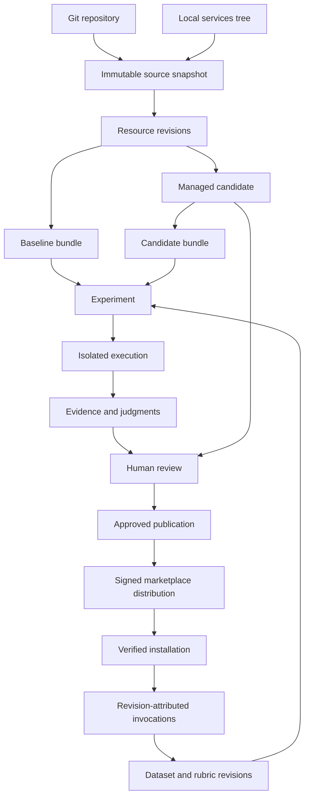

# Skills: analysis, experiments and managed revisions

## Delivery contract

This document is the implementation specification and progress ledger. A planned
capability is not a completion claim. Component tests do not prove a working pilot.

The system has three connected capabilities:

1. **Continuous analysis:** always-available observation of normal skill usage,
   conversations, tools, cost, latency, quality feedback and coverage gaps. It
   requires no experiment or background judge to be running.
2. **Experiments:** frozen baseline/candidate comparisons, evidence-backed
   suggestions and human-reviewed improvement. Inference is separately budgeted.
3. **Version impact:** immutable revisions, publication and installation evidence,
   invocation-level attribution, impact trends and reviewed rollback.

The loop is observe → identify → revise → experiment → review → publish → measure.
Before/after trends are associations, not proof of causal improvement. A conversation
can contain several skills and revisions; attribution belongs to each invocation.

### Agreed first release

- Baseline: `admin_daily_brief`, `admin_critical_projects`, `admin_ai_usage`,
  `systemprompt_cli`, retaining IDs, membership and access rules.
- Claude Code first; freeze client, model, provider and tool configuration across
  comparisons. OpenCode and the UK sales skills are outside this deliverable.
- Atlassian is read-only. Live writes target dedicated platform test records only.
- Managed revisions are authoritative after adoption. Git remains a supported
  authoring source, not a competing runtime truth.
- Reviewed publication, verified clean installation and rollback are in scope.
- Paid pilot: **$5 total**, including baseline, candidate, judges, retries and all
  auxiliary AI calls. Never silently shrink the requested matrix to fit.
- No production deployment or automatic production replay is part of acceptance.

## Architecture and ownership

Core owns sources, immutable assets/revisions, resolution, execution, credentials,
accounting and publication. Astound owns benchmark content, the admin presentation
and acceptance. PostgreSQL is the only required persistent storage dependency.

### Entity map

| Entity | Responsibility |
|---|---|
| Source | Owned origin: Git, local tree or managed authoring; references credentials, never stores their bytes |
| Source snapshot | Exact origin capture: commit/root when Git, manifest digest and importer version |
| Resource | Stable identity and kind: skill, plugin, marketplace or supporting resource |
| Revision | Immutable resource content, dependency revisions, parent and provenance |
| Asset | Exact bytes, SHA-256, byte length, media type; access checked through owner/resource |
| Bundle | Deterministic installable projection of exact revisions and assembler version |
| Dataset/rubric | Versioned evaluation cases, partitions, expectations and scoring rules |
| Experiment | Frozen matrix, objective, execution configuration and parent budget |
| Execution | One case × variant × repetition, authenticated owner and fenced lease |
| Evidence | Outputs, events, requests, judgments, approvals, readbacks and accounting |
| Publication | Approved revision selection, audience and monotonic generation |
| Installation | Client receipt attesting publication and exact installed bundle digest |

Git commit, resource revision, bundle hash, publication generation and experiment ID
are different identifiers. Never substitute one for another. Every mutable operation
has an authenticated actor; hashes are content integrity, not authorization.

## Sources, import and synchronization

Register sources with kind, location, credential reference and import settings. Git
sources additionally pin a tracked ref and subdirectory. Resolve the ref to a commit
before reading files. Import parses content and does not execute repository hooks.

The existing Anthropic-tree importer is a starting point, not a Git sync service.
Its remote plugin references must be resolved through explicitly configured source
repositories and exact commits. Unresolved references block publication, rather
than silently dropping resources. Preserve the disjoint manifest/sidecar ownership
of metadata; do not add a second author for the same field.

Resource identity is `(source, upstream key)` with an explicit binding to an
installation resource ID. Preserve the four baseline IDs during initial import.
Cross-source ID collisions require an explicit binding decision; source priority,
import order and filesystem order must never replace an active revision.

Identical imports are idempotent. Record snapshots even when a new Git commit has
unchanged resource bytes; content may deduplicate without losing provenance.

Editing an imported resource creates a managed child revision, retaining the
upstream snapshot, parent revision, author, rationale and motivating evidence.
It does not write upstream Git. Sync creates incoming revisions and never changes
the published pointer. Reconcile with a three-way comparison of the common upstream
base, managed revision and incoming revision. Resolution creates another candidate.
No automatic merge-and-publish.

Upstream removals propose withdrawal. An approved withdrawal creates a tombstone;
a managed resource cannot fall back to an older disk copy. Source credential loss
blocks sync, not access to already approved durable revisions.

## Asset storage and reproducible bundles

Use PostgreSQL relational tables for identities and relationships, JSONB for typed
manifests, and bounded BYTEA assets for exact file content. Authorization-domain
scoped references prevent digest knowledge from granting access. Validate hash and
length on ingress and retrieval. Assets are immutable; metadata changes produce a
new manifest. Avoid returning file bytes in ordinary list/detail APIs.

A revision includes SKILL.md, configuration metadata and supporting references,
templates, scripts and binary files. Manifests record portable relative path,
digest, byte length and executable flag. Reject traversal, escaping symlinks,
duplicate destinations and unsafe archive entries before materialization.

Use one shared asset representation for managed resources and evaluation workspaces.
Convert existing text-only frozen workspaces into manifests/assets through a forward,
verified migration; remove the superseded read/write path after conversion. Do not
retain dual authoritative stores or silently discard development records.

Bundle generation pins dependency revisions and assembler version, uses canonical
manifest serialization and stable file/archive ordering and timestamps. Identical
inputs produce identical installed bytes. Store the manifest durably; archives are
reproducible projections, not another source of truth.

Limits: 256 files/8 MiB input workspace; 16 MiB combined exported artifacts/logs per
execution. Oversized input fails preflight. Evidence overflow is explicit and cannot
produce a fully verified result. Temporary workspaces are removed after verified
export; failed cleanup remains visible and is retried by the supervisor.

Retain active/rollback publication dependencies while referenced. Retain benchmark
evidence 90 days and raw production-derived evidence 30 days unless stricter policy
applies. Promote only reviewed, sanitized material to durable cases. Garbage collect
only unreferenced expired assets; retain an evidence-expired marker in reports.

Evaluation artifacts are distinct from the existing user-facing AI Usage dashboard
artifact. They are the input files and proof behind a comparison, not a second
mechanism for publishing dashboards.

## Baseline and dataset

Import the exact current four-skill bundle as an **unevaluated baseline**. Verify
repository, resolved bundle and installed client hashes; expose discrepancies.
Freeze schemas, fixture versions, clock/timezone, model, prices, client image and
runtime configuration with each experiment.

Author 40 cases: ten per skill, seven development and three holdout each.

| Skill | Required case coverage |
|---|---|
| Daily Brief | Pagination, RAG arithmetic, partial coverage, unreadable status, stale/conflicting evidence, fresh reads on repeat |
| Critical Projects | Recorded/derived risk, evidence-backed priority, permission gaps, synthetic-only fallback, unsupported totals/history |
| AI Usage | USD/microdollars, periods, unknown accounting, users vs requests, unsupported ROI, authorized writes/readback |
| CLI | Help discovery, syntax, caller identity, ambiguous target, denied operations, approved write and timeout reconciliation |

Include prompt injection and unauthorized-write attempts across cases. Expected
behavior must allow multiple correct answers and valid tool sequences. Do not score
by exact prose matching. Fixture clocks and tool responses are deterministic; model
outputs are not assumed deterministic.

Candidate generation sees development cases only. When holdout failures inform an
edit, mark the holdout consumed and require a fresh holdout revision for a new
independent improvement claim.

Deterministic checks cover arithmetic, permissions, readbacks, provenance and
accounting. Semantic rubric: correctness 35%, evidence 35%, coverage 20%, usefulness
10%; scores 1–5, default pass 4/5. Unauthorized writes, fabricated evidence, owner
mismatch and unverified execution integrity are hard failures regardless of score.
AI judgments require resolvable evidence and remain distinct from human judgments.
Invalid/missing judgments remain unscored, never automatic passes.

## Evaluator and identity

Run an evaluator service through the existing binary and subprocess supervisor.
Poll every 5s, heartbeat every 20s, lease 60s; renew credentials before expiry.
Maximum two active executions per owner, 30 minutes accumulated active time.
Approval waits release capacity and expire after 24h.

Each pinned Claude Code container runs non-root, read-only root, one CPU, 2 GiB RAM,
128 processes and bounded writable storage. It receives no provider, administrator,
database or worker credentials and cannot reach peer executions or arbitrary
internet destinations. Only the trusted evaluator controls Docker; no socket in
the client. Use execution-scoped gateway/MCP access.

Every privileged operation validates authenticated owner, execution, session and
current lease. Allowed operations are the intersection of frozen permissions and
current owner permissions. Revocation takes effect during execution. Validate
installed bundle hashes before inference. Production usage never inherits an eval
execution identity and eval/judge traffic never enters normal usage cohorts.

Atlassian remains read-only. A live platform-write case updates a harmless profile
field on a dedicated test user, verifies it and restores it. No role, routing or
operational-user changes. Bind approval to exact execution, target, proposed patch
and observed precondition. Stale approvals fail. After timeout, read back before
retry; uncertain outcomes require review rather than automatic replay.

Critical Projects remains read-only even when tools expose writes. The benchmark
must enforce existing skill behavior rather than alter it to make a case pass.

## Accounting

One parent pilot budget caps all experiments and auxiliary calls at $5. Reserve
conservative bounded cost before every provider dispatch using frozen prices.
Settle exactly once; unknown usage retains reservation. Generation, judging,
selectors, scanners, repair and retries all charge the same budget. Internal AI
paths cannot bypass admission. Preserve encrypted terminal recovery receipts.

Preflight displays the matrix and maximum cost and blocks unaffordable requests.
The authored suite contains 40 cases; the first paid pilot explicitly selects eight
(two per skill), baseline and candidate once each plus bounded judging. If it cannot
fit, report budget-blocked and the estimate. Do not silently remove cases, substitute
mock inference for live proof or claim statistical significance from a smoke test.

## Presentation and improvement

Analysis remains available without workers. Add revision attribution only when
installation/invocation evidence proves it; historical events remain revision-unknown.
Related conversation cost overlaps between skills and is not causal skill cost.

Evaluations supports baseline/candidate, dataset/rubric selection, frozen settings,
budget preflight, progress, approval waits, cancellation and explicit failure states.
Comparison shows case matrix, quality/cost plot and evidence timeline; measures
quality, failures, latency, tokens, tools and cost per successful task. Failed-attempt
spend remains in that metric's numerator. Show sample size, unscored cases and unknown
accounting next to results. Never hide hard failures inside averages.

Candidate editing shows instruction/supporting-file diffs, parent revision, rationale
and findings. Optional AI drafting uses only development evidence and the same
budget. Export comparison JSON, Markdown report, case evidence manifest, skill diff,
publication decision and installation/rollback receipts.

## Publication and resolution

One core resolver serves agents, runtime, marketplace, bridge, CLI and evals. Managed
resources resolve exclusively through approved publication; missing/tombstoned is an
explicit unavailable result. Non-managed resources keep their existing config path;
this is an explicit management boundary, not a fallback for managed resources.

Approval binds exact candidate, bundle digest, experiment evidence, limitations and
current publication generation. Atomically create publication and distribution
outbox event. Stale generations conflict; no last-write-wins. Current access policies
remain authoritative; skill publication never implicitly grants tools or access.

Distribute via existing signed marketplace mechanisms. Track approved, distributed
and installed separately. Signed manifest delivery is not an installation receipt.
Acceptance requires a clean Claude Code client reporting the expected digest.
Rollback is a new reviewed generation referencing retained revisions, with a new
installation receipt; do not erase intervening history.

## Interfaces and implementation sequence

Extend existing typed application services rather than build a parallel eval stack.
Add source registration/sync/reconciliation, revision/candidate creation, authorized
asset/bundle downloads, experiment preflight/comparison, approval-bound operations,
publication/distribution/installation and rollback. Browser writes retain same-origin
checks; workers cannot publish or manage sources. Use bounded inputs, typed IDs,
owner checks, idempotency and optimistic generation checks throughout.

1. Source/asset/revision schema and services; import adapters and deterministic bundles.
2. Managed resolver; import four baseline skills across every consumer.
3. Supervised evaluator, fixture tools, identity and complete shared accounting.
4. Evidence/scoring, review artifacts and Analysis interfaces.
5. Reviewed publication, distribution, installation and rollback.
6. Fault acceptance, paid pilot and retained evidence.

Run core CI for core changes; build/test from Astound through coordinated `just`
recipes. Preserve concurrent work on `next`. Keep SQLx caches current. No global
claims of readiness while required checks remain failed or unexecuted.

## Acceptance and progress ledger

Completion requires idempotent imports; explicit source conflicts; no silent Git
replacement; deterministic bundles; consistent resolver output; no managed fallback;
foreign-owner/lease/artifact rejection; crash/cancel cleanup; approval expiry;
nonduplicated writes; concurrent $5 enforcement; useful fixture failures; inspectable
comparisons; clean installation and verified rollback; desktop/mobile browser checks.

Record actual source/revision/bundle IDs, experiments, approvals, readbacks, request
accounting and installation receipts. Mock tests and screenshots do not substitute
for real execution. Budget/access blockers remain explicit.

| Stage | Status | Evidence |
|---|---|---|
| Continuous usage analysis | Existing initial implementation | `docs/analysis/implementation.md` |
| Architecture | Written | This document |
| Sources/assets/revisions | Baseline capture, immutable candidates, file comparisons and owner-scoped revision browser implemented | Core `fde431867`; local build, Clippy, 877 unit tests and 767 database tests passed; 110 HTTP contract tests passed (one existing benchmark ignored) |
| Verified revision input bundles | Implemented and locally verified | Owned dependency closure, canonical JSON, full SHA-256, exact binary bytes/modes; unit, database, HTTP and browser checks passed |
| Shared managed runtime resolver | Pending | — |
| Supervised Claude Code evaluator | Pending | — |
| Experiment inspection | Existing records connected to owner-scoped list/detail pages; local empty-state browser check passed | Frozen matrix, execution status and settled/reserved budget views |
| Outcome comparison and suggestions | Pending | — |
| Publication/install/rollback | Pending | — |
| $5 live pilot | Pending | — |

Managed authoring uses a single injected repository per router. Local browser checks
verified four-skill capture, owner-scoped exports, candidate creation, unchanged
baseline/source files and desktop/mobile rendering. Visual inspection identified
Handlebars indentation altering editable multiline text; the renderer now disables
partial indentation. The browser adapter preserves line endings and leading blank
lines, and rejects text containing NUL bytes. Exact-byte browser checks passed for
LF and CRLF submissions. Bundle exports preserve source bytes and return identical
canonical content and SHA-256 across repeated reads. The final HTTP suite passed all 110 tests (one existing benchmark is explicitly
ignored because it requires a seeded, disposable performance database). No experiment,
publication, live write acceptance case or paid inference has been launched.

## Implementation contracts

### Authoring interfaces

The initial authoring API is under `/api/public/admin/managed`. The authenticated
principal supplies ownership; request bodies never supply an effective owner.

| Method and relative route | Contract |
|---|---|
| `POST /baselines/super-admin` | Capture the four configured skills twice; reject an unstable tree; import exact bytes without activating them |
| `POST /sources` | Register an immutable source specification; an identical owner/name registration is idempotent; a changed specification conflicts |
| `GET /sources/{id}` | Read an owned source specification, with credential references only |
| `POST /sources/{id}/snapshots` | Record validated provenance for that source kind |
| `POST /resources` | Bind source identity to one installation resource key; reject conflicting sources |
| `POST /revisions` | Atomically verify lineage, dependencies and assets, then persist an immutable manifest |
| `GET /revisions/{id}` | Verify the manifest digest before returning metadata |
| `GET /revisions/{id}/files` | Verify every asset hash and byte length; return an authorized, non-cacheable export |
| `GET /revisions/{id}/bundle` | Resolve the exact owned dependency closure; verify every manifest, asset and dependency pin; return canonical JSON with `X-Content-SHA256` |
| `POST /revisions/{id}/candidates` | Replace one existing UTF-8 file, preserve all other assets and dependencies, require a rationale |
| `GET /revisions/{baseline}/compare/{candidate}` | Require the same owned resource; report added, removed and changed files plus dependency/provenance changes |

Browser routes are `/admin/analysis/versions`, resource history below that route,
and `/admin/analysis/revisions/{id}` with `/edit` and `/compare/{candidate}`.
Lists page in batches of 50. Instruction previews are bounded; exports retain the
full verified content. The browser adapter preserves the original LF, CRLF or CR
line-ending convention despite HTML form normalization. Mixed line endings require
an exact asset revision; the editor refuses to silently rewrite them. The JSON
revision API continues to preserve explicitly submitted bytes. The browser distinguishes file comparison from outcome
comparison. A text candidate is not a publication or an evaluated improvement.

Validation returns 422 for invalid managed content, 404 for unavailable/foreign
resources, 409 for identity or generation conflicts, and an internal error for
integrity/database failures. Browser query validation returns 400. Browser writes
require an administrator and a valid same-origin request. An integrity failure must
never be rewritten as an empty resource or a successful import.

### Publication transaction and runtime boundary

Implement publication only after all runtime consumers use the resolver. The
transaction locks the stable resource binding, checks the expected generation,
verifies the approved candidate and pinned bundle/evidence, inserts an immutable
publication decision, advances the current selection, and appends an outbox event.
A retry with the same operation key and identical decision returns the same result;
a changed decision under that key conflicts. Rollback follows this same transaction.

The durable selection distinguishes these states:

| State | Runtime behavior |
|---|---|
| Imported, never adopted | Existing configured skill remains authoritative |
| Adopted and published | Resolve the exact selected revision and verified assets |
| Adopted and withdrawn | Explicitly unavailable; never consult the disk copy |
| Adopted with missing/corrupt content | Integrity error; never consult the disk copy |

Resolve a complete catalogue generation for manifest assembly. Include revision,
publication generation and supporting-file content in cache identity. Download
requests must identify the manifest/bundle they were issued for: a publication
between manifest retrieval and file retrieval must not mix old hashes with new
bytes. Retain referenced bundle generations for outstanding installation attempts.

Consumers that must agree are the gateway signed manifest, gateway plugin files,
marketplace export, CLI inspection/export, agent skill loading and evaluator bundle
materialization. Filesystem authoring validation remains an explicit authoring
operation. It must not be used as runtime resolution for adopted resources.

### Experiment state and recovery

An experiment freezes its matrix before any execution is eligible for claiming.
Preflight is pure validation and estimation. A launch atomically records the frozen
specification, idempotency key, shared budget reference and execution rows. A worker
claims only owner-authorized queued work with a fenced lease.

| Execution state | Permitted transition and evidence |
|---|---|
| Queued | Claim to running after permission, budget and installation preflight |
| Running | Heartbeat; emit ordered durable evidence; request approval; finish, fail or cancel |
| Awaiting approval | Persist exact operation/precondition; release capacity; resume with a fresh lease only after valid approval |
| Completed | Terminal execution evidence and accounting coverage are recorded; scoring may still be pending |
| Error/cancelled | Retain evidence and unsettled reservations; record cleanup outcome |
| Approval expired | Terminal blocked operation; no automatic execution |

Completion of the client process does not imply a successful task, complete billing,
or a passing judgment. Keep execution outcome, evaluation outcome, accounting
coverage and cleanup state separate. A worker crash invalidates its lease; recovery
reconciles its owned container and reservations before any retry. Do not replay an
uncertain external write. Events carry an execution ID, fencing token and monotonic
sequence; duplicate delivery must be idempotent and conflicting delivery must fail.

### Measurement joins and denominators

Always-on analysis starts from authenticated invocation events and joins through
verified session/conversation/request correlations. Use explicit coverage counts:
observed invocations, correlated invocations, revision-attributed invocations,
requests with usage, and requests with settled cost. Missing values remain missing.

A revision impact view groups by skill revision, client/model configuration, time
window and task cohort. Show counts beside rates. Display related conversation cost
as an overlapping association; do not sum it across skills as total platform spend.
Direct tool cost exists only where independently metered. Inference cost surrounding
a tool call must not be relabelled as a tool invoice.

An experiment comparison uses paired case/repetition records with frozen settings.
Report all attempted executions, hard failures, unscored outcomes and incomplete
accounting. Cost per successful task is total attempted spend divided by verified
successful tasks; when there are no successes, show undefined rather than zero.
A pilot establishes pipeline behavior and identifies examples for review. Larger,
independent samples are required for general improvement claims.

### Local validation evidence

- Preview: `http://localhost:8081/admin/analysis/versions`; the existing server on
  port 8080 was preserved.
- Screenshots: `.build/evals-artifacts/versions.png`, `revision.png`,
  `comparison.png`, `comparison-mobile.png`, and `evaluations.png`.
- Browser assertions: four baseline bindings, owner-scoped exports, unchanged
  source/baseline, exact candidate bytes, LF/CRLF and leading blank lines, NUL
  rejection, invalid query rejection, mobile containment and no JavaScript errors.
- Local validation snapshot (2026-09-12): no ingested usage or experiment executions. Authoring
  checks do not establish real usage patterns, installation correctness or quality.
- Core `22d481cdf` passed build, SQLx, Clippy, schema/identity gates and domain tests.
  That full CI run also failed in other suites, including formatting in the bridge
  GUI tests and the bridge source-size gate. Full-core CI is not a green release gate.

### Revision input bundle contract

The revision input export binds the root revision, all declared dependency revisions,
canonical manifests and deduplicated exact-byte assets. Schema version 1 allows at
most 64 revisions, 256 expanded files and 8 MiB of expanded content. Shared assets
count again toward the expanded limit at each materialized reference. Parent revisions
remain provenance and are not implicitly included as dependencies.

Resolution checks ownership for every revision. Verification rejects unsupported
schemas, changed bytes or metadata, invalid dependency hashes, missing dependencies,
cycles, unsafe paths and unrelated extra records/assets. Canonical JSON and its full
SHA-256 are stable across repeated reads; executable-mode changes change identity.
Downloads require authentication and use attachment/no-store/nosniff headers.

This is the reproducible input representation. Host-specific installable projection,
evaluator materialization, signed distribution and installation receipts remain in
the runtime resolver/publication stages. No filesystem fallback or activation is
performed by this authoring export.

### Final local checks for revision authoring and bundles

On 12 September 2026, the merged implementation passed `just build`, `just clippy`,
877 unit tests, 767 database integration tests and 110 HTTP contract tests. The one
ignored HTTP performance benchmark still requires a separate seeded database. The
new bundle route is the only additional access-contract baseline row in this final
increment; existing route outcomes are unchanged. All 1,228 SQLx cache query hashes
match their filenames after the forward merge.

The rebuilt 8081 preview passed browser assertions for canonical bundle downloads,
SHA-256 headers, exact stored bytes, unchanged baseline/source, LF/CRLF and leading
blank lines, rejected NUL edits, query validation, mobile containment and JavaScript
errors. Refreshed screenshots are in `.build/evals-artifacts/`. The existing 8080
server was preserved. Cost ingestion also rejects negative sub-microdollar amounts
before rounding and excludes the overflowing floating-point boundary for `i64`.

Core `71d2e4ca0` passed strict Clippy, Rustdoc and MSRV CI checks. Its source-size
failures are the existing bridge `gui/command/general.rs` and `gui/tray.rs` files.
The comment gate identified two new method comments in the bundle module; commits
`d3a96e8c8` and `fde431867` move that documentation to the public type without changing
runtime behavior. CI confirmation of those comment-only corrections remains pending.
These local results validate the implemented authoring slice, not the outstanding
runtime resolver, evaluator, shared pilot budget, scoring or publication lifecycle.
