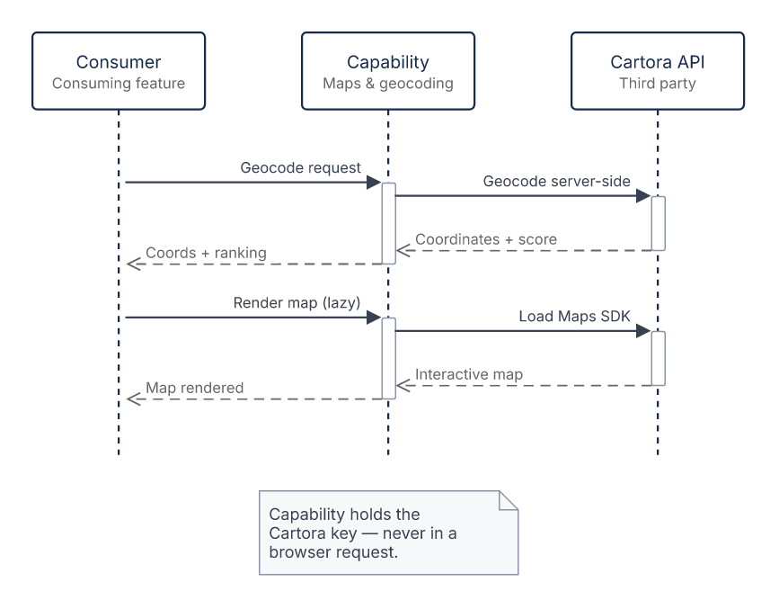
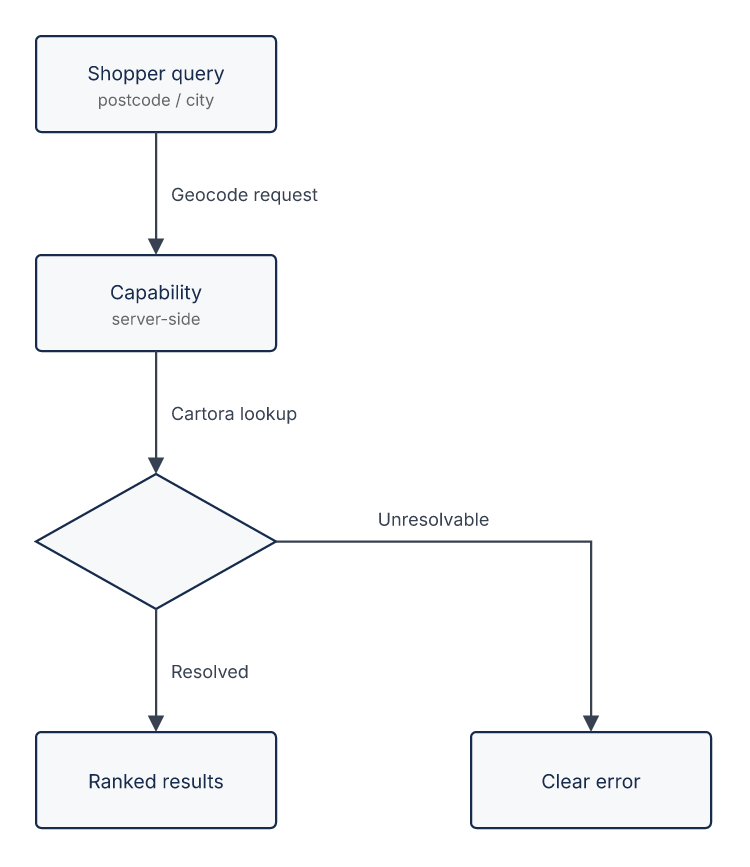

# Cartora Maps Integration ISD

## General ISD Information

|   |   |
| - | - |
| WBS Code | — |
| Project Name | Cartora Maps Integration |
| Jira Reference | JIRA SFX-4102 — "Store Locator (find a store)" (consumer-feature tracker; the sources record no dedicated ticket for this integration) |
| Author/Owner | Dane (SA lead) |
| ISD Status | draft |
| Target Approval Date | dd/mm/yyyy |

### Astound Approval

|    |             |            |
| -- | ----------- | ---------- |
| FA | not started | Ben Okafor |
| FE | not started | TBC        |
| BE | not started | TBC        |
| QA | not started | TBC        |

### Meridian Outfitters Approval

|    |             |      |
| -- | ----------- | ---- |
| PO | not started | Mara |

## Reference Materials

| Material | Link / reference | Notes |
|---|---|---|
| Cartora Geocoding API | https://developers.cartora.example/docs/geocoding | Cartora Geocoding API reference |
| Cartora Maps SDK | https://developers.cartora.example/docs/maps-sdk | Cartora Maps SDK guide |
| Cartora key policy | https://developers.cartora.example/docs/keys | Cartora key domain-restriction & quota policy |
| SRD / BRD | https://wiki.example.com/display/COM/Store+Locator+SRD | Consumer-feature context (first consumer of this capability) |

## Overview

This ISD specifies the Cartora maps integration — an agnostic capability that gives storefront features a reusable, governed way to present interactive maps and location search. Cartora is wrapped as the single vendor behind a stable capability interface, so consuming features get interactive map rendering plus postcode and city geocoding with proximity ranking without integrating Cartora directly. The capability owns vendor governance centrally, so consuming features depend only on its interface rather than on any Cartora key, quota, or billing of their own. The Store Locator page is the first consumer.

## Integration Specification

This section outlines the technical contract for the Cartora maps integration: the integration points in data-flow order, their request/response shape, and the governance rules that apply across them.

### Integration Flow Overview

```drawio:sequence:integration-flow-overview
title: "Cartora maps integration — data flow"
participants:
  - { id: consumer,   title: "Consumer",    subtitle: "Consuming feature" }
  - { id: capability, title: "Capability",  subtitle: "Maps & geocoding" }
  - { id: cartora,    title: "Cartora API", subtitle: "Third party" }
messages:
  - { kind: call,   from: consumer,   to: capability, text: "Geocode request" }
  - { kind: call,   from: capability, to: cartora,    text: "Geocode server-side" }
  - { kind: return, from: cartora,    to: capability, text: "Coordinates + score" }
  - { kind: return, from: capability, to: consumer,   text: "Coords + ranking" }
  - { kind: call,   from: consumer,   to: capability, text: "Render map (lazy)" }
  - { kind: call,   from: capability, to: cartora,    text: "Load Maps SDK" }
  - { kind: return, from: cartora,    to: capability, text: "Interactive map" }
  - { kind: return, from: capability, to: consumer,   text: "Map rendered" }
notes:
  - under: capability
    text: "Capability holds the Cartora key — never in a browser request."
```



### Geocoding & Proximity

Resolves a postal code or a city to coordinates with proximity-ranked results for the consuming feature. Per the approved call approach, geocoding requests are served **server-side**: the Cartora key stays server-side, and throttling, caching, and quota governance live in the capability. Geocode responses are cacheable server-side with a bounded lifetime to respect quota; the cache lifetime is settled in the technical design.

**Endpoint:** HTTPS GET `…/v1/geocode` (Cartora Geocoding API), JSON.

**Request → Cartora Geocoding**

| Field | Source | Note |
| --- | --- | --- |
| `q` | shopper postcode or city | Verbatim search query |
| `key` | capability-held Cartora key | Domain-restricted API key, sent as a query parameter (origin-locked); server-side only |
| `country` | storefront locale region | Scopes results to the market |
| `limit` | capability config | Caps proximity results |

**Response ← Cartora Geocoding**

| Cartora field | Maps to | Note |
| --- | --- | --- |
| `results[].lat`, `results[].lng` | `coordinates` | Transient — never persisted |
| `results[].score` | `proximityRanking` | Orders results by proximity |
| `results[].label` | — | Vendor display label; not part of the consumer contract |

**Error handling:** input Cartora cannot resolve yields a clear error result to the consumer instead of coordinates.

```drawio:flow:geocoding-resolution
title: "Geocoding resolution outcome"
nodes:
  - { id: query,      row: 0, col: 0, title: "Shopper query", subtitle: "postcode / city" }
  - { id: capability, row: 1, col: 0, title: "Capability",    subtitle: "server-side" }
  - { id: gate,       row: 2, col: 0, kind: decision }
  - { id: results,    row: 3, col: 0, title: "Ranked results" }
  - { id: error,      row: 3, col: 1, title: "Clear error" }
edges:
  - { from: query,      to: capability, text: "Geocode request" }
  - { from: capability, to: gate,       text: "Cartora lookup" }
  - { from: gate,       to: results,    text: "Resolved" }
  - { from: gate,       to: error,      text: "Unresolvable" }
```



### Map Rendering

Exposes Cartora interactive map rendering to consuming features as a lazy-loadable entrypoint.

- **Channel:** Cartora Maps SDK — JS bundle plus vector tiles over HTTPS.
- **Entrypoint:** lazy-loadable; the map loads only when the consumer requests it, and the consumer's content stays usable before and while the map is loading.
- **Key supply:** the capability supplies its domain-restricted key at SDK initialisation; the SDK attaches it to map requests. Consumers configure no key.

### Key Governance & Privacy

- **Key:** domain-restricted to the storefront origins; held server-side for geocoding and supplied at SDK initialisation for map rendering; consumers hold no Cartora key.
- **Quota & billing:** guardrails on the client's Cartora account; throttling, caching, and quota governance are owned by the capability.
- **Release prerequisite:** the domain-restricted key is issued by the client's platform owner before the capability's first release.
- **Privacy:** shopper coordinates are transient — never persisted and never sent to analytics.

## In Scope Functional Requirements

**Re-usability Legend**

- `[SF Next OOTB]` — base SF Next functionality, used as delivered
- `[3rd party OOTB]` — delivered by the third-party service as licensed, consumed as published
- `[SF Next Modified]` — base SF Next functionality that must be changed / adapted
- `[Legacy AS IS]` — ported from the legacy codebase to SF Next without behavioural change
- `[Legacy Modified]` — ported from the legacy codebase but must be changed / adapted
- `[New]` — brand-new functionality, built from scratch

### 3PI.MAP.GEO — Geocoding with proximity ranking

#### User Story

As a shopper, I want to search for stores by postal code, city, or my current location, so that I see the nearest stores first.

#### Acceptance Criteria

##### [New]

1. The capability SHALL expose a stable interface that resolves a postal code or city to coordinates and returns proximity-ranked store results.
2. Consumers SHALL integrate against that interface without holding any Cartora key, quota, or billing.
3. The capability SHALL keep Cartora key, quota, and billing governance centralized so consuming features hold none of it.
4. The geocoding call approach (client-side vs server proxy) remains undecided (Q1).

#### Key behaviours

| # | Scenario | GIVEN | WHEN | THEN |
| --- | --- | --- | --- | --- |
| **Postcode and city geocoding with proximity ranking** |  |  |  |  |
| 1 | Valid postcode resolves to proximity-ranked results | a consumer requesting geocoding for a valid postal code | the capability processes the request | the consumer receives coordinates and proximity-ranked results for that postal code |
| 2 | Valid city resolves to proximity-ranked results | a consumer requesting geocoding for a city name | the capability processes the request | the consumer receives coordinates and proximity-ranked results for that city |
| 3 | Unresolvable input returns a clear error to the consumer | a consumer requesting geocoding for input Cartora cannot resolve | the capability processes the request | the consumer receives a clear error result instead of coordinates |
| 4 | Cartora key stays out of the browser | a consumer using the capability's geocoding | a shopper's search triggers geocoding requests | no browser-visible request contains the Cartora key |
| **Shopper coordinate privacy** |  |  |  |  |
| 5 | Coordinates are not persisted or sent to analytics | a shopper interaction that passed coordinates through the capability | the geocoding or map request completes | the shopper's coordinates are not persisted by the capability<br>the shopper's coordinates are not sent to analytics |

### 3PI.MAP.RND — Governed map rendering

#### User Story

As a shopper, I want to see nearby stores on an interactive map, so that I can locate a store to visit.

#### Acceptance Criteria

##### [3rd party OOTB]

1. The capability SHALL render through the vendor's own map runtime as delivered, owning no map-drawing behaviour of its own; what the runtime draws changes with the vendor, not with this change.

##### [New]

1. The capability SHALL expose map rendering as a lazy-loadable entrypoint so consuming features keep maps off their critical path.
2. The capability SHALL keep the Cartora key domain-restricted, with quota and billing governed on the client's Cartora account (guardrails per Q2).
3. The capability SHALL keep shopper coordinates transient — never persisted and never sent to analytics.

#### Key behaviours

| # | Scenario | GIVEN | WHEN | THEN |
| --- | --- | --- | --- | --- |
| 1 | Map loads on consumer demand without blocking content | a consuming feature whose page content has rendered | the consumer requests the map entrypoint | an interactive map is rendered<br>the consumer's content stays usable before and while the map loads |
| 2 | Consumers render maps without holding a vendor key | a consuming feature integrating the map entrypoint | the map renders | the consumer supplies no Cartora key of its own<br>map requests carry the capability's domain-restricted key |

### 3PI.MAP.STY — Consumed map presentation (style and map type)

#### User Story

As a shopper, I see the store map in the brand's configured style and map type (street/satellite).

#### Acceptance Criteria

The presentation itself — map type and brand theme — is authored and published OUTSIDE this change, on the vendor's hosted no-code surface, by the client's brand/content team. This slice delivers only how the capability references that published presentation and how it behaves when the presentation changes or cannot be resolved.

##### [3rd party OOTB]

1. The capability SHALL render its map surface against the published presentation configuration it is pointed at, so the configured map type and brand theme reach the storefront with no storefront release.
2. The capability SHALL hold a reference to that presentation and never a copy of it, so a re-published presentation reaches the storefront without a code change.
3. When the referenced presentation cannot be resolved, the capability SHALL still expose a usable map surface on the vendor's default presentation rather than failing the consuming feature's render.
4. The v1 presentation configuration SHALL be the brand/content team's published "Brand Street" style, which that team authors and owns.

#### Key behaviours

| # | Scenario | GIVEN | WHEN | THEN |
| --- | --- | --- | --- | --- |
| 1 | Published presentation reaches the map surface | a published presentation carrying a map type and brand theme | a consumer renders the capability's map surface | the map surface is rendered against that published presentation |
| 2 | Re-published presentation needs no release | a consumer rendering the capability's map surface | the brand team re-publishes the presentation on the vendor surface | the changed map type and theme reach the consumer without a code change |
| 3 | Unresolvable presentation still yields a usable map | a referenced presentation the capability cannot resolve | a consumer renders the capability's map surface | a usable map surface is rendered on the vendor's default presentation<br>the consuming feature's render does not fail |

### 3PI.MAP.MRK — Consumed store markers

#### User Story

As a shopper, I see stores on the map with the brand's custom markers/pins.

#### Acceptance Criteria

The marker artwork is authored and published OUTSIDE this change, inside the same vendor-hosted presentation the client's brand/content team owns. This slice delivers only how the capability renders the published marker set.

##### [3rd party OOTB]

1. The capability SHALL plot store locations with the marker set carried by the published presentation, so brand-authored markers reach the storefront with no storefront release.
2. The capability SHALL define no marker artwork of its own, so the published marker set stays the single source for how a store appears on the map.
3. When the published presentation carries no custom marker set, the capability SHALL still plot store locations using the vendor's default marker.

#### Key behaviours

| # | Scenario | GIVEN | WHEN | THEN |
| --- | --- | --- | --- | --- |
| 1 | Brand-authored markers plot the stores | a published presentation carrying a custom marker set | the capability plots store locations on the map surface | the stores are plotted with that published marker set |
| 2 | Presentation without custom markers falls back to the default | a published presentation carrying no custom marker set | the capability plots store locations on the map surface | the stores are plotted using the vendor's default marker |

## Out Of Scope / Limitations

- Consumer UI/UX — the Store Locator page, map/list synchronization, store detail, service filters, navigation, accessibility, and shopper-facing copy — is owned by the functional Store Locator change.
- Store data (commerce Stores API), address autocomplete (Addressly), and appointment booking (SlotBook) are separate services owned by separate changes.
- The "Get directions" hand-off is a native device deep-link owned by the functional surface; it makes no Cartora call.

## Deferred Requirements

None.

## Change Requests

None.

## Open Questions

Use inline comments during review whenever possible; this table is only for questions in areas the document does not cover.

| Q# | Question | Owner | Notes | Decision |
| --- | --- | --- | --- | --- |
