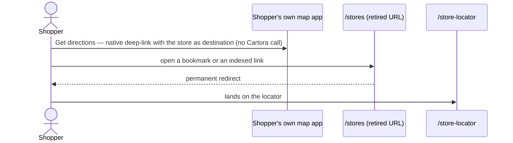

# SLS - Store Locator — Technical Design

## Technical Design Overview

This technical design plans the functional Store Locator — a single Storefront Next
`/store-locator` route whose loader turns typed, city, or current-location search into an
accessible, proximity-ordered result list, with an interactive map lazily loaded off the
critical path and the legacy `/stores` directory retired behind a permanent redirect. It owns
the developer-level HOW only: the geocoding, address-autocomplete, and store-data capabilities
it needs are consumed through feature-side seams other changes deliver, so the feature holds no
vendor key. Seven primary delivery units become seven vertical phases; accessibility and
localization are carried inside every phase rather than scheduled as a clean-up phase.

What constrains downstream (tasks): the phase order is the execution order — the first phase
establishes the route, loader, and capability seams the later phases extend; the map stays a
lazy client island off the critical JS path; store data is read from the existing Stores API
with no new model; and each phase is proven by developer-owned verification only (loader and
component unit tests plus a bundle check), with functional and QA testing out of scope. The
approved grooming bounds hold: regular weekly opening hours only, and shopper coordinates never
persisted, placed in URLs or history, or sent to analytics.

Two questions are passed forward to the planning approval session: the contract shape the
consumed geocoding and address-suggestion seams code against (CRITICAL — it blocks tasks), and
whether locator store-data reads take any edge caching in v1 (NICE-TO-HAVE). No planning
decision is approved yet; the questions below are open.

## Technical Design Source Inventory

| Artifact | Location | Planning use |
|---|---|---|
| FSD | `openspec/changes/add-store-locator/fsd/store-locator.md` | Signed functional WHAT — primary interpretation of approved intent (projects proposal stories, specs, and approved grooming) |
| Specs | `openspec/changes/add-store-locator/specs/**/*.md` | Structured executable projection of the signed WHAT — behaviour contract and RQ/WBS trace |
| Grooming | `openspec/changes/add-store-locator/grooming.md` | APPROVED decision authority — locked decisions and prerequisites (P#) this plan honours and references, never re-decides |
| Architecture design | `openspec/changes/add-store-locator/design.md` | HOW / architecture rationale — locked decisions and cross-cutting constraints; not a requirements source |
| Proposal | `openspec/changes/add-store-locator/proposal.md` | Approved delivery offer — Requirements Lock, delivery slices, scope boundaries, and dependencies/access |
| Discovery | `openspec/changes/add-store-locator/discovery.md` | Source/provenance history — requirement trace origins, affected capabilities, and dependency background |
| Stories | `openspec/changes/add-store-locator/stories.md` | Jira delivery grouping (TBD-1..TBD-9); not a behaviour source |

## Delivery Inventory

| Unit | Source | Story | Spec trace | Classification | Implementation areas | Notes |
|---|---|---|---|---|---|---|
| Store search | `stories.md` + `specs/store-locator/spec.md` | `TBD-1` | RQ-701 / SLS.SRCH — Store search; RQ-701 / SLS.SRCH — Management | PRIMARY | Frontend | Covers typed/city/current-location search plus Business Manager radius/use-my-location configuration. |
| Address autocomplete | `stories.md` + `specs/store-locator/spec.md` | `TBD-2` | RQ-710 / SLS.AC — Address autocomplete in store search | PRIMARY | Frontend | Addressly seam remains per Q1. |
| Synchronized map and list | `stories.md` + `specs/store-locator/spec.md` | `TBD-3` | RQ-702 / SLS.MAP — Synchronized map and list; Side-by-side map and list on desktop; List-first layout with map toggle on mobile and tablet; Management | PRIMARY | Frontend | Layout variants and results-per-page management stay with the map/list phase. |
| Store detail | `stories.md` + `specs/store-locator/spec.md` | `TBD-4` | RQ-703 / SLS.DTL — Store detail | PRIMARY | Frontend | Regular weekly hours only per grooming. |
| Filter stores by service | `stories.md` + `specs/store-locator/spec.md` | `TBD-5` | RQ-705 / SLS.FLT — Filter stores by service; RQ-705 / SLS.FLT — Management | PRIMARY | Frontend | Service options follow Business Manager configuration. |
| Get directions | `stories.md` + `specs/store-locator/spec.md` | `TBD-6` | RQ-704 / SLS.DIR — Get directions | PRIMARY | Frontend | Native map-provider deep link; no extra maps-vendor call. |
| Accessibility | `stories.md` + `specs/store-locator/spec.md` | `TBD-7` | RQ-706 / SLS.A11Y — Accessible store locator | CROSS-CUTTING | Frontend | Carried by every phase for the surface it adds; built accessible per surface (semantic markup / `sfnext-test-ids`). |
| Localization | `stories.md` + `specs/store-locator/spec.md` | `TBD-8` | RQ-707 / SLS.I18N — Localizable content | CROSS-CUTTING | Frontend | Carried by every shopper-facing surface; built key-backed per surface (`sfnext-i18n`). |
| Navigation entry and directory retirement | `stories.md` + `specs/global-navigation/spec.md` + `specs/store-locator/spec.md` + `specs/store-directory/spec.md` | `TBD-9` | RQ-709 / GH.UTL — Footer utility links; RQ-709 / GH.UTL — Retired store directory URL redirects to the locator; REMOVED — Static store directory page; REMOVED — Manually authored content | PRIMARY | Frontend, CMS | Footer link, permanent redirect, and Page Designer retirement are one shopper-visible switch-over. |

## Delivery Phases

**Decomposition criterion:** a phase is one shopper-observable locator capability delivered end to end —
its loader work, its components, its copy, and its own test evidence — so closing a phase leaves the
storefront working and committable. The locator is a single Storefront Next route, so phases are not area
splits: every phase touches that route and is verified through it.

**Primary phase units:** the Delivery Inventory rows classified PRIMARY. One phase per primary story unit,
never a fraction of one; `TBD-9` additionally carries the `store-directory` REMOVED requirements, because
the retirement and the redirect that replaces them are one shopper-visible switch-over.

**Shared seams:** the route shell, the loader, and the Cartora/Addressly seams (`capabilities.ts`, contract
per Q1) are not a phase of their own — they are folded into P1, the first phase that consumes them, which
makes P1 the pattern-setting phase the later ones extend.

**Cross-cutting obligations:** accessibility (RQ-706) and localization (RQ-707) are carried by every phase
for the surface it adds — built accessible (semantic markup / `sfnext-test-ids`) and key-backed per surface;
their functional verification is out of scope.

**Rejected splits:** no separate shell/seam foundation phase — it delivers nothing a shopper can observe;
no separate accessibility or localization phase — deferring either to the end would rework every earlier
surface; no Frontend/CMS split of `TBD-9` — the footer link, the redirect, and the Page Designer retirement
are one switch-over and are verified together.

| Phase | Name | Delivers (story / RQ · WBS) | Acceptance coverage | Areas | Depends on | Verification |
|---|---|---|---|---|---|---|
| P1 | Search, results list, and the shared locator shell | `TBD-1` / RQ-701 · SLS.SRCH — plus the shared route, loader, and capability seams later phases consume | Empty locator shell; typed postcode/city search; use-my-location granted and denied; proximity-ordered result list; no coordinates in URL/history/analytics | Locator route shell and loader; Search and suggestion surface; Results, map, and selection surface (list only); capability seams | — | Loader unit tests (search-param parsing, proximity pass-through) |
| P2 | Address autocomplete | `TBD-2` / RQ-710 · SLS.AC | Typed address produces suggestions from the Addressly seam; selecting a suggestion submits the search; manual search still works when no suggestion is used | Search and suggestion surface | P1 | Suggestion-adapter unit test against the stubbed Addressly seam |
| P3 | Interactive map synchronized with the list | `TBD-3` / RQ-702 · SLS.MAP | Map loads on demand; list remains usable before and while the map loads; list selection updates marker selection and marker selection updates the list | Results, map, and selection surface | P1 | Selection-sync unit test; bundle check that no map SDK sits on the critical path |
| P4 | Store detail | `TBD-4` / RQ-703 · SLS.DTL | Selected store shows name, full address, phone, regular weekly opening hours, and services; holiday hours stay out of v1 per grooming Q1 | Store detail, service filter, and directions surface | P1 | Store-detail rendering unit test (regular weekly hours, services) |
| P5 | Filter stores by service | `TBD-5` / RQ-705 · SLS.FLT | Click-and-collect, returns, and gift-wrapping filters narrow the same result set; clear restores full results; no-match empty state is shown | Store detail, service filter, and directions surface; Locator route shell and loader | P1 | Loader filter-narrowing unit test (filter, clear, empty state) |
| P6 | Get directions | `TBD-6` / RQ-704 · SLS.DIR | Directions opens the shopper's own map provider with the store as destination; no additional maps-vendor call and no key exposure | Store detail, service filter, and directions surface | P4 | Directions deep-link unit test asserting no maps-vendor call |
| P7 | Navigation entry, retired URL, and directory retirement | `TBD-9` / RQ-709 · GH.UTL, plus the `store-directory` REMOVED requirement | Footer "Our stores" points to `/store-locator`; bookmarked `/stores` permanently redirects; legacy Page Designer store-directory content is retired | Navigation and directory switch-over | P1 | Redirect loader unit test; Page Designer page removed |
| Cross-cutting | Accessibility and localization | `TBD-7` / RQ-706 · SLS.A11Y; `TBD-8` / RQ-707 · SLS.I18N | Every added surface is keyboard-operable and screen-reader understandable and draws its copy from translation keys; a non-default locale renders translated labels and messages | All locator building blocks; Localization resources | — | Carried inside every phase for the surface it adds; translation keys extracted, synced, and compiled (`sfnext-i18n`); accessibility built into each surface (semantic markup / `sfnext-test-ids`) |

## Implementation Architecture

### Frontend / Storefront Surface

| Surface | Server responsibility | Client responsibility | Hydration / ownership |
|---|---|---|---|
| `/store-locator` route | Loader parses search params (query, service filter), geocodes via the Cartora capability seam, reads stores from the Stores API, returns proximity-ordered results; SSR shell renders the accessible list first | Search island (input, use-my-location, autocomplete), filter island, map island, list↔map selection sync | Eager for search/filter islands; lazy for the map island |
| `/stores` retired URL | Loader returns a permanent redirect to `/store-locator` | — | No client hydration |

### Backend / SFCC Surface

| Surface | Responsibility | Inputs / triggers | Outputs / side effects |
|---|---|---|---|
| None — no Backend / SFCC implementation: store data is read through the existing commerce Stores API; no new endpoints, hooks, jobs, custom objects, or metadata (design: "no new store data model for v1") | — | — | — |

### CMS / Content Surface

| Surface | Responsibility | Owned identifiers | Notes |
|---|---|---|---|
| Legacy `/stores` Page Designer content page | Retire the static directory page and its authoring entry | Page Designer `/stores` content page | No content migration; store data now comes from the Stores API |

### Implementation Building Blocks

| Block | Responsibility | Interfaces / contracts | Owned identifiers | Trace |
|---|---|---|---|---|
| Locator route shell and loader | Owns the `/store-locator` SSR shell, search-param parsing, store reads, proximity ordering, and filter branch | Public route `/store-locator`; loader inputs: query, service filter, ephemeral geolocation submission; Cartora/Addressly seams per Q1 | `src/routes/_app.store-locator.tsx`, `StoreLocatorPage` | RQ-701, RQ-702, RQ-703, RQ-705, RQ-710 |
| Search and suggestion surface | Collects postcode/city input, use-my-location action, and Addressly suggestions while preserving manual search | Addressly suggestion seam per Q1; coordinates never in URL/history/analytics | `StoreSearch`, feature capability seams | RQ-701, RQ-710 |
| Results, map, and selection surface | Keeps an accessible list usable before map load, loads the Cartora map lazily, and syncs list↔marker selection | Cartora map entrypoint seam per Q1; no map SDK in the initial route bundle | `StoreList`, `StoreMap`, selection sync state | RQ-702, RQ-706 |
| Store detail, service filter, and directions surface | Shows approved store detail fields, filters stores by service, and opens directions in the shopper's own map app | Regular weekly hours only; directions are native deep links, not a maps-vendor call | `StoreDetail`, `ServiceFilter`, `GetDirectionsLink` | RQ-703, RQ-704, RQ-705 |
| Navigation and directory switch-over | Re-points global navigation and permanently redirects the retired URL while retiring legacy authored content | Footer link target `/store-locator`; permanent redirect from `/stores` | `/stores` redirect route, global footer navigation, Page Designer `/stores` page | RQ-709, store-directory REMOVED |
| Localization resources | Ensures all locator UI copy is key-backed and renders in non-default locales | Translation-key catalog and sync path | Locator locale resources | RQ-707 |

## Runtime Flows

**Search and results**

```mermaid
sequenceDiagram
    actor S as Shopper
    participant R as /store-locator route (loader, SSR)
    participant Sm as Capability seams (Cartora / Addressly, per Q1)
    participant API as Stores API

    S->>R: open /store-locator
    R-->>S: SSR shell — search form + accessible empty list
    alt typed search
        S->>R: postcode/city as URL search params (typed or via an Addressly suggestion)
    else use my location — explicit action, permission granted
        S->>R: coordinates via an ephemeral fetcher submission (never in the URL)
    else location permission denied
        Note over S: explanation shown — manual search stays available (no request sent)
    end
    R->>Sm: geocode the query (server-side Cartora seam)
    alt query resolves
        Sm-->>R: coordinates
        R->>API: store read + proximity ordering
        alt stores returned
            API-->>R: stores with service attributes
            R-->>S: list renders server-first; the lazy map island loads and syncs selection both ways
        else no matching stores or Stores API unavailable
            API-->>R: empty/error result
            R-->>S: grounded empty/error state; manual search remains available
        end
    else query cannot be resolved
        Sm-->>R: no coordinates
        R-->>S: address/search error state; manual search remains available
    end
    S->>R: apply / clear service filter (URL search param)
    R-->>S: list and map narrowed / restored — empty state when nothing matches
    Note over S,API: Shopper coordinates — never persisted, never in URLs or history, never sent to analytics
```

**Hand-offs and entry points**



## Implementation Constraints

| Concern | Planning decision | Verification |
|---|---|---|
| Rendering / hydration | SSR/RSC page shell with the accessible list server-rendered; map is a lazy client island off the critical JS path | Initial bundle contains no map SDK code (bundle check) |
| Data fetching | Server-only loading: loader-driven search via URL params; geolocation coords via an ephemeral fetcher submission; suggestions via the Addressly seam | Loader unit tests; no direct vendor calls from feature code |
| Caching | Store data is a storefront/edge caching candidate; exact strategy is planning question Q2 | Decided with Q2 |
| Security | Geolocation user-initiated and permission-gated; coordinates never persisted, never in URLs, never sent to analytics; no vendor keys held by the feature | Analytics payload assertion (unit); code review of the seams |
| Performance | List-first render keeps results usable immediately; map entrypoint loads on demand | Bundle check |
| i18n / translations | All shopper-facing copy via `sfnext-i18n` translation keys with a locator namespace and sync path; multi-locale | Translation keys extracted, synced, and compiled (`sfnext-i18n`) |
| CMS / Page Designer | Legacy `/stores` content page retired at launch | Page removed; redirect loader unit test covers the URL |

## Verification Strategy

| Target | Evidence | Coverage / trace | Blockers | Notes |
|---|---|---|---|---|
| Locator route shell and loader | Unit tests for search-param parsing, proximity ordering pass-through, and service-filter narrowing | RQ-701, RQ-705 | Cartora/Addressly seams stubbed per Q1 | Vitest, co-located |
| Search and suggestion surface | Suggestion-adapter unit test against the stubbed Addressly seam; use-my-location submission unit test asserting coordinates stay out of the URL | RQ-701, RQ-710 | Addressly seam stubbed per Q1 | Coordinates never persisted or sent to analytics |
| Results, map, and selection surface | Unit test for list↔map selection state | RQ-702, RQ-706 | — | Bundle check asserts the map SDK is absent from the initial route bundle |
| Store detail and directions surface | Store-detail rendering unit test (regular weekly hours, services); directions deep-link unit test asserting no maps-vendor call | RQ-703, RQ-704 | — | Regular weekly hours only per grooming |
| Navigation and directory switch-over | Redirect loader unit test; Page Designer page removed | RQ-709, store-directory REMOVED | — | — |
| Accessibility and localization | Translation keys extracted, synced, and compiled (`sfnext-i18n`); accessibility built into each surface (semantic markup / `sfnext-test-ids`) | RQ-706, RQ-707 | — | WCAG 2.2 AA target; functional a11y / locale verification out of scope |

## Risks

| Risk | Impact | Owner | Resolution |
|---|---|---|---|
| Cartora and Addressly capabilities not yet delivered (grooming P1/P2, DEFERRED-APPROVED) | Map, geocoded search, and autocomplete paths cannot release until the capabilities deliver | dev lead / SA | Sequence dependent tasks after capability delivery; build and test against the Q1 seams meanwhile |
| Map entrypoint weight once the Cartora capability lands | Initial-render budget regression if the entrypoint is not truly lazy | FE | Verify with the bundle check before release |
| Holiday hours requests after launch | Stakeholders may ask to show holiday hours, but grooming keeps v1 to regular weekly hours only | dev lead / BA | Keep holiday hours out of v1 tasks; raise a CR if the client wants to add the scope later |

## Open Questions

| Q# | Severity | Question | Why unclear | Recommendation / Decision | Owner | Status | Approved by |
|---|---|---|---|---|---|---|---|
| Q1 | CRITICAL | Which contract shape do the consumed-capability seams code against before the Cartora and Addressly changes publish their interfaces — feature-side adapter modules with agreed signatures now (stubbed until the capabilities deliver), or dependent tasks blocked on the integration changes' published contracts? | No source publishes the capability interface contract this feature codes against: the Cartora and Addressly capabilities are DEFERRED-APPROVED upstream deliveries (grooming P1/P2), and search, map, and autocomplete tasks and their tests build against that seam (`sfnext-data-fetching`) | Feature-side adapter modules (`capabilities.ts`) with agreed signatures now, stubbed until the capabilities deliver, so search/map/autocomplete tasks and tests build against a stable seam rather than blocking on the integration changes | dev lead / SA | OPEN | |
| Q2 | NICE-TO-HAVE | What caching should locator store-data reads use in v1 — edge/HTTP cache headers on the search loader responses, or no caching until traffic warrants it? | design routes it to planning — design Planning Deferrals PD1, acknowledged in grooming Planning Routes PD1 ("exact caching strategy deferred to technical-design planning"); store data is a storefront/edge caching candidate, read-only reference data served by the existing Stores API (`b2c-ecdn`) | No caching in v1 — read the Stores API directly and revisit edge/HTTP caching when traffic warrants it (`b2c-ecdn`) | dev lead | OPEN | |

## Review & Approval

- [ ] **Approved** — a human reviewed this technical design and approves proceeding to the next phase
- **Approved by:** —
- **Date:** —
- **Review notes:** —
