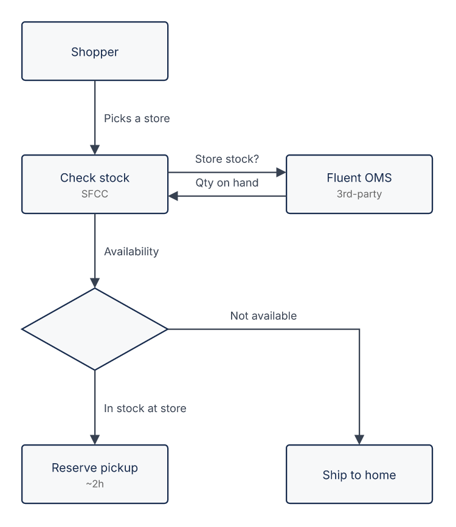

# Store pickup eligibility

```drawio:flow:bopis-pickup-eligibility
title: "Store pickup eligibility"
nodes:
  - { id: shopper, row: 0, col: 0, title: "Shopper" }
  - { id: check,   row: 1, col: 0, title: "Check stock", subtitle: "SFCC" }
  - { id: oms,     row: 1, col: 1, title: "Fluent OMS", subtitle: "3rd-party" }
  - { id: decide,  row: 2, col: 0, kind: decision }
  - { id: pickup,  row: 3, col: 0, title: "Reserve pickup", subtitle: "~2h" }
  - { id: ship,    row: 3, col: 1, title: "Ship to home" }
edges:
  - { from: shopper, to: check,  text: "Picks a store" }
  - { from: check,   to: oms,    text: "Store stock?" }
  - { from: oms,     to: check,  text: "Qty on hand" }
  - { from: check,   to: decide, text: "Availability" }
  - { from: decide,  to: pickup, text: "In stock at store" }
  - { from: decide,  to: ship,   text: "Not available" }
```


