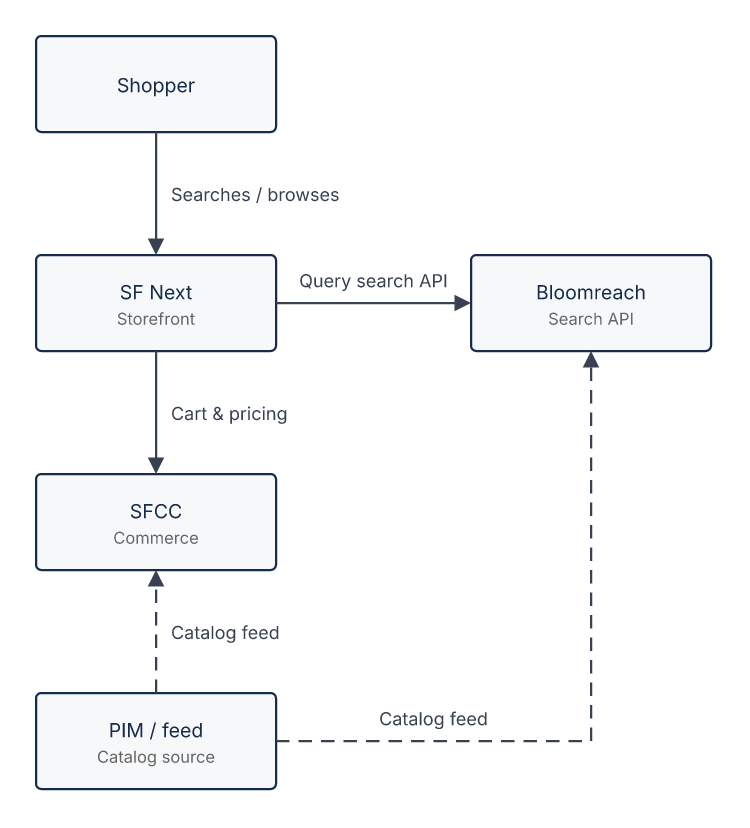

# Search integration overview

```drawio:flow:search-integration-overview
title: "Search integration overview"
nodes:
  - { id: shopper,    row: 0, col: 0, title: "Shopper" }
  - { id: sfnext,     row: 1, col: 0, title: "SF Next", subtitle: "Storefront" }
  - { id: bloomreach, row: 1, col: 1, title: "Bloomreach", subtitle: "Search API" }
  - { id: sfcc,       row: 2, col: 0, title: "SFCC", subtitle: "Commerce" }
  - { id: pim,        row: 3, col: 0, title: "PIM / feed", subtitle: "Catalog source" }
edges:
  - { from: shopper, to: sfnext,     text: "Searches / browses" }
  - { from: sfnext,  to: bloomreach, text: "Query search API" }
  - { from: sfnext,  to: sfcc,       text: "Cart & pricing" }
  - { from: pim,     to: sfcc,       text: "Catalog feed", type: async }
  - { from: pim,     to: bloomreach, text: "Catalog feed", type: async }
```


