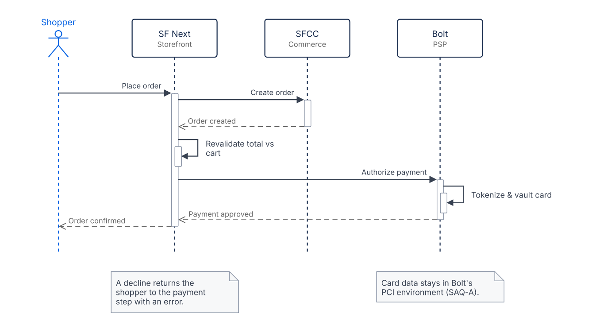

# Payment authorization flow

```drawio:sequence:checkout-payment-authorization
title: "Payment authorization flow"
participants:
  - { id: shopper, title: "Shopper", kind: actor }
  - { id: sfnext,  title: "SF Next", subtitle: "Storefront" }
  - { id: sfcc,    title: "SFCC", subtitle: "Commerce" }
  - { id: bolt,    title: "Bolt", subtitle: "PSP" }
messages:
  - { kind: call,   from: shopper, to: sfnext, text: "Place order" }
  - { kind: call,   from: sfnext,  to: sfcc,   text: "Create order" }
  - { kind: return, from: sfcc,    to: sfnext, text: "Order created" }
  - { kind: self,   from: sfnext,               text: "Revalidate total vs cart" }
  - { kind: call,   from: sfnext,  to: bolt,   text: "Authorize payment" }
  - { kind: self,   from: bolt,                text: "Tokenize & vault card" }
  - { kind: return, from: bolt,    to: sfnext, text: "Payment approved" }
  - { kind: return, from: sfnext,  to: shopper, text: "Order confirmed" }
notes:
  - under: bolt
    text: "Card data stays in Bolt's PCI environment (SAQ-A)."
  - under: sfnext
    text: "A decline returns the shopper to the payment step with an error."
```


