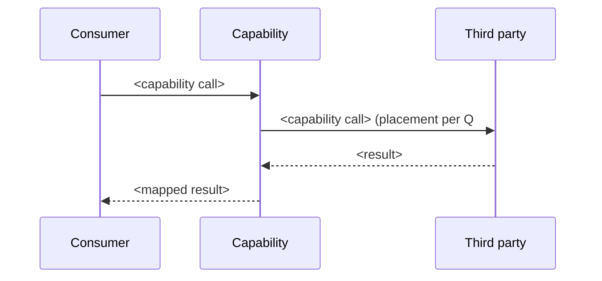

# <Change> — Architecture / Solution Design

<!-- Comments here are local section-filling hints only. The change name/title is the
     discovery-resolved owned change, NOT the raw feature name. -->

## Solution Overview

<!-- Reader map (not a summary): orient a reader — an LLM first, a human second — before the
     detail sections. Answer, from the sections below as they stand NOW: what does this design
     SETTLE, WHY is it shaped this way, what CONSTRAINS downstream, and what is PASSED FORWARD?
     Its machine-readable counterpart is the Document Consumption Guide; the two split the same
     facts along the prose/identifier line and never overlap.
     - WHAT IT SETTLES: the solution at architecture level and the inherited delivery scope
       (functional owns the storefront solution and consumes integrations; integration owns the
       agnostic service capability and excludes consumer UI / other services), plus the
       owned-vs-consumed boundary — naming the boundary, never listing its members.
     - WHY IT IS SHAPED THIS WAY: the load-bearing approach/decision, by SUBJECT and COUNT (e.g.
       "seven architecture decisions", the build-vs-reuse rung) — not a retelling of each block.
     - WHAT CONSTRAINS DOWNSTREAM (technical-design): the conclusions the next phase must honour.
     - WHAT IS PASSED FORWARD: the open questions handed to grooming and, when present, the items
       routed to planning as deferrals — by subject, never re-listing Q#/PD# rows.
     Name SUBJECTS not identifiers ("the retired /stores redirect", not "Q2"); counts/magnitudes
     are welcome. When discovery carries a deferred or unsigned Change Request candidate the build
     brushes against, this is its home: one non-goal line (what it is + why it is out of scope) —
     a consumed dependency belongs in Dependencies, a new ask belongs here. Do not re-list what a
     section below already carries; write it after the body is final and re-derive it when the
     body changes. -->

## Document Consumption Guide

<!-- The interface a downstream reader (an LLM first, a human second) uses to consume this file
     without re-reading the body — placed directly after Solution Overview, so the two-layer
     interface (prose reader map + this navigation map) sits before the detail sections it maps.
     DESIGN-SPECIFIC: this is a MAP of the document's CURRENT structure — ONE row per `##` section
     in document order. It does not own or judge scope, it REFLECTS state: add a section and a row
     appears; remove one and the row goes. Exclude ONLY the three sections that cannot map content
     — Solution Overview (the reader map), this guide itself, and Design Gate (a self-check).
     Every OTHER `##` section gets a row, including Design Source Inventory, Risks / Mitigations,
     and Review & Approval.
     Each row: "What it settles & why it matters downstream" (navigation — a short human-readable
     phrase) plus "Key data" (the identifiers/sets that section exports — WBS with gap class,
     capability names with direction, `D#`, contract keys, `Q#`/`PD#` with status, paths; `None`
     for an empty set — never a restated requirement title or prose). A PROJECTION, never a new
     source of truth: every value must already be readable in the named section. Write it after
     the body is final and re-derive it whenever the body changes; a carried-over row is a defect.
     Each row's key-data authority is defined in the schema's DOCUMENT CONSUMPTION GUIDE ROWS. -->

| Section | What it settles & why it matters downstream | Key data |
|---|---|---|
| <## section name, in document order> | <short navigation phrase> | <identifiers/sets this section exports, or `None`> |

## Affected Capabilities

<!-- The capabilities THIS change owns and what it does to each — the design's pointed footprint.
     Discovery already ENUMERATED the affected capabilities (which capability + ADD / MODIFY /
     REMOVE direction); this section does NOT restate that list — it goes one level deeper: for
     EACH owned capability, state at architecture / behaviour level WHAT this change adds, modifies,
     or removes and WHERE (the surface / entry / behaviour that changes), grounded in the
     capability's baseline spec. Discovery = high-level enumeration; design = the specific change per
     capability. Keep it capability level — no file / route / component / loader wiring or code (that
     is technical-design). These are surfaces the change OWNS, so none of them is a Dependencies row.
     Consumed services the change does not own go in Dependencies, not here. -->

| Capability | Change | What changes (architecture level) | Spec |
|---|---|---|---|
| <owned capability> | <ADD / MODIFY / REMOVE> | <what this change adds/modifies/removes and where, at capability level> | `openspec/specs/<capability>/spec.md` |

## Design Source Inventory

<!-- References into already-collected context (discovery trace, existing specs, current patterns,
     vendor docs). Do not restate discovery content here — point to it. -->

| Input | Reference | Used for |
|---|---|---|
| Discovery (this change) | `openspec/changes/<name>/discovery.md` | <resolved scope, dependencies, open questions> |
| <BRD / SRD / notes> | <project-context anchor> | <what it grounds> |

## Gap Analysis

<!-- What EXISTS today per in-scope requirement, and how far it is from the target — the facts the
     decisions below are made from. The row keys are a two-part set: every in-scope clean WBS code of
     discovery's Requirements Trace, PLUS every owned capability from Affected Capabilities whose
     MODIFY / REMOVE direction no in-scope WBS row already covers (a surface being retired or
     re-pointed usually has no signed requirement of its own). Cover both parts; a functional change
     gets per-requirement rows for part one, an integration change lighter capability-level ones.
     Ground each Current State cell in an anchor (baseline spec, a
     discovery-stated fact, a live URL) — an unanchored "already covered" is a fabrication just as an
     invented gap is. `Gap` is the DISTANCE from what exists to what the requirement needs, from the
     closed set `none` / `config` / `adapt` / `rebuild` / `remove` — assess the MECHANISM the
     requirement needs, not this feature's own instance of it. Notes carry the one-line proof: the
     evidence, and for a `remove` whether it is already signed upstream or newly proposed here. -->

| WBS | Current State | Desired State | Gap | Notes |
|---|---|---|---|---|
| <clean WBS code, or the capability when the row has no signed WBS> | <what exists today and where, with its anchor: platform/OOTB baseline, third-party-managed, legacy surface, or none> | <the target for this requirement, inherited from the signed requirement> | <none / config / adapt / rebuild / remove> | <one-line proof: evidence, and why a lighter close does not work when the gap is `rebuild`> |

### Legacy Behaviour Overview

<!-- ONLY when a legacy implementation of this behaviour exists; omit the subsection entirely when
     there is none. A short narrative of how the behaviour works in legacy TODAY — what it covers,
     what it does not, and what (if anything) is portable. Facts, not decisions: say nothing about
     what WILL happen to the surface, and never name a value an Open Question leaves open (stating
     the retirement's redirect type here hardens that Q# exactly as a decision row would). -->

## Architecture Decisions

### D1 — [Title]

<!-- One block per decision, numbered D1, D2, … in document order — the `D#` is the stable,
     joinable id the Document Consumption Guide's Architecture Decisions row exports and a
     downstream artifact cites. Chosen approach + rationale + alternatives + trade-offs.
     One claim per bullet, stated dry and directly — no second sentence re-arguing the
     first, no hedges or lead-ins; citations and undecided markers always stay.
     Reference existing codebase patterns only at the level needed to justify the decision.
     Decisions needing sign-off are PROPOSED and raised in Open Questions — not asserted as final.
     FIREWALL: make NO decision here (and mint NO Q# / proposed-direction below) for a CONSUMED
     integration's internal choice (call placement / client-vs-proxy, key exposure, quota) — that
     is the owning integration change's, carried here at most as a consumed-dependency risk. A new /
     unsigned Change Request ask (e.g. an appointment-booking capability the packet mentions but no
     change owns) is NOT a decision either: its only home is one Solution Overview non-goal line. -->

- **Decision:** <chosen approach>
- **Rationale:** <why this option>
- **Alternatives considered:** <option and reason rejected>
- **Trade-offs:** <known cost / limitation>

### D# (proposed, raised for grooming — Q#) — [Title]

<!-- Use this variant ONLY for an item that discovery lists in its Open Questions table (a Q#
     the design must lean on): PROPOSE a direction but do NOT settle it. Qualitative lean + its
     main alternative + the trade-off between them; never an invented concrete value (type, exact
     approach, location, number). Mirror the Q# in Open Questions below.
     NOT eligible here: an unsigned / pending Change Request candidate, a deferred / later-phase
     item, anything the trace hands to another change, or a consumed integration's INTERNAL choice
     (client-vs-proxy call placement, key exposure, quota governance — owned by the integration
     change, so on your `Open Questions OUT` line) — those get NO Q# and NO proposed direction (at
     most one Solution Overview non-goal line, or a consumed-dependency risk whose mitigation defers
     to the owning change). Omit this block when there is no such item. -->

- **Proposed direction:** <qualitative lean, its main alternative, and the trade-off between them>
- **Status:** Undecided — raised for grooming with rationale/alternatives; not asserted as decided.

## Base Configuration & Cross-Cutting

<!-- Configuration and cross-cutting concerns that apply regardless of scope (both BA and SA).
     Fill only rows that affect the solution choice or sign-off; omit non-applicable concerns.
     Each row states the qualitative constraint / posture and why — never a concrete number
     (TTL, latency, size budget) or component / module / file wiring; those are technical-design.

     The `Applies to` column is the story-friendly technical-intent source: it lists the clean WBS
     codes (from discovery's Requirements Trace, e.g. `CHK.PAY CHK.SUM`, space-separated) that this
     concern shapes, or `all` when it applies to the whole change. The functional-artifacts script projects the four
     technical concerns — Rendering, Caching, Security, Performance — into each story's Implementation
     notes by intersecting this column with the story's covered WBS; Privacy / i18n / CMS are solution
     constraints only (i18n / consent land in acceptance criteria, not Implementation notes). Keep the
     `Constraint / decision` cell to one intent line ending with the primary skill in backticks so the
     script can carry that skill link verbatim. WBS codes exist at design time (discovery already
     enumerated them); slices (S#) do not — never reference S# here. -->

| Concern | Applies to | Constraint / decision | Rationale |
|---|---|---|---|
| Rendering | <WBS codes this concern shapes, e.g. `CHK.PAY CHK.SUM`, or `all`> | <SSR/RSC/client-boundary constraint, if architecture-relevant; see `sfnext-routing`> | <why> |
| Caching | <WBS codes, or `all`> | <cacheability / invalidation intent, if architecture-relevant; storefront/edge see `b2c-ecdn`, commerce-backend see `b2c-custom-caches`> | <why> |
| Security | <WBS codes, or `all`> | <auth context, scopes, PII, secrets, if architecture-relevant; see `sfnext-authentication` / `b2c-slas-auth-patterns`> | <why> |
| Performance | <WBS codes, or `all`> | <perf posture / strategy (qualitative — no number: no ms / s / KB / req-s target), if architecture-relevant; see `sfnext-performance`> | <why> |
| Privacy | <WBS codes, or `all`> | <PII / consent / data-retention constraint, if architecture-relevant> | <why> |
| i18n / Content | <WBS codes, or `all`> | <source of truth for copy/content, if architecture-relevant; see `sfnext-i18n`> | <why> |
| CMS | <WBS codes, or `all`> | <content model or authoring constraint, if architecture-relevant; see `sfnext-page-designer` / `b2c-page-designer`> | <why> |

## Integration Specification

<!-- Integration-scope changes only: the third-party service contract at capability level.
     For a FUNCTIONAL change, render this section as a single line: `N/A — functional change.`
     plus a pointer to the Dependencies table, which is the single place the consumed services
     are listed.
     State the vendor contract concretely (real endpoints/paths, params, auth, documented codes and
     quota/TTL), each grounded in a cited vendor doc; keep only OUR build (our files/routes, our code,
     our own tuning numbers) out — that is technical-design. -->

### Overview

<!-- Local reader-map for THIS section (an LLM first, a human second): 1-2 sentences that LEAD
     WITH the contract SHAPE the Solution Approach fixed (API / SDK / cartridge, and why the
     subsections below are what they are); when the section carries more than one service or
     contract, NAME each and how the section splits by them, and note what the section defers out
     (an open call placement, our build -> technical-design). Do NOT re-describe what the capability
     settles or why it exists — that is the Solution Overview's job. MUST END WITH a `Read in order:`
     signpost naming the subsections actually present, in document order, each with a one-clause
     purpose — a single compact line when the section is small, grouped by service/contract cluster
     when it is large — so a downstream reader can navigate a large contract without re-reading it.
     Orient WITHIN this section only; do NOT restate the Solution Overview or re-list Document
     Consumption Guide rows. It is a projection of this section's body. -->

### Integration Documentation

<!-- Official vendor docs used to derive endpoints and data mapping. Gather them by searching the
     web first, then local/project-context, then asking the user. Cite realistic anchors, never
     fabricate. -->

| Document | Reference |
|---|---|
| <doc name> | <anchor / URL> |

### Contract

<!-- The concrete contract, in the SHAPE of the chosen Solution Approach (see the Integration
     Specification content rule) — pick ONE, do not emit the others:
     - from-scratch / documented API → an Endpoints table (Endpoint/Channel | Protocol/Method |
       Data Format | Authorization) + a field-level Data Mapping (Request send / Response receive),
       from the vendor's real endpoints/params/auth/codes/quota.
     - vendor SDK → the SDK interface: init/config, the methods called (inputs/returns, when),
       the events subscribed (when they fire + payload), lifecycle. Endpoints ONLY for real
       network assets (a loader/CDN URL); NO request/response data-mapping table — its absence
       is correct, not a gap.
     - reuse cartridge/module → the configuration / extension contract: integration points, the
       config/settings we set, extension seams. Do NOT invent vendor endpoints the cartridge
       encapsulates.
     Ground every value in a cited doc; if the contract cannot be grounded, raise an Open Question. -->

### Data Flow

<!-- Boundary-level sequence of the integration (a diagram is welcome). Draw consumer -> capability
     -> vendor only; the arrows carry NO vendor endpoint / path / query-param / field and NO chosen
     key-transport, and do NOT split into client-vs-proxy branches when the call placement is an open
     Q#. The concrete wire lives in the Contract subsection above (API shape only); an SDK / reuse
     approach has no vendor endpoint to draw. -->

## Risks / Mitigations

<!-- Solution-level risks this change carries. A CONSUMED integration's internal choice (call
     placement, key exposure, quota) may appear ONLY as a consumed-dependency risk whose Mitigation
     DEFERS to the owning integration change / grooming — never a Mitigation that commits a tier or
     uses a directional verb (`default to`, `use`, `enforce`) or names a mechanism / value. Do NOT
     harden here a choice you (correctly) did not decide above, and do NOT turn an unsigned Change
     Request ask into a risk row — that stays a Solution Overview non-goal line. -->

| Risk | Impact | Mitigation |
|---|---|---|
| <risk> | <impact> | <mitigation> |

## Dependencies

<!-- RELIES ON but does NOT own. Emit ONLY the rows on your plan's `Dependencies ROWS`
     line — copy them verbatim; add no row here at emit time, and nothing on the
     `Dependencies OUT` line may appear. ALWAYS a table (never prose / a collapsed
     "None."); if genuinely none, emit one row `| None | — | — | <why> |`. Type is a
     CLOSED set — functional: `upstream integration change` / `existing service`;
     integration: `account` / `credentials` / `billing` / `sandbox` / `environment`. A
     discovery synonym (`external integration`, `data service`, `functional surface`) is
     remapped to a member above, never copied verbatim.
     STOP CONDITION at emit — if a row's Note would contain "owned", "modified",
     "removed", "not a dependency", "out of scope", "CR", "pending", "for completeness",
     or "for transparency", the row is misplaced: do NOT write it. An owned MODIFY / REMOVE
     surface — the re-pointed navigation entry, or the retired legacy `/stores` page — is an
     Affected Capabilities row, NEVER a Dependencies row. Its home is Affected Capabilities
     (an owned surface) or a Solution Overview non-goal line (an unsigned CR / deferred
     item). -->

| Dependency | Type | Status | Note |
|---|---|---|---|
| <dependency> | <functional: upstream integration change / existing service — integration: account / credentials / billing / sandbox / environment> | <status, e.g. already integrated / to be delivered (separate change) / unconfirmed (Q#)> | <requirement(s) or reason it is needed> |

## Open Questions

<!-- Design-level decisions raised for grooming sign-off; inherits discovery's undecided items.
     Emit ONLY the Q# rows on your plan's `Open Questions ROWS` line — each must mirror a Q# that
     discovery's own Open Questions table carries for THIS flow. Do NOT mint a Q# for a consumed
     integration's internal call approach / key exposure / quota: that is the integration change's
     question, carried here at most as a consumed-dependency risk. -->

| Q# | Question | Owner | Status |
|---|---|---|---|
| Q1 | <question> | <BA / SA> | Raised for grooming |

## Planning Deferrals

<!-- ALWAYS present, like Open Questions / Dependencies: write `None.` (no table) when the design
     defers nothing — do NOT omit the section. A planning deferral is a bounded HOW the design
     deliberately does not settle — an implementation strategy, a tuning approach, a build
     sequencing — as distinct from an Open Question (a CHOICE grooming signs) and a Dependency (a
     consumed service). `PD#` is the design-owned planning-deferral namespace; downstream
     technical-design consumes these rows. Owner is per-row (BA / SA / tech-design) — who owns the
     deferred item. Do NOT route here a consumed integration's internal choice (that stays with the
     owning change) or a signed requirement (that is built, not deferred). Target phase is
     `planning`. When nothing is deferred, replace the table below with a single `None.` line. -->

| PD# | Source (design section/decision) | Deferred item | Why not decided now | Target phase | Owner | Status |
|---|---|---|---|---|---|---|
| PD1 | <design section / D# it comes from> | <the developer-HOW item deferred> | <why it is a planning item, not a decision or Q# now> | planning | <BA / SA / tech-design> | routed to planning |

## Design Gate

<!-- State this AFTER the design body, like the Discovery Gate. Design runs pre-grooming.
     Mark each item checked ([x]): this is the passed pre-grooming self-check for a design you
     are producing BECAUSE it is warranted — not an open to-do list. Leave a box unchecked only
     if that item genuinely does not hold (and then reconsider whether design should be emitted). -->

- [x] Design is warranted (cross-cutting / new pattern / dependency / integration / security / performance / migration / ambiguity)
- [x] Delivery scope and change identity match the discovery trace (not re-decided, not the raw feature name)
- [x] Every architecture decision records rationale, alternatives, and trade-offs (numbered `D#`)
- [x] Decisions needing sign-off are raised as Open Questions for grooming, not asserted as decided
- [x] Developer-HOW items are routed to planning as `PD#` deferrals (when any), not decided here
- [x] Solution Overview reads as a reader map and the Document Consumption Guide maps every current `##` section (excluding Solution Overview, this guide, and Design Gate); both re-derived from the final body
- [x] No OUR-build implementation detail (our files/routes/wiring, our code) — deferred to technical-design (vendor-contract detail belongs in Integration Specification)

## Review & Approval

<!-- Human sign-off gate for this phase. After generating this artifact the workflow command STOPS
     here and runs the Per-Artifact Review Gate (see rules/workflow/openspec-workflow/openspec-workflow.mdc): a short
     summary + open questions, then Approve / Request changes — plus Walk the questions
     (recommended) ONLY when this artifact still has open questions in this pass (with none,
     drop Walk; never re-walk already-settled decisions). The agent NEVER checks this box and NEVER names itself as
     approver; only a named human approves after review. The next phase stays blocked until Approved
     is checked with a real human in "Approved by". This is separate from the Design Gate above,
     which is the agent's self-check. -->

- [ ] **Approved** — a human reviewed this artifact and approves proceeding to the next phase
- **Approved by:** —   <!-- real human name or role; never Agent / LLM / Cursor / blank -->
- **Date:** —
- **Review notes:** —   <!-- optional: what was reviewed, deferrals, follow-ups -->
