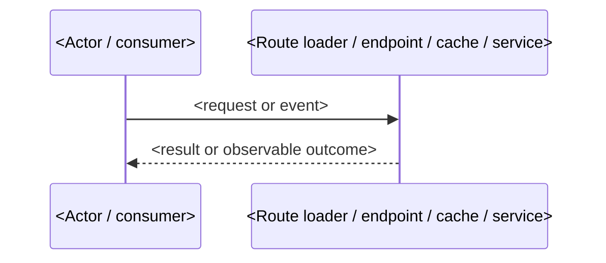

<!--
  Technical Design — implementation architecture and phased delivery plan.
  Generated by /opsx:plan after the BA/SA phase completed (specs done, Grooming Approval Gate
  passed). Internal engineering document — never published to the client.

  Source of truth:
  - Signed requirements: fsd/**/*.md or isd/**/*.md when present — interpret WHAT the client approved.
  - Structured trace: specs/**/*.md — RQ/WBS inventory, scenarios, ADD/MODIFY/REMOVE disposition.
  - Locked decisions: APPROVED grooming ledger + design.md decisions — reference them, never re-decide.
  - Delivery grouping: proposal.md + stories.md when present — preserve story keys and sequencing.

  Opens with a Technical Design Overview reader-map (written LAST, from the finished body). This
  artifact OWNS the developer-level HOW: it invents implementation identifiers (routes, components,
  cartridges, endpoints, caches) following the platform skills' conventions, decides what upstream
  deferred to planning, and raises the rest as Open Questions. Fresh state: every Open Question is
  OPEN carrying the agent's recommendation with an empty "Approved by"; CRITICAL questions block
  tasks.md (not this document). Undecided magnitudes (TTL, quota) are questions, never values.

  STRUCTURE LAW: every heading and every table below always appears, with exactly these columns.
  When a sub-section has no work, its table carries exactly ONE row: `None — <grounded reason>`
  in the first cell and `—` in every other cell. Never drop a heading or a table, never replace
  a table with prose, never leave placeholder cells like `<component>`. The Technical Design
  Overview is prose by design (a reader-map), not a table.
-->

# <Code> - <Feature Name> — Technical Design

## Technical Design Overview

<!-- Reader map (not a summary): what this design settles at implementation level, why it is shaped
     this way, what constrains downstream tasks.md, and what is passed forward as OPEN questions. By
     subject and count; name subjects, not identifiers, and do not re-list the tables below. Write it
     LAST, from the finished sections as they stand, and re-derive it when the body changes. Fresh
     state: it may note that questions are open, but claims no approval. -->

<one to three short paragraphs: what this build delivers and its inherited scope; the load-bearing HOW shape by subject and count; what constrains downstream tasks; the open questions passed forward. No approval claims.>

## Technical Design Source Inventory

<!-- The upstream artifacts this plan consumes, each mapped to how planning uses it. List every
     artifact actually present for this change: discovery, design, proposal, grooming, and the delta
     specs are always here (the ENTRY GATE requires them); stories, FSD, and ISD are conditional —
     include the ones that exist, and never invent a row for a skipped optional artifact. Map each to
     its planning use by authority: signed FSD/ISD = the approved WHAT; specs = behaviour contract and
     RQ/WBS trace; grooming = APPROVED decisions/prerequisites this plan honours, never re-decides;
     design = HOW/architecture working material; proposal = the approved delivery offer, scope, and
     dependencies; discovery = source/provenance history; stories = Jira delivery grouping. -->

| Artifact | Location | Planning use |
|---|---|---|
| FSD / ISD | `openspec/changes/<name>/fsd/<feature>.md` or `isd/<capability>.md` | Signed WHAT — primary interpretation of approved intent (conditional: the one this change produced) |
| Specs | `openspec/changes/<name>/specs/**/*.md` | Behaviour contract and RQ/WBS trace |
| Grooming | `openspec/changes/<name>/grooming.md` | APPROVED decisions and prerequisites (P#) this plan honours and references, never re-decides |
| Architecture design | `openspec/changes/<name>/design.md` | HOW / architecture working material — locked decisions and constraints; not a requirements source |
| Proposal | `openspec/changes/<name>/proposal.md` | Approved delivery offer — Requirements Lock, delivery slices, scope boundaries, dependencies/access |
| Discovery | `openspec/changes/<name>/discovery.md` | Source/provenance history — requirement trace origins, affected capabilities, dependency background |
| Stories | `openspec/changes/<name>/stories.md` | Jira delivery grouping (conditional); not a behaviour source |

## Delivery Inventory

<!-- The single reconciled source map for planning and tasks.md. Build it from the requirement and
     story ledgers. When stories.md exists, FIRST write one row per story key (Unit = key + title,
     Story = that key); do not replace story rows with RQ-only rows. Add extra non-story rows only for
     spec work with no story identity (REMOVED, approved DEFERRED scope, PREREQUISITE, or a true
     cross-cutting requirement). When stories.md is absent, units come from in-scope RQ/WBS.

     Every in-scope `### Requirement:` heading across delta specs (ADDED, MODIFIED, REMOVED,
     cross-cutting included) must appear in Spec trace, either on a primary story unit, as
     CROSS-CUTTING, or as DEFERRED / PREREQUISITE. Management/layout headings join the story row for
     the same WBS; accessibility/localization/privacy/security are CROSS-CUTTING unless the source
     makes them a standalone consumable deliverable. REMOVED specs without RQ metadata are named in
     Spec trace. Scope deferred by the approved lock is a DEFERRED row. If a story cannot map to spec
     trace, stop before tasks.md. -->

| Unit | Source | Story | Spec trace | Classification | Implementation areas | Notes |
|---|---|---|---|---|---|---|
| <planning unit> | <stories.md / specs / REMOVED spec / approved lock> | `<STORY-ID>` or `—` | <RQ-ID / WBS — Requirement name(s)> | <PRIMARY / CROSS-CUTTING / SHARED SEAM / PREREQUISITE / DEFERRED> | <Frontend / Backend / CMS / Cross-cutting> | <mapping, deferred scope, removed-content handling, or "—"> |

## Delivery Phases

<!-- The delivery SEQUENCING layer, decided BEFORE the implementation sections so the architecture,
     runtime flows, constraints, and verification below elaborate THESE phases (not the reverse): how
     this change reaches done in increments that each close as something a shopper or a consuming
     feature can observe or call. tasks.md groups its work under these phases, so the order decided
     here is the execution order.

     Write the five labelled lines first — they are the verticality proof for THIS change, never
     generic method prose — then the table.

     Coverage is fixed, shape is judgement. Every Delivery Inventory row appears in exactly one phase
     row or is explicitly classified in the labelled lines as cross-cutting, as a seam folded into the
     phase that first consumes it, as a prerequisite, or as deferred scope. In Primary phase units,
     record `unit(s) -> P# -> observable/callable close condition`; a story key alone is not proof.
     Joined rows must name the one outcome that closes them together. Phase count, names, and ordering
     follow the change's own dependencies: two phases on a small capability are as correct as seven on
     a large surface.

     Vertical, never horizontal. A phase is an increment, not a layer or a task bucket ("data layer",
     "add the service definition", "wire the components", "write the tests"). Shared scaffolding is
     folded into the first phase that consumes it instead of becoming a foundation phase that delivers
     nothing on its own; accessibility, localization, privacy, and security are carried by EVERY phase
     for the surface it adds, never postponed to a final clean-up phase.

     Acceptance coverage names the behaviour branches the phase proves — the permission, error,
     privacy, and negative branches its requirements carry — not a restatement of the phase name.
     Areas name the implementation surfaces/identifiers this phase introduces (routes/components/state/
     CMS, or cartridge/endpoint/cache/metadata) — elaborated in Implementation Architecture below —
     precisely enough for tasks.md to reference them. Verification names the DEVELOPER-owned evidence
     (unit/integration tests, dev checks) that will prove the phase done (detailed in Verification
     Strategy below); functional / QA proof is out of scope; when it is blocked on a prerequisite,
     keep the phase and note the P#. STRUCTURE LAW applies: the labelled lines and the table always
     appear, with these exact columns. -->

**Decomposition criterion:** <what one phase means for THIS change — what must be observable or callable when a phase closes>

**Primary phase units:** <each PRIMARY unit or joined unit set mapped as `unit(s) -> P# -> observable/callable close condition`; story keys alone are not proof>

**Shared seams:** <shared shell / seam / helper work and the phase it is folded into; "none — <grounded reason>" when the phases share no in-change artifact>

**Cross-cutting obligations:** <each CROSS-CUTTING unit and the phases that carry it; never schedule these as a cleanup phase>

**Rejected splits:** <splits considered and rejected for this change, including foundation/task/cross-cutting-only splits; each reason says why it would not close a consumable increment>

| Phase | Name | Delivers (story / RQ · WBS) | Acceptance coverage | Areas | Depends on | Verification |
|---|---|---|---|---|---|---|
| P1 | <the increment this phase closes> | `<STORY-ID>` / <RQ-ID> · <WBS> | <behaviour branches this phase proves> | <routes / components / modules / cartridges / endpoints / caches this phase introduces (detailed below)> | — | <developer tests and checks that prove it done> |
| Cross-cutting | <obligation carried by every phase> | <RQ-ID · WBS, or "—"> | <what every added surface must show> | <areas it applies to> | — | <proven inside each phase; closed change-level by …> |

## Implementation Architecture

<!-- Implementation architecture, not a task list: elaborate the surfaces and building blocks the
     Delivery Phases above cut the work into, so tasks.md can project them into work. Inapplicable
     surfaces keep one grounded None row. -->

### Frontend / Storefront Surface

| Surface | Server responsibility | Client responsibility | Hydration / ownership |
|---|---|---|---|
| `<route or surface>` (or `None — <grounded reason>`) | <RSC/loader/server work> | <client island/state/form work> | <eager / lazy / none> |

### Backend / SFCC Surface

<!-- Bucket-B guard: consumer-facing endpoint namespaces/paths and response fields are sourced or
     written "per Q#" with a matching Open Question. -->

| Surface | Responsibility | Inputs / triggers | Outputs / side effects |
|---|---|---|---|
| `<endpoint/hook/job/service>` (or `None — <grounded reason>`) | <purpose> | <input; path/schema per Q# unless sourced> | <output or side effect> |

### CMS / Content Surface

| Surface | Responsibility | Owned identifiers | Notes |
|---|---|---|---|
| `<content surface>` (or `None — <grounded reason>`) | <authoring/rendering/retirement responsibility> | <content type / slot / page / module> | <fallback or setup notes> |

### Implementation Building Blocks

<!-- One row per important block, seam, interface, or owned configuration area. Prefer relevance over
     exhaustive file lists: name responsibilities and owned identifiers, not every file that might change. -->

| Block | Responsibility | Interfaces / contracts | Owned identifiers | Trace |
|---|---|---|---|---|
| `<block>` | <what this block owns> | <calls/events/contracts; Bucket-B values per Q# unless sourced> | <route/module/component/cartridge/cache/config identifiers> | <RQ-ID / WBS> |

## Runtime Flows

<!-- Implementation-level runtime scenarios as one or more small mermaid sequence diagrams.
     Participants are the building blocks above; cover permission/error/cache/privacy branches when relevant. -->

## Implementation Constraints

<!-- Fill only rows that apply. If optional design.md exists, this section must conform to it.
     Bucket-B guard applies to every value here: a TTL, quota, or cache dimension no source states
     is written "per Q#" (with the matching question), never as a guessed number like "5 min".
     Skills: `sfnext-routing`, `sfnext-data-fetching`, `b2c-custom-caches`, `b2c-ecdn`,
     `sfnext-authentication`, `b2c-slas-auth-patterns`, `sfnext-performance`, `sfnext-i18n`,
     `sfnext-page-designer`, `b2c-page-designer`. -->

| Concern | Planning decision | Verification |
|---|---|---|
| Rendering / hydration | <SSR/RSC/client island; eager/lazy hydration> | <how verified> |
| Data fetching | <loader/action/server function/client fetch; fallback/error path> | <how verified> |
| Caching | <cacheability, dimensions; TTL per Q# unless a source states it; invalidation> | <how verified> |
| Security | <auth context, scopes, PII, secrets> | <how verified> |
| Performance | <bundle, LCP/INP/CLS, streaming/deferred work> | <how verified> |
| i18n / translations | <translation keys/source/sync path> | <how verified> |
| CMS / Page Designer | <content type/slot/authoring dependency> | <how verified> |

## Verification Strategy

<!-- The detailed DEVELOPER-owned evidence plan for the building blocks and the Delivery Phases above.
     Developer-owned automated verification ONLY: unit and integration tests plus developer checks
     (bundle/perf guard, `tsc`, lint). Functional / end-to-end / manual-QA / accessibility-audit / UAT
     verification is owned by QA and is OUT OF SCOPE here — never author E2E, Playwright, manual-QA,
     a11y-audit, or UAT rows (or such evidence in any phase/constraint Verification cell). A requirement
     whose only proof is functional/QA carries no row here — its build obligation still lives in Delivery
     Inventory, Building Blocks, and each phase's acceptance coverage. Skills: `sfnext-test-ids`,
     `systematic-debugging`. -->

| Target | Evidence | Coverage / trace | Blockers | Notes |
|---|---|---|---|---|
| `<building block / phase>` | <unit / integration test / developer check (bundle/perf/`tsc`/lint) / review evidence> | <RQ-ID / scenario names> | <grooming P# / external owner blocking the check, or —> | <fixtures, data, env, or —> |

## Risks

<!-- Record implementation risks or blockers that do not change BA scope (a blocker is a risk with its
     resolution — no separate classification). If a risk changes agreed scope, push it back to
     proposal/grooming as a CR or open question instead of silently absorbing it. -->

| Risk | Impact | Owner | Resolution |
|---|---|---|---|
| <risk or blocker> | <impact> | <owner> | <decision or next action> |

## Open Questions

<!-- Planning-stage grooming AND the single home for each question's resolution. These are TECHNICAL
     unknowns discovered while planning the HOW — not BA scope questions (those belong in
     discovery/grooming; if a question changes agreed scope, push it back to proposal/grooming as a CR
     instead of answering it here). This table is the OUTPUT of the deferral enumeration: each row's
     "Why unclear" cell QUOTES the upstream sentence that defers the choice to technical design (or
     names the value no source states) — the quote is the row's proof of membership. Tag each CRITICAL
     (a tasks breakdown built on the wrong answer would need rework — must be approved at the Planning
     gate before generating tasks.md) or NICE-TO-HAVE (a refinement that can be carried into
     implementation without blocking). Cite the relevant skill in Why unclear when the answer depends
     on a platform pattern (e.g. `sfnext-data-fetching`, `b2c-scapi-schemas`).

     The "Recommendation / Decision" cell is the single home for the answer: on fresh generation it
     carries the agent's RECOMMENDATION (its recommended answer, never an approval); on the human
     approval session the SAME cell records the approved decision and "Approved by" is filled — there
     is no separate decisions table. On fresh generation every question is OPEN with its recommendation
     present and an EMPTY "Approved by" cell.

     This section is authored while planning the HOW (the questions surface as the deferrals are
     enumerated) but is PLACED here at the bottom, just before Review & Approval.

     Facilitation rule:
     - Ask one Open Question at a time in chat; do not dump all planning questions at once.
     - Do not use the AskUserQuestion tool for planning approval.
     - For each question, briefly explain the technical unknown, why it matters before tasks.md, what each
       option means for implementation/test/risk/sequencing, and any agent recommendation. Then wait for
       the human/dev lead/SA answer before updating this file and moving to the next question. -->

| Q# | Severity | Question | Why unclear | Recommendation / Decision | Owner | Status | Approved by |
|---|---|---|---|---|---|---|---|
| Q1 | CRITICAL | <choice the sources defer to this artifact that needs a human call — e.g. the interface contract consumers and tests build against>? | <verbatim quote of the deferring source sentence; which skill/pattern it depends on> | <the agent's recommended answer (fresh state); the approved decision once a human signs off> | dev lead / SA | OPEN | |
| Q2 | NICE-TO-HAVE | <deferred refinement — e.g. the exact TTL/caching strategy the sources leave open>? | <verbatim quote of the deferring source sentence> | <recommended answer; approved decision later> | dev lead | OPEN | |

<!-- Status becomes APPROVED / DEFERRED-APPROVED only during the human approval session — never at
     generation time; the agent may recommend, never approve its own recommendation. -->

## Review & Approval

<!-- Human sign-off gate for this phase. After generating this artifact the workflow command STOPS
     here and runs the Per-Artifact Review Gate (see rules/workflow/openspec-workflow/openspec-workflow.mdc): a short
     summary + open questions, then Approve / Request changes — plus Walk the questions
     (recommended) ONLY when this artifact still has open questions in this pass (with none,
     drop Walk; never re-walk already-settled decisions). This is separate from the Open Questions table
     above (per-question technical approval that gates tasks.md): this box is the reviewer's roll-up
     sign-off that the technical design is ready. The agent NEVER checks this box and NEVER names
     itself as approver; only a named human (dev lead / SA) approves after review. -->

- [ ] **Approved** — a human reviewed this technical design and approves proceeding to the next phase
- **Approved by:** —   <!-- real human name or role; never Agent / LLM / Cursor / blank -->
- **Date:** —
- **Review notes:** —   <!-- optional: what was reviewed, deferrals, follow-ups -->
